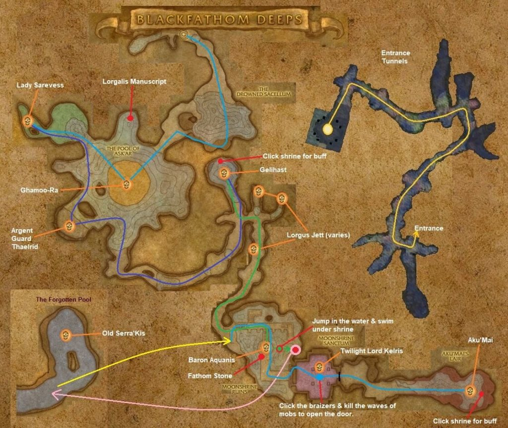

# Blackfathom Deeps

[All Forever dungeon guides](README.md)

## Plan your run

**Planning range: 24–32 / Five players / Ashenvale.** Researched 31 October 2026; beta details may change. Playfulls lists dungeon level 22+; that is a data label, not a verified portal-entry requirement. [Current dungeon data](https://playfulls.com/loot-tables/dungeons/blackfathom-deeps).

Enter the ruins at northern Zoram Strand and descend through the hostile approach. Bring underwater breathing for the submerged optional fight.

Follow the pools into Moonshrine Sanctum. Include Sarevess's side cave and Serra'kis underwater. After Kelris, activate only one brazier at a time and finish its waves. [Entrance and route reference](https://www.icy-veins.com/wow-forever/blackfathom-deeps-guide).

## Layout maps

Annotated Classic reference layout; Forever details may differ. [Full-size map](https://eintr.net/WoW/images/Black-fathom-Deeps-walkthrough-map-1024x865.jpg) / [Map source](https://eintr.net/WoW/World-of-Warcraft-Classic-Dungeon-Walkthrough.html).

- [Map of Blackfathom Deeps, The Pool of Ask'Ar](https://playfulls.com/dungeonmaps/blackfathom-deeps-1.webp)
- [Map of Blackfathom Deeps, Moonshrine Sanctum](https://playfulls.com/dungeonmaps/blackfathom-deeps-2.webp)
- [Map of Blackfathom Deeps, The Forgotten Pool](https://playfulls.com/dungeonmaps/blackfathom-deeps-3.webp)

Open the [interactive dungeon map](https://playfulls.com/loot-tables/dungeons/blackfathom-deeps) for floor controls and available markers. Some boss positions are approximate or absent. [Annotated reference layout](https://foreveroth.com/en/donjons/?donjon=blackfathom-deeps).

## Bosses and tactics

The following tactics are summarized from the Forever guide.

- **Ghamoo-ra:** Ranged avoid Trample; armor reduction helps.
- **Lady Sarevess:** Clear naga, control her escorts, and spread for lightning.
- **Gelihast:** Pull fleeing murlocs back; free the tank from Net.
- **Lorgus Jett:** Remove Lightning Shield with an offensive dispel.
- **Old Serra'kis (optional):** Manage breath while fighting underwater.
- **Twilight Lord Kelris:** Clear the sanctum first; interrupt Mind Blast and recover threat after Sleep.
- **Aku'mai:** Move out of poison clouds; save healing for Frenzied Rage.

[Tactics source](https://www.icy-veins.com/wow-forever/blackfathom-deeps-guide).

## Boss loot and item links

Named equipment, boss-specific recipes, pets, bags and quest starters currently listed by the sources appear below. Drop percentages are omitted: the sites mix expectations, legacy values and beta observations. Boss associations are community reports; client item existence alone does not prove a live drop.

| Boss / encounter | Named drops |
| --- | --- |
| Ghamoo-ra | [Ghamoo-ra's Bind](https://playfulls.com/item/6908-ghamoo-ras-bind); [Spiked Shell Band](https://playfulls.com/item/273839-spiked-shell-band); [Tortoise Armor](https://playfulls.com/item/6907-tortoise-armor); [Pattern: Filigreed Flame Leggings](https://playfulls.com/item/253942-pattern-filigreed-flame-leggings); [Pattern: Filigreed Silky Leggings](https://playfulls.com/item/253940-pattern-filigreed-silky-leggings); [Pattern: Totemic Leather Hood](https://playfulls.com/item/252801-pattern-totemic-leather-hood) |
| Lady Sarevess | [Darkwater Talwar](https://playfulls.com/item/11121-darkwater-talwar); [Naga Battle Gloves](https://playfulls.com/item/888-naga-battle-gloves); [Naga Heartpiercer](https://playfulls.com/item/3078-naga-heartpiercer); [Pattern: Brawler's Leather Hood](https://playfulls.com/item/252798-pattern-brawlers-leather-hood); [Pattern: Filigreed Shadow Leggings](https://playfulls.com/item/253944-pattern-filigreed-shadow-leggings); [Plans: Acolyte's Silvered Chain Helm](https://playfulls.com/item/251383-plans-acolytes-silvered-chain-helm) |
| Gelihast | [Algae Fists](https://playfulls.com/item/6906-algae-fists); [Cursed Murloc Eye](https://playfulls.com/item/273840-cursed-murloc-eye); [Reef Axe](https://playfulls.com/item/6905-reef-axe); [Pattern: Filigreed Flame Circlet](https://playfulls.com/item/253980-pattern-filigreed-flame-circlet); [Blueprint: Fishing Rack](https://playfulls.com/item/273141-blueprint-fishing-rack); [Murloc Skin Bag](https://playfulls.com/item/1470-murloc-skin-bag) |
| Lorgus Jett | [Fallenroot Longbow](https://playfulls.com/item/273843-fallenroot-longbow); [Treacherous Treads](https://playfulls.com/item/273842-treacherous-treads); [Twilight Maul](https://playfulls.com/item/273841-twilight-maul) |
| Old Serra'kis | [Bands of Serra'kis](https://playfulls.com/item/6902-bands-of-serrakis); [Bite of Serra'kis](https://playfulls.com/item/6904-bite-of-serrakis); [Glowing Thresher Cape](https://playfulls.com/item/6901-glowing-thresher-cape) |
| Twilight Lord Kelris | [Gaze Dreamer Pants](https://playfulls.com/item/6903-gaze-dreamer-pants); [Rod of the Sleepwalker](https://playfulls.com/item/1155-rod-of-the-sleepwalker); [Twilight Lord Girdle](https://playfulls.com/item/273846-twilight-lord-girdle); [Pattern: Totemic Leather Leggings](https://playfulls.com/item/252823-pattern-totemic-leather-leggings) |
| Aku'mai | [Leech Pants](https://playfulls.com/item/6910-leech-pants); [Moss Cinch](https://playfulls.com/item/6911-moss-cinch); [Strike of the Hydra](https://playfulls.com/item/6909-strike-of-the-hydra); [Pattern: Filigreed Flame Circlet](https://playfulls.com/item/253980-pattern-filigreed-flame-circlet); [Pattern: Filigreed Pearly Circlet](https://playfulls.com/item/253984-pattern-filigreed-pearly-circlet); [Pattern: Stormrider's Leather Kilt](https://playfulls.com/item/252824-pattern-stormriders-leather-kilt); [Plans: Acolyte's Silvered Chain Leggings](https://playfulls.com/item/251378-plans-acolytes-silvered-chain-leggings); [Plans: Guard's Silvered Chain Leggings](https://playfulls.com/item/251376-plans-guards-silvered-chain-leggings) |

[Loot source: Playfulls](https://playfulls.com/loot-tables/dungeons/blackfathom-deeps). Shared recipe pools and generic trash/world drops remain in the [complete source table](https://playfulls.com/loot-tables/dungeons/blackfathom-deeps); they are excluded from this boss table. See [Playfulls methodology](https://playfulls.com/methodology) for its client-versus-community distinction.

## Evidence and remaining gaps

Pattern: Brawler's Leather Legguards (252820) and Pattern: Defender's Leather Kilt (252822) are vendor-sold recipes with sparse community drop reports, so they remain outside the targeted boss table. [Wowhead reports the kilt pattern from Thalnos](https://www.wowhead.com/forever/item=252822/pattern-defenders-leather-kilt) and [the legguards pattern from Gelihast](https://www.wowhead.com/forever/npc=6243/gelihast). These reports do not establish reliable targeted boss loot.
