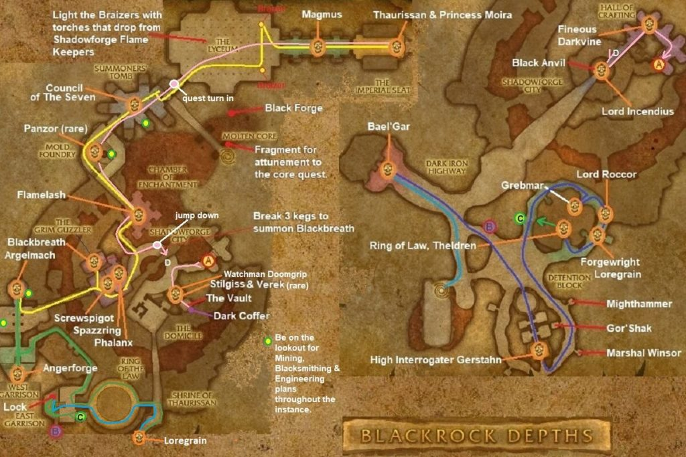

# Blackrock Depths

[All Forever dungeon guides](README.md)

**Research snapshot: 31 October 2026.** Tactics and annotated layouts use Classic references. Forever loot reports and Classic drop tables are listed separately.

**Level:** Client level 48; reported entry minimum 42; Classic planning 52–60. **Location:** Blackrock Mountain / Searing Gorge. **Group:** 5. Client level is a listing value, not a promise that a group at that level can finish the dungeon. [Forever listing](https://playfulls.com/loot-tables/dungeons/blackrock-depths).
[Entry-level source](https://wowfdb.com/zones/blackrock-depths/).

## Before entering

Classic reference: obtain Dark Iron Legacy from Franclorn while a ghost; recover Ironfel from Fineous and use the monument for Shadowforge Key. Gerstahn's Prison Cell Key serves the prison. Stock Relic Coffer Keys for vaults. At the Lyceum, find and kill two Flame Keepers, collect torches and light both braziers. Preserve Moira if doing the rescue quest. The Ring of Law selects one normal challenger; Theldren's summoned party instead draws from Lefty, Rotfang, Snokh Blackspine, Malgen Longspear (and Gnashjaw), Korv, Rezznik, Va'jashni and Volida. [Classic preparation reference](https://www.wowhead.com/classic/guide/blackrock-depths-detention-block-dungeon-strategy-wow-classic).

## Layout and route

Annotated Classic reference layout; Forever details may differ. [Full-size map](https://eintr.net/WoW/images/Blackrock-Depths-walkthrough-map-1-1024x683.jpg) / [Map source](https://eintr.net/WoW/World-of-Warcraft-Classic-Dungeon-Walkthrough.html).

Descend the mountain chains through Forgewright's Tomb and the quarry. Choose a prison/arena/key run or an Upper City/Emperor run before starting. The long route links prison, Ring of Law, vault/anvil/Fineous, barracks, golem workshop, Grim Guzzler, Flamelash, Seven, Lyceum, Magmus and throne. Shadowforge doors shorten later visits. [Classic route reference](https://www.wowhead.com/classic/guide/blackrock-depths-detention-block-dungeon-strategy-wow-classic).

- [Annotated Classic layout and route](https://eintr.net/WoW/images/Blackrock-Depths-walkthrough-map-1-1024x683.jpg) — Classic reference; Forever changes unverified. [Map source](https://eintr.net/WoW/World-of-Warcraft-Classic-Dungeon-Walkthrough.html).
- [Blackrock Depths](https://playfulls.com/dungeonmaps/blackrock-depths-1.webp) — Community-hosted dungeon map; boss pins may be approximate or incomplete. [Map source](https://playfulls.com/loot-tables/dungeons/blackrock-depths).

## Bosses and tactics

Use these as Classic-based tactical prompts, not verified Forever combat logs. “Client listed” means the current community client roster names the encounter; additional rares, companions and summons are included for planning. [Current roster](https://playfulls.com/loot-tables/dungeons/blackrock-depths), [tactical reference](https://www.wowhead.com/classic/guide/blackrock-depths-detention-block-dungeon-strategy-wow-classic).

| Boss / encounter | Status | Action |
| --- | --- | --- |
| High Interrogator Gerstahn | Client listed; main encounter | Interrupt Mana Burn; plan for fear. |
| Lord Roccor | Client listed; optional | Keep casters outside Ground Tremor. |
| Houndmaster Grebmar | Client listed; optional | Clear dogs; prevent low-health fleeing. |
| Anub'shiah | Classic reference; arena | Remove curses; interrupt Shadow Bolt. |
| Eviscerator | Classic reference; arena | Heal tank through physical burst. |
| Gorosh the Dervish | Classic reference; arena | Move melee out during Whirlwind. |
| Grizzle | Classic reference; arena | Save tank mitigation for enrage. |
| Hedrum the Creeper | Classic reference; arena | Cure poison; keep healer free. |
| Ok'thor the Breaker | Classic reference; arena | Interrupt spells; dispel Polymorph. |
| Pyromancer Loregrain | Client listed; optional | Control adds; interrupt fire casts. |
| Lord Incendius | Client listed; main encounter | Back against terrain; leave fire patches. |
| Warder Stilgiss | Client listed; optional | Interrupt Frostbolt; dispel Frost Nova. |
| Verek | Classic reference; companion | Separate from Stilgiss; control dog. |
| Watchman Doomgrip | Classic reference; vault | Collect guardians; heal Sunder-stacked tank. |
| Fineous Darkvire | Client listed; main encounter | Clear patrol path; interrupt Holy Light. |
| Bael'Gar | Client listed; optional | Turn away; pick up spawned elementals. |
| General Angerforge | Client listed; main encounter | Kill medics; gather summoned guards. |
| Golem Lord Argelmach | Client listed; main encounter | Control constructs; spread against Chain Lightning. |
| Hurley Blackbreath | Client listed; optional | Control cronies after breaking the kegs. |
| Phalanx | Client listed; optional | Face away; heal through Thunderclap. |
| Ribbly Screwspigot | Client listed; optional | Expect Gouge; prevent fleeing. |
| Plugger Spazzring | Client listed; optional | Prepare for the bar becoming hostile. |
| Ambassador Flamelash | Client listed; main encounter | Kill approaching spirits before they empower him. |
| Anger'rel | Classic reference; seven | Pace sequential Seven encounter. |
| Doom'rel | Classic reference; seven | Interrupt Shadow Bolt Volley; control summons. |
| Dope'rel | Classic reference; seven | Maintain tank control; conserve resources. |
| Gloom'rel | Classic reference; seven | Maintain tank control; conserve resources. |
| Hate'rel | Classic reference; seven | Interrupt dangerous casts. |
| Seeth'rel | Classic reference; seven | Interrupt Frostbolt. |
| Vile'rel | Classic reference; seven | Interrupt healing. |
| Magmus | Client listed; main encounter | Avoid fire jets and frontal burst. |
| Princess Moira Bronzebeard | Client listed; companion | Interrupt heals; keep alive for rescue quests. |
| Emperor Dagran Thaurissan | Client listed; main encounter | Clear room; respect Avatar of Flame. |
| Panzor the Invincible | Classic reference; rare | Optional rare golem; maintain tank control. |
| Theldren | Classic reference; quest | Dungeon-set arena summon; coordinate interrupts and crowd control. |

Ring of Law chooses one of six normal challengers. The Seven is a sequential seven-dwarf event with a shared reward chest. Theldren is a separate, conditional arena summon; he is not Lord Valthalak.

## Forever loot currently documented

The following is the complete boss-associated list recovered from the linked Playfulls page for this wing, not a complete Forever drop table. These are community loot associations checked against client item data; a client item existing does not by itself prove its drop source. Drop percentages are intentionally omitted because the source marks them unconfirmed in Forever. [Live loot source](https://playfulls.com/loot-tables/dungeons/blackrock-depths).

| Boss | Linked items |
| --- | --- |
| High Interrogator Gerstahn | [Prison Cell Key](https://playfulls.com/item/11140-prison-cell-key) (Access) |
| Lord Roccor | [Formula: Smoking Heart of the Mountain](https://playfulls.com/item/11813-formula-smoking-heart-of-the-mountain) (Recipe) |
| Pyromancer Loregrain | [Formula: Enchant Weapon - Fiery Weapon](https://playfulls.com/item/11207-formula-enchant-weapon-fiery-weapon) (Recipe) |
| Lord Incendius | [Ace of Elementals](https://playfulls.com/item/19268-ace-of-elementals) (Card) |
| Fineous Darkvire | [Master Builder's Shirt](https://playfulls.com/item/11840-master-builders-shirt) |
| Ambassador Flamelash | [Tablet of Flame Shock VI](https://playfulls.com/item/23320-tablet-of-flame-shock-vi) (Spell-learning item) |
| Emperor Dagran Thaurissan | [Thaurissan Family Jewels](https://playfulls.com/item/12033-thaurissan-family-jewels) (Container) |

Bosses absent from this section have no recovered Forever loot association in this source. The table below supplies a separately labeled Classic reference. Dungeon-wide random drops, quest turn-in rewards and event chests are not silently counted as boss loot.

## Classic loot reference

**These drops are not confirmed for Forever.**

Direct links open Classic item records. Each boss name links to the database or guide supporting its Classic drop association. Named equipment and recipes are listed; ordinary grey/white items and broad random world-drop pools are omitted. A missing entry means the retrieved sources did not supply a dedicated table. Rare spawns and quest summons may require different access or may change in Forever.

| Boss / encounter | Linked items |
| --- | --- |
| [High Interrogator Gerstahn](https://classicdb.ch/?npc=9018) | [Kentic Amice](https://classicdb.ch/?item=11624); [Enthralled Sphere](https://classicdb.ch/?item=11625); [Blackveil Cape](https://classicdb.ch/?item=11626); [Greaves of Withering Despair](https://classicdb.ch/?item=22240) **Quest / access / other:** [A Crumpled Up Note](https://classicdb.ch/?item=11446) |
| [Lord Roccor](https://classicdb.ch/?npc=9025) | [Stoneshell Guard](https://classicdb.ch/?item=11631); [Earthslag Shoulders](https://classicdb.ch/?item=11632); [Formula: Smoking Heart of the Mountain](https://classicdb.ch/?item=11813); [Mantle of Lost Hope](https://classicdb.ch/?item=22234); [Idol of Ferocity](https://classicdb.ch/?item=22397) **Quest / access / other:** [Essence of the Elements](https://classicdb.ch/?item=11129); [A Crumpled Up Note](https://classicdb.ch/?item=11446); [Rockshard Pellets](https://classicdb.ch/?item=11630) |
| [Houndmaster Grebmar](https://classicdb.ch/?npc=9319) | [Spritecaster Cape](https://classicdb.ch/?item=11623); [Fleetfoot Greaves](https://classicdb.ch/?item=11627); [Houndmaster's Bow](https://classicdb.ch/?item=11628); [Houndmaster's Rifle](https://classicdb.ch/?item=11629) **Quest / access / other:** [A Crumpled Up Note](https://classicdb.ch/?item=11446) |
| [Anub'shiah](https://classicdb.ch/?npc=9031) | [Shadefiend Boots](https://classicdb.ch/?item=11675); [Graverot Cape](https://classicdb.ch/?item=11677); [Carapace of Anub'shiah](https://classicdb.ch/?item=11678); [Savage Gladiator Greaves](https://classicdb.ch/?item=11731) **Quest / access / other:** [A Crumpled Up Note](https://classicdb.ch/?item=11446) |
| [Eviscerator](https://classicdb.ch/?npc=9029) | [Rubicund Armguards](https://classicdb.ch/?item=11679); [Splinthide Shoulders](https://classicdb.ch/?item=11685); [Girdle of Beastial Fury](https://classicdb.ch/?item=11686); [Savage Gladiator Grips](https://classicdb.ch/?item=11730) **Quest / access / other:** [A Crumpled Up Note](https://classicdb.ch/?item=11446) |
| [Gorosh the Dervish](https://classicdb.ch/?npc=9027) | [Savage Gladiator Chain](https://classicdb.ch/?item=11726); [Bloodclot Band](https://classicdb.ch/?item=22257); [Flarethorn](https://classicdb.ch/?item=22266); [Leggings of Frenzied Magic](https://classicdb.ch/?item=22271) **Quest / access / other:** [A Crumpled Up Note](https://classicdb.ch/?item=11446) |
| [Grizzle](https://classicdb.ch/?npc=9028) | [Plans: Dark Iron Pulverizer](https://classicdb.ch/?item=11610); [Grizzle's Skinner](https://classicdb.ch/?item=11702); [Stonewall Girdle](https://classicdb.ch/?item=11703); [Dregmetal Spaulders](https://classicdb.ch/?item=11722); [Entrenching Boots](https://classicdb.ch/?item=22270) **Quest / access / other:** [A Crumpled Up Note](https://classicdb.ch/?item=11446) |
| [Hedrum the Creeper](https://classicdb.ch/?npc=9032) | [Spiderfang Carapace](https://classicdb.ch/?item=11633); [Silkweb Gloves](https://classicdb.ch/?item=11634); [Hookfang Shanker](https://classicdb.ch/?item=11635); [Savage Gladiator Helm](https://classicdb.ch/?item=11729) **Quest / access / other:** [A Crumpled Up Note](https://classicdb.ch/?item=11446) |
| [Ok'thor the Breaker](https://classicdb.ch/?npc=9030) | [Ban'thok Sash](https://classicdb.ch/?item=11662); [Ogreseer Fists](https://classicdb.ch/?item=11665); [Savage Gladiator Leggings](https://classicdb.ch/?item=11728); [Cyclopean Band](https://classicdb.ch/?item=11824) **Quest / access / other:** [A Crumpled Up Note](https://classicdb.ch/?item=11446) |
| [Pyromancer Loregrain](https://classicdb.ch/?npc=9024) | [Formula: Enchant Weapon - Fiery Weapon](https://classicdb.ch/?item=11207); [Flamestrider Robes](https://classicdb.ch/?item=11747); [Pyric Caduceus](https://classicdb.ch/?item=11748); [Searingscale Leggings](https://classicdb.ch/?item=11749); [Kindling Stave](https://classicdb.ch/?item=11750) **Quest / access / other:** [A Crumpled Up Note](https://classicdb.ch/?item=11446) |
| [Lord Incendius](https://www.wowhead.com/classic/guide/blackrock-depths-detention-block-dungeon-strategy-wow-classic) | [Cinderhide Armsplints](https://classicdb.ch/?item=11764); [Pyremail Wristguards](https://classicdb.ch/?item=11765); [Flameweave Cuffs](https://classicdb.ch/?item=11766); [Emberplate Armguards](https://classicdb.ch/?item=11767) |
| [Warder Stilgiss](https://classicdb.ch/?npc=9041) | [Boreal Mantle](https://classicdb.ch/?item=11782); [Chillsteel Girdle](https://classicdb.ch/?item=11783); [Arbiter's Blade](https://classicdb.ch/?item=11784); [Dark Warder's Pauldrons](https://classicdb.ch/?item=22241) **Quest / access / other:** [A Crumpled Up Note](https://classicdb.ch/?item=11446) |
| [Verek](https://classicdb.ch/?npc=9042) | [Verek's Collar](https://classicdb.ch/?item=11755); [Verek's Leash](https://classicdb.ch/?item=22242) **Quest / access / other:** [A Crumpled Up Note](https://classicdb.ch/?item=11446) |
| [Watchman Doomgrip](https://classicdb.ch/?npc=9476) | No dedicated equipment verified in retrieved table. **Quest / access / other:** [A Crumpled Up Note](https://classicdb.ch/?item=11446); [Dark Iron Fanny Pack](https://classicdb.ch/?item=11468) |
| [Fineous Darkvire](https://classicdb.ch/?npc=9056) | [Chief Architect's Monocle](https://classicdb.ch/?item=11839); [Senior Designer's Pantaloons](https://classicdb.ch/?item=11841); [Lead Surveyor's Mantle](https://classicdb.ch/?item=11842); [Foreman's Head Protector](https://classicdb.ch/?item=22223) **Quest / access / other:** [Ironfel](https://classicdb.ch/?item=10999); [A Crumpled Up Note](https://classicdb.ch/?item=11446); [Dark Iron Fanny Pack](https://classicdb.ch/?item=11468) |
| [Bael'Gar](https://classicdb.ch/?npc=9016) | [Lavacrest Leggings](https://classicdb.ch/?item=11802); [Force of Magma](https://classicdb.ch/?item=11803); [Rubidium Hammer](https://classicdb.ch/?item=11805); [Sash of the Burning Heart](https://classicdb.ch/?item=11807) **Quest / access / other:** [A Crumpled Up Note](https://classicdb.ch/?item=11446) |
| [General Angerforge](https://classicdb.ch/?npc=9033) | [Force of Will](https://classicdb.ch/?item=11810); [Angerforge's Battle Axe](https://classicdb.ch/?item=11816); [Lord General's Sword](https://classicdb.ch/?item=11817); [Royal Decorated Armor](https://classicdb.ch/?item=11820); [Warstrife Leggings](https://classicdb.ch/?item=11821) **Quest / access / other:** [A Crumpled Up Note](https://classicdb.ch/?item=11446); [Marshal Windsor's Lost Information](https://classicdb.ch/?item=11464); [Dark Iron Fanny Pack](https://classicdb.ch/?item=11468) |
| [Golem Lord Argelmach](https://classicdb.ch/?npc=8983) | [Naglering](https://classicdb.ch/?item=11669); [Second Wind](https://classicdb.ch/?item=11819); [Omnicast Boots](https://classicdb.ch/?item=11822); [Luminary Kilt](https://classicdb.ch/?item=11823) **Quest / access / other:** [Head of Argelmach](https://classicdb.ch/?item=11268); [A Crumpled Up Note](https://classicdb.ch/?item=11446); [Marshal Windsor's Lost Information](https://classicdb.ch/?item=11465); [Dark Iron Fanny Pack](https://classicdb.ch/?item=11468) |
| [Hurley Blackbreath](https://classicdb.ch/?npc=9537) | [Ragefury Eyepatch](https://classicdb.ch/?item=11735); [Coal Miner Boots](https://classicdb.ch/?item=18043); [Hurley's Tankard](https://classicdb.ch/?item=18044); [Firemoss Boots](https://classicdb.ch/?item=22275) **Quest / access / other:** [Lost Thunderbrew Recipe](https://classicdb.ch/?item=11312); [A Crumpled Up Note](https://classicdb.ch/?item=11446); [Dark Iron Fanny Pack](https://classicdb.ch/?item=11468) |
| [Phalanx](https://classicdb.ch/?npc=9502) | [Bloodfist](https://classicdb.ch/?item=11744); [Fists of Phalanx](https://classicdb.ch/?item=11745); [Golem Fitted Pauldrons](https://classicdb.ch/?item=22212) **Quest / access / other:** [A Crumpled Up Note](https://classicdb.ch/?item=11446) |
| [Ribbly Screwspigot](https://classicdb.ch/?npc=9543) | [Plans: Dark Iron Plate](https://classicdb.ch/?item=11612) **Quest / access / other:** [Ribbly's Quiver](https://classicdb.ch/?item=2662); [Ribbly's Bandolier](https://classicdb.ch/?item=2663); [Ribbly's Head](https://classicdb.ch/?item=11313); [A Crumpled Up Note](https://classicdb.ch/?item=11446); [Wayfarer's Knapsack](https://classicdb.ch/?item=11742) |
| [Plugger Spazzring](https://classicdb.ch/?npc=9499) | [Barman Shanker](https://classicdb.ch/?item=12791); [Mixologist's Tunic](https://classicdb.ch/?item=12793); [Schematic: Goblin Jumper Cables XL](https://classicdb.ch/?item=18653) **Quest / access / other:** [A Crumpled Up Note](https://classicdb.ch/?item=11446) |
| [Ambassador Flamelash](https://classicdb.ch/?npc=9156) | [Circle of Flame](https://classicdb.ch/?item=11808); [Flame Wrath](https://classicdb.ch/?item=11809); [Cape of the Fire Salamander](https://classicdb.ch/?item=11812); [Molten Fists](https://classicdb.ch/?item=11814); [Burst of Knowledge](https://classicdb.ch/?item=11832) **Quest / access / other:** [Essence of the Elements](https://classicdb.ch/?item=11129); [A Crumpled Up Note](https://classicdb.ch/?item=11446) |
| [Anger'rel](https://classicdb.ch/?npc=9035) | No dedicated equipment verified in retrieved table. |
| [Doom'rel](https://classicdb.ch/?npc=9039) | No dedicated equipment verified in retrieved table. |
| [Dope'rel](https://classicdb.ch/?npc=9040) | No dedicated equipment verified in retrieved table. |
| [Gloom'rel](https://classicdb.ch/?npc=9037) | No dedicated equipment verified in retrieved table. |
| [Hate'rel](https://classicdb.ch/?npc=9034) | No dedicated equipment verified in retrieved table. |
| [Seeth'rel](https://classicdb.ch/?npc=9038) | No dedicated equipment verified in retrieved table. |
| [Vile'rel](https://classicdb.ch/?npc=9036) | No dedicated equipment verified in retrieved table. |
| [Magmus](https://classicdb.ch/?npc=9938) | [Golem Skull Helm](https://classicdb.ch/?item=11746); [Magmus Stone](https://classicdb.ch/?item=11935); [Lavastone Hammer](https://classicdb.ch/?item=22208); [Totem of Rage](https://classicdb.ch/?item=22395); [Libram of Truth](https://classicdb.ch/?item=22400) **Quest / access / other:** [A Crumpled Up Note](https://classicdb.ch/?item=11446) |
| [Princess Moira Bronzebeard](https://classicdb.ch/?npc=8929) | [Swiftwalker Boots](https://classicdb.ch/?item=12553); [Hands of the Exalted Herald](https://classicdb.ch/?item=12554); [High Priestess Boots](https://classicdb.ch/?item=12556); [Ebonsteel Spaulders](https://classicdb.ch/?item=12557) **Quest / access / other:** [A Crumpled Up Note](https://classicdb.ch/?item=11446); [Dark Iron Fanny Pack](https://classicdb.ch/?item=11468) |
| [Emperor Dagran Thaurissan](https://classicdb.ch/?npc=9019) | [Ironfoe](https://classicdb.ch/?item=11684); [Hand of Justice](https://classicdb.ch/?item=11815); [Robes of the Royal Crown](https://classicdb.ch/?item=11924); [Thaurissan's Royal Scepter](https://classicdb.ch/?item=11928); [The Emperor's New Cape](https://classicdb.ch/?item=11930); [Dreadforge Retaliator](https://classicdb.ch/?item=11931); [Guiding Stave of Wisdom](https://classicdb.ch/?item=11932); [Imperial Jewel](https://classicdb.ch/?item=11933); [Emperor's Seal](https://classicdb.ch/?item=11934); [Wristguards of Renown](https://classicdb.ch/?item=22204); [Sash of the Grand Hunt](https://classicdb.ch/?item=22207) **Quest / access / other:** [A Crumpled Up Note](https://classicdb.ch/?item=11446); [Dark Iron Fanny Pack](https://classicdb.ch/?item=11468) |
| [Panzor the Invincible](https://classicdb.ch/?npc=8923) | [Rock Golem Bulwark](https://classicdb.ch/?item=11785); [Stone of the Earth](https://classicdb.ch/?item=11786); [Shalehusk Boots](https://classicdb.ch/?item=11787); [Soot Encrusted Footwear](https://classicdb.ch/?item=22245) **Quest / access / other:** [Essence of the Elements](https://classicdb.ch/?item=11129); [A Crumpled Up Note](https://classicdb.ch/?item=11446) |
| [Theldren](https://classicdb.ch/?npc=16059) | No dedicated equipment verified in retrieved table. **Quest / access / other:** [Top Piece of Lord Valthalak's Amulet](https://classicdb.ch/?item=22047) |

**Chest of the Seven (event chest, Classic):** [Wraith Scythe](https://classicdb.ch/?item=11920); [Impervious Giant](https://classicdb.ch/?item=11921); [Blood-etched Blade](https://classicdb.ch/?item=11922); [The Hammer of Grace](https://classicdb.ch/?item=11923); [Ghostshroud](https://classicdb.ch/?item=11925); [Deathdealer Breastplate](https://classicdb.ch/?item=11926); [Legplates of the Eternal Guardian](https://classicdb.ch/?item=11927); [Haunting Specter Leggings](https://classicdb.ch/?item=11929). [Chest loot source](https://www.wowhead.com/classic/guide/blackrock-depths-shadowforge-city-dungeon-strategy-wow-classic).

**Arena Spoils after Theldren (Classic event chest):** [Lefty's Brass Knuckle](https://classicdb.ch/?item=22317); [Malgen's Long Bow](https://classicdb.ch/?item=22318); [Ironweave Mantle](https://classicdb.ch/?item=22305); [Shroud of Arcane Mastery](https://classicdb.ch/?item=22330). [Chest source](https://warcraft.wiki.gg/wiki/Arena_Spoils).
