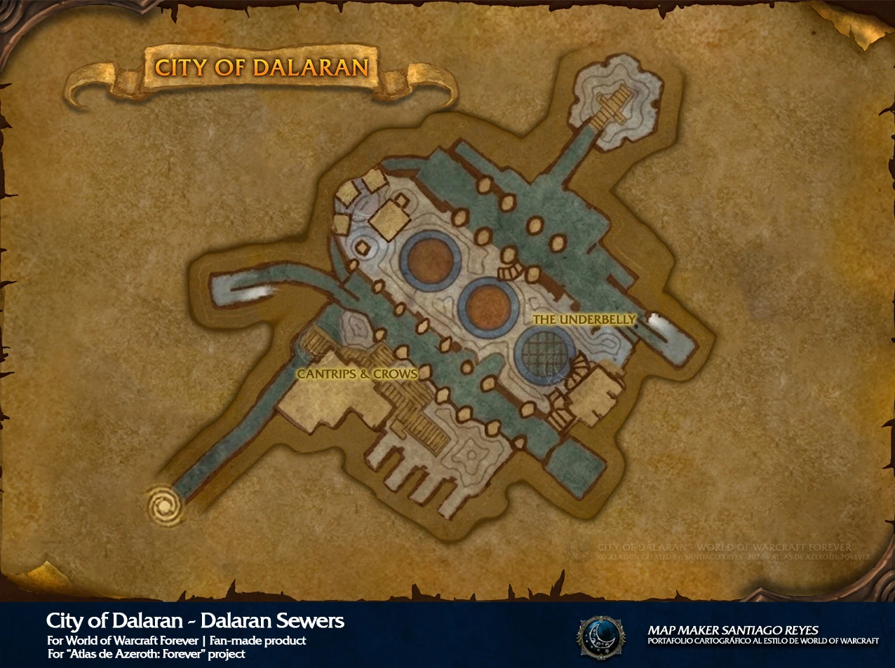
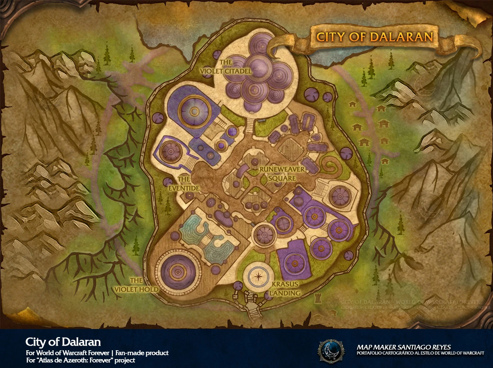

# City of Dalaran

[All Forever dungeon guides](README.md)

**Checked 31 October 2026 · Five players · Official level band: 28–33.** These are reported Forever beta encounters and drops; the tables cover documented boss gear, recipes and named quest items, not guaranteed drop rates or every shared trash item.

[Official dungeon overview](https://news.blizzard.com/en-us/article/24301455/explore-the-new-dungeons-of-world-of-warcraft-forever).

## Entrance and preparation

Use the sewer entrance outside Dalaran. Obtain the Dalaran Sewer Key through Heart of Disruption: Alliance starts An Alarming Request in Southshore; Horde starts with Magus Wordeen Voidglare in Tarren Mill, then follows the Dalaran chain. Icy Veins also documents an Alliance approach through the friendly city. Published quest minimum levels differ; check your client.

To summon Lyn, take the Black Tome from Arugal’s room after Shadowfang Keep, use it near the Ambermill Leyline Focus to create the Tome of Dalaran, then use that tome at the sewer runes. Bring interrupts, curse removal, magic dispels and drinking water.

[Entrance / quest reference](https://www.icy-veins.com/wow-forever/city-of-dalaran-guide); [Beta access details](https://www.icy-veins.com/wow-forever/city-of-dalaran-guide).

## Layout and route

Begin in the sewers: Atrexis and optional Lyn. Continue onto the city surface for Arcane Anomaly, Fel Ancient, Unstable Sentinel, Mana Devourer and Arcanic Enigma; finish at Shade of the Archmage via Modera’s portal. Surface order can vary.

[Open full map](https://playfulls.com/dungeonmaps/city-of-dalaran-2.webp)

Map by Santiago Reyes, Atlas de Azeroth: Forever; hosted by Playfulls. [Map source and interactive boss overlay](https://playfulls.com/loot-tables/dungeons/city-of-dalaran).

[Open full map](https://playfulls.com/dungeonmaps/city-of-dalaran-1.webp)

Map by Santiago Reyes, Atlas de Azeroth: Forever; hosted by Playfulls. [Map source and interactive boss overlay](https://playfulls.com/loot-tables/dungeons/city-of-dalaran).

## Boss tactics

Interrupt Mana Burn. Stop casting into Reflection Field. Face Fragmented Sentries away from allies; expect substantial arcane damage.

| Boss | What to do |
| --- | --- |
| Atrexis the Grave Knight | Clear nearby necromancers, collect summoned skeletons, and watch tank damage during disarm and frenzy. |
| Lyn the Ignored | Summoned encounter. Control skeletons, remove Curse of Thorns and heal through Shadow Bolt Volley. |
| Arcane Anomaly | Avoid the rotating Focal Blast beam. Interrupt Arcane Bolt and keep the tank covered. |
| Arcanic Enigma | Kill both Mana Phantoms first; interrupt Mana Burn. Dispel Manamorph, collect adds and keep casters outside the silence. |
| Unstable Sentinel | Face the frontal attack away. Retreat beyond 25 yards during Malfunction; clear nearby tomes before pulling. |
| Fel Ancient | Speak to Grindle Firespark to remove the barrier. Leave green pools immediately and break roots when they overlap. |
| Mana Devourer | Clear the entire room before pulling. Use damage cooldowns before repeated mana drains exhaust the healer. |
| Shade of the Archmage | Speak to Modera for the portal. Dodge Bounding Mana, keep ranged outside Arcane Explosion and recover after Mass Polymorph. |

[Encounter research](https://www.method.gg/wow-forever/dungeons/city-of-dalaran); [Mechanics cross-check](https://www.icy-veins.com/wow-forever/city-of-dalaran-guide).

## Documented boss drops

| Boss | Gear, recipes and quest drops |
| --- | --- |
| Atrexis the Grave Knight | [Graveweave Bindings](https://www.wowhead.com/forever/item=273036) (Cloth bracers); [Bonebinder's Signet](https://www.wowhead.com/forever/item=273032) (Ring); [Gravespike Repeater](https://www.wowhead.com/forever/item=273033) (Crossbow) |
| Lyn the Ignored | [Bonepile Gaze](https://www.wowhead.com/forever/item=273055) (Shield); [Cartilage Shapers](https://www.wowhead.com/forever/item=273054) (Leather Hands); [Tendonscraper Dagger](https://www.wowhead.com/forever/item=273053) (Main-hand dagger) |
| Arcane Anomaly | [Mana-Warped Chain Shirt](https://www.wowhead.com/forever/item=273035) (Mail Chest); [Ephemeral Grips](https://www.wowhead.com/forever/item=273034) (Cloth Hands); [Runemender's Seal](https://www.wowhead.com/forever/item=273031) (Ring) |
| Arcanic Enigma | [Drape of Shifting Energy](https://www.wowhead.com/forever/item=273045) (Cloak); [Violet Sorcerer's Robes](https://www.wowhead.com/forever/item=273044) (Cloth Chest); [Wand of Mana Concentration](https://www.wowhead.com/forever/item=273043) (Wand) |
| Unstable Sentinel | [Guardian's Dualblade](https://www.wowhead.com/forever/item=273046) (Two-hand axe); [Unstable Crystalline Shoulderpads](https://www.wowhead.com/forever/item=273047) (Leather Shoulder); [Refractory Scaleguards](https://www.wowhead.com/forever/item=273048) (Mail Legs); [Blueprint: Spinning Wheel](https://www.wowhead.com/forever/item=273099) (Tailoring recipe) |
| Fel Ancient | [Blightleaf Rope](https://www.wowhead.com/forever/item=273039) (Cloth Waist); [Garb of Fallen Felbark](https://www.wowhead.com/forever/item=273038) (Leather Chest); [Felbough Arm](https://www.wowhead.com/forever/item=273037) (Polearm) |
| Mana Devourer | [Manascale Treads](https://www.wowhead.com/forever/item=273042) (Mail Feet); [Slitherwrap Girdle](https://www.wowhead.com/forever/item=273041) (Leather Waist); [Spine of the Devourer](https://www.wowhead.com/forever/item=273040) (Two-hand staff) |
| Shade of the Archmage | [Ponderous Orb](https://www.wowhead.com/forever/item=273052) (Off-hand); [Archmagister's Faceted Pendant](https://www.wowhead.com/forever/item=273049) (Necklace); [Violet Sorcerer's Mantle](https://www.wowhead.com/forever/item=273051) (Cloth Shoulder); [Arcane Mote](https://www.wowhead.com/forever/item=251961) (Quest item); [Blueprint: Arcane Salvager](https://www.wowhead.com/forever/item=273103) (Enchanting recipe) |

[Beta gear table](https://playfulls.com/loot-tables/dungeons/city-of-dalaran); [Recipe and encounter cross-check](https://www.icy-veins.com/wow-forever/city-of-dalaran-guide). Item links open the Forever edition of Wowhead.

The eight-boss roster includes optional summoned Lyn. Maps use a different numbering order from a sewer-first playthrough. Blueprint: Arcane Salvager is reported on both Rath’mael in Ruins of Lordaeron and Shade of the Archmage here; these are source-listed beta associations, not a promise of a fixed drop rate.

**Why some databases list nine:** Historical client rows call Arcanic Enigma “Mana Elemental” and additionally list Mana Wraith. The latter has no verified separate boss fight or drops in the written beta guides, so it is not given an invented strategy here. [Client roster versus observed encounters](https://wowfwiki.com/wiki/City_of_Dalaran); [Eight observed, ninth unencountered](https://mmonster.co/wow-forever/guides/dungeons/city-of-dalaran).
