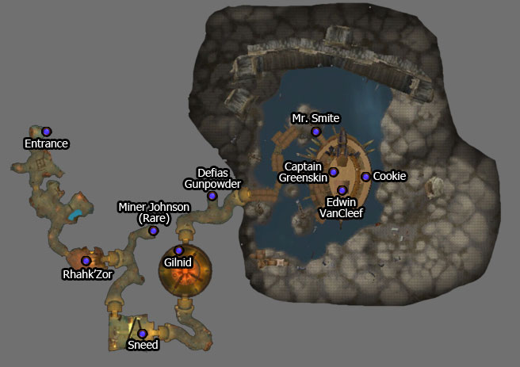

# The Deadmines

[All Forever dungeon guides](README.md)

## Plan your run

**Planning range: 17–26 / Five players / Westfall.** Researched 31 October 2026; beta details may change. Playfulls lists dungeon level 16+; that is a data label, not a verified portal-entry requirement. [Current dungeon data](https://playfulls.com/loot-tables/dungeons/deadmines).

Enter the mine through the building in Moonbrook, southern Westfall. Alliance has the easier approach.

Follow the mine through the shredder and forge to the ship. Sweep the decks before the captain's cabin; Cookie is around the ship's rear. Check Johnson's side tunnel. [Entrance and route reference](https://www.icy-veins.com/wow-forever/deadmines-guide).

## Layout maps

Annotated Classic reference layout; Forever details may differ. [Full-size map](https://static.icy-veins.com/images/classic-plus/forever/dungeons/deadmines-map.jpg) / [Map source](https://www.icy-veins.com/wow-forever/deadmines-guide/).

- [Map of Deadmines, The Deadmines](https://playfulls.com/dungeonmaps/deadmines-1.webp)
- [Map of Deadmines, Ironclad Cove](https://playfulls.com/dungeonmaps/deadmines-2.webp)

Open the [interactive dungeon map](https://playfulls.com/loot-tables/dungeons/deadmines) for floor controls and available markers. Some boss positions are approximate or absent. [Annotated reference layout](https://foreveroth.com/en/donjons/?donjon=the-deadmines).

## Bosses and tactics

The following tactics are summarized from the Forever guide.

- **Rhahk'Zor:** Pull his guards separately; heal through the tank stun.
- **Miner Johnson (rare):** Clear surrounding miners before committing.
- **Sneed's Shredder → Sneed:** Clear the room for fear; reacquire Sneed after the machine dies.
- **Gilnid:** Control or kill his engineer; the engineer's constructs die with him.
- **Mr. Smite:** Kill both guards first; top the tank before weapon-change stuns.
- **Captain Greenskin:** Kill the Squallshaper; face the captain's cleave away.
- **Edwin VanCleef:** Kill initial guards; collect and defeat reinforcements around half health.
- **Cookie (optional):** Pull into cleared space; interrupt Cookie's Cooking.

[Tactics source](https://www.icy-veins.com/wow-forever/deadmines-guide).

## Boss loot and item links

Named equipment, boss-specific recipes, pets, bags and quest starters currently listed by the sources appear below. Drop percentages are omitted: the sites mix expectations, legacy values and beta observations. Boss associations are community reports; client item existence alone does not prove a live drop.

| Boss / encounter | Named drops |
| --- | --- |
| Rhahk'Zor | [Ogre Loincloth](https://playfulls.com/item/273289-ogre-loincloth); [Rhahk'Zor's Hammer](https://playfulls.com/item/5187-rhahkzors-hammer); [Rockslicer](https://playfulls.com/item/872-rockslicer); [Plans: Crusader's Gloves](https://playfulls.com/item/251364-plans-crusaders-gloves) |
| Sneed | [Bandsaw Wristbands](https://playfulls.com/item/273293-bandsaw-wristbands); [Buzz Saw](https://playfulls.com/item/1937-buzz-saw); [Buzzer Blade](https://playfulls.com/item/2169-buzzer-blade); [Dull Sawblade](https://playfulls.com/item/285292-dull-sawblade); [Gold-flecked Gloves](https://playfulls.com/item/5195-gold-flecked-gloves); [Taskmaster Axe](https://playfulls.com/item/5194-taskmaster-axe); [Pattern: Filigreed Pristine Gown](https://playfulls.com/item/253902-pattern-filigreed-pristine-gown); [Plans: Crusader's Gloves](https://playfulls.com/item/251364-plans-crusaders-gloves); [Blueprint: Repair Bot](https://playfulls.com/item/273092-blueprint-repair-bot) |
| Miner Johnson | [Gold-plated Buckler](https://playfulls.com/item/5443-gold-plated-buckler); [Miner's Cape](https://playfulls.com/item/5444-miners-cape) |
| Gilnid | [Goblin Hammer](https://playfulls.com/item/273297-goblin-hammer); [Lavishly Jeweled Ring](https://playfulls.com/item/1156-lavishly-jeweled-ring); [Smelting Pants](https://playfulls.com/item/5199-smelting-pants); [Pattern: Brawler's Leather Gloves](https://playfulls.com/item/252777-pattern-brawlers-leather-gloves); [Pattern: Filigreed Silky Gown](https://playfulls.com/item/253904-pattern-filigreed-silky-gown); [Pattern: Trapper's Leather Gloves](https://playfulls.com/item/252778-pattern-trappers-leather-gloves); [Blueprint: Anvil](https://playfulls.com/item/273086-blueprint-anvil) |
| Captain Greenskin | [Blackened Defias Belt](https://playfulls.com/item/10403-blackened-defias-belt); [Emberstone Staff](https://playfulls.com/item/5201-emberstone-staff); [Impaling Harpoon](https://playfulls.com/item/5200-impaling-harpoon) |
| Mr. Smite | [First Mate Band](https://playfulls.com/item/284715-first-mate-band); [Smite's Mighty Hammer](https://playfulls.com/item/7230-smites-mighty-hammer); [Smite's Reaver](https://playfulls.com/item/5196-smites-reaver); [Thief's Blade](https://playfulls.com/item/5192-thiefs-blade); [Pattern: Defender's Leather Gloves](https://playfulls.com/item/252779-pattern-defenders-leather-gloves); [Pattern: Stormrider's Leather Gloves](https://playfulls.com/item/252781-pattern-stormriders-leather-gloves) |
| Cookie | [Cookie's Stirring Rod](https://playfulls.com/item/5198-cookies-stirring-rod); [Cookie's Tenderizer](https://playfulls.com/item/5197-cookies-tenderizer); [Lookie's Spyglass](https://playfulls.com/item/273298-lookies-spyglass); [Pattern: Defender's Leather Gloves](https://playfulls.com/item/252779-pattern-defenders-leather-gloves); [Pattern: Filigreed Pearly Gown](https://playfulls.com/item/253910-pattern-filigreed-pearly-gown); [Pattern: Filigreed Shining Gown](https://playfulls.com/item/253912-pattern-filigreed-shining-gown); [Pattern: Trapper's Leather Gloves](https://playfulls.com/item/252778-pattern-trappers-leather-gloves); [Blueprint: Cookie's Feast](https://playfulls.com/item/273102-blueprint-cookies-feast); [Cat Carrier (Siamese)](https://playfulls.com/item/8490-cat-carrier-siamese) |
| Edwin VanCleef | [Blackened Defias Armor](https://playfulls.com/item/10399-blackened-defias-armor); [Cape of the Brotherhood](https://playfulls.com/item/5193-cape-of-the-brotherhood); [Corsair's Overshirt](https://playfulls.com/item/5202-corsairs-overshirt); [Cruel Barb](https://playfulls.com/item/5191-cruel-barb); [Pattern: Defender's Leather Hood](https://playfulls.com/item/252800-pattern-defenders-leather-hood); [Pattern: Filigreed Pristine Leggings](https://playfulls.com/item/253938-pattern-filigreed-pristine-leggings); [Pattern: Filigreed Shining Leggings](https://playfulls.com/item/253948-pattern-filigreed-shining-leggings); [Pattern: Totemic Leather Hood](https://playfulls.com/item/252801-pattern-totemic-leather-hood); [Pattern: Trapper's Leather Hood](https://playfulls.com/item/252799-pattern-trappers-leather-hood); [Pattern: Wisdom's Leather Hood](https://playfulls.com/item/252803-pattern-wisdoms-leather-hood); [An Unsent Letter](https://playfulls.com/item/2874-an-unsent-letter) |

[Loot source: Playfulls](https://playfulls.com/loot-tables/dungeons/deadmines). Shared recipe pools and generic trash/world drops remain in the [complete source table](https://playfulls.com/loot-tables/dungeons/deadmines); they are excluded from this boss table. See [Playfulls methodology](https://playfulls.com/methodology) for its client-versus-community distinction.

## Evidence and remaining gaps

Playfulls groups Sneed and his Shredder together. Buzzer Blade, Buzz Saw and Dull Sawblade belong to the Shredder; Bandsaw Wristbands, Gold-flecked Gloves and Taskmaster Axe belong to Sneed. Recipe assignments remain under their combined encounter.
