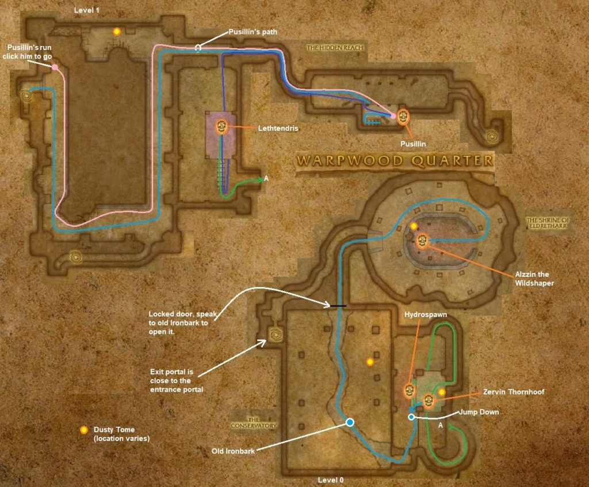

# Dire Maul East

[All Forever dungeon guides](README.md)

**Research snapshot: 31 October 2026.** Tactics and annotated layouts use Classic references. Forever loot reports and Classic drop tables are listed separately.

**Level:** Client Dire Maul level 54; Classic planning 56–60. **Location:** Feralas. **Group:** 5. Client level is a listing value, not a promise that a group at that level can finish the dungeon. [Forever listing](https://playfulls.com/loot-tables/dungeons/dire-maul).

## Before entering

Classic reference: East needs no key. Pusillin drops Crescent Key for North and West. Bring curse removal and demon control; assign the healer to watch Zevrim's sacrifice victim. For quest runs collect Lethtendris's Web and Shards of the Felvine objectives first. [Classic preparation reference](https://www.wowhead.com/classic/guide/dire-maul-east-dungeon-strategy-wow-classic).

## Layout and route

Annotated Classic reference layout; Forever details may differ. [Full-size map](https://eintr.net/WoW/images/Dire-Maul-East-walkthrough-map-1-1024x848.jpg) / [Map source](https://eintr.net/WoW/World-of-Warcraft-Classic-Dungeon-Walkthrough.html).

Enter the eastern wing from Eldre'Thalas's courtyard. Chase Pusillin for the key, then clear Hydrospawn, Lethtendris and Zevrim. After Zevrim dies, speak to Old Ironbark to open the way to Alzzin. A jump run is a separate shortened farming route and skips optional encounters. [Classic route reference](https://www.wowhead.com/classic/guide/dire-maul-east-dungeon-strategy-wow-classic).

- [Annotated Classic layout and route](https://eintr.net/WoW/images/Dire-Maul-East-walkthrough-map-1-1024x848.jpg) — Classic reference; Forever changes unverified. [Map source](https://eintr.net/WoW/World-of-Warcraft-Classic-Dungeon-Walkthrough.html).
- [Dire Maul](https://playfulls.com/dungeonmaps/dire-maul-1.webp) — Community-hosted dungeon map; boss pins may be approximate or incomplete. [Map source](https://playfulls.com/loot-tables/dungeons/dire-maul).

## Bosses and tactics

Use these as Classic-based tactical prompts, not verified Forever combat logs. “Client listed” means the current community client roster names the encounter; additional rares, companions and summons are included for planning. [Current roster](https://playfulls.com/loot-tables/dungeons/dire-maul), [tactical reference](https://www.wowhead.com/classic/guide/dire-maul-east-dungeon-strategy-wow-classic).

| Boss / encounter | Status | Action |
| --- | --- | --- |
| Pusillin | Client listed; optional | Chase; kill imps; stop casts during reflect. |
| Hydrospawn | Client listed; main encounter | Clear pool; collect hydroling adds. |
| Lethtendris | Client listed; main encounter | Kill Pimgib; interrupt Void Bolt; decurse. |
| Pimgib | Classic reference; companion | Control imp; kill before Lethtendris. |
| Zevrim Thornhoof | Client listed; main encounter | Heal sacrifice target; dispel Intense Pain. |
| Alzzin the Wildshaper | Client listed; main encounter | Interrupt healing; gather imps from wall. |
| Isalien | Classic reference; quest | Interrupt healing; control Empyrean; quest summon. |
| Empyrean | Classic reference; companion | Control Isalien's summoned hippogryph. |

## Forever loot currently documented

The following is the complete boss-associated list recovered from the linked Playfulls page for this wing, not a complete Forever drop table. These are community loot associations checked against client item data; a client item existing does not by itself prove its drop source. Drop percentages are intentionally omitted because the source marks them unconfirmed in Forever. [Live loot source](https://playfulls.com/loot-tables/dungeons/dire-maul).

| Boss | Linked items |
| --- | --- |
| Hydrospawn | [Ace of Elementals](https://playfulls.com/item/19268-ace-of-elementals) (Card) |
| Pusillin | [Recipe: Runn Tum Tuber Surprise](https://playfulls.com/item/18267-recipe-runn-tum-tuber-surprise) (Recipe); [Crescent Key](https://playfulls.com/item/18249-crescent-key) (Access) |

Bosses absent from this section have no recovered Forever loot association in this source. The table below supplies a separately labeled Classic reference. Dungeon-wide random drops, quest turn-in rewards and event chests are not silently counted as boss loot.

## Classic loot reference

**These drops are not confirmed for Forever.**

Direct links open Classic item records. Each boss name links to the database or guide supporting its Classic drop association. Named equipment and recipes are listed; ordinary grey/white items and broad random world-drop pools are omitted. A missing entry means the retrieved sources did not supply a dedicated table. Rare spawns and quest summons may require different access or may change in Forever.

| Boss / encounter | Linked items |
| --- | --- |
| [Pusillin](https://classicdb.ch/?npc=14354) | [Recipe: Runn Tum Tuber Surprise](https://classicdb.ch/?item=18267); [Libram of Rapidity](https://classicdb.ch/?item=18332); [Libram of Focus](https://classicdb.ch/?item=18333) **Quest / access / other:** [Book of Incantations](https://classicdb.ch/?item=18261); [Garona: A Study on Stealth and Treachery](https://classicdb.ch/?item=18356); [Codex of Defense](https://classicdb.ch/?item=18357); [The Arcanist's Cookbook](https://classicdb.ch/?item=18358); [The Light and How to Swing It](https://classicdb.ch/?item=18359); [Harnessing Shadows](https://classicdb.ch/?item=18360); [The Greatest Race of Hunters](https://classicdb.ch/?item=18361); [Holy Bologna: What the Light Won't Tell You](https://classicdb.ch/?item=18362); [Frost Shock and You](https://classicdb.ch/?item=18363); [The Emerald Dream](https://classicdb.ch/?item=18364); [Foror's Compendium of Dragon Slaying](https://classicdb.ch/?item=18401) |
| [Hydrospawn](https://classicdb.ch/?npc=13280) | [Breakwater Legguards](https://classicdb.ch/?item=18305); [Riptide Shoes](https://classicdb.ch/?item=18307); [Tempest Talisman](https://classicdb.ch/?item=18317); [Waterspout Boots](https://classicdb.ch/?item=18322); [Waveslicer](https://classicdb.ch/?item=18324); [Libram of Rapidity](https://classicdb.ch/?item=18332); [Libram of Focus](https://classicdb.ch/?item=18333) **Quest / access / other:** [Essence of Water](https://classicdb.ch/?item=7080); [Hydrospawn Essence](https://classicdb.ch/?item=18299); [Garona: A Study on Stealth and Treachery](https://classicdb.ch/?item=18356); [Codex of Defense](https://classicdb.ch/?item=18357); [The Arcanist's Cookbook](https://classicdb.ch/?item=18358); [The Light and How to Swing It](https://classicdb.ch/?item=18359); [Harnessing Shadows](https://classicdb.ch/?item=18360); [The Greatest Race of Hunters](https://classicdb.ch/?item=18361); [Holy Bologna: What the Light Won't Tell You](https://classicdb.ch/?item=18362); [Frost Shock and You](https://classicdb.ch/?item=18363); [The Emerald Dream](https://classicdb.ch/?item=18364); [Foror's Compendium of Dragon Slaying](https://classicdb.ch/?item=18401); [Ace of Elementals](https://classicdb.ch/?item=19268) |
| [Lethtendris](https://classicdb.ch/?npc=14327) | [Lethtendris's Wand](https://classicdb.ch/?item=18301); [Band of Vigor](https://classicdb.ch/?item=18302); [Quel'dorai Channeling Rod](https://classicdb.ch/?item=18311); [Felhide Cap](https://classicdb.ch/?item=18325); [Libram of Rapidity](https://classicdb.ch/?item=18332); [Libram of Focus](https://classicdb.ch/?item=18333) **Quest / access / other:** [Lethtendris's Web](https://classicdb.ch/?item=18426) |
| [Pimgib](https://classicdb.ch/?npc=14349) | [Libram of Rapidity](https://classicdb.ch/?item=18332); [Libram of Focus](https://classicdb.ch/?item=18333); [Pimgib's Collar](https://classicdb.ch/?item=18354) |
| [Zevrim Thornhoof](https://classicdb.ch/?npc=11490) | [Gloves of Shadowy Mist](https://classicdb.ch/?item=18306); [Clever Hat](https://classicdb.ch/?item=18308); [Helm of Awareness](https://classicdb.ch/?item=18313); [Fervent Helm](https://classicdb.ch/?item=18319); [Satyr's Bow](https://classicdb.ch/?item=18323); [Libram of Rapidity](https://classicdb.ch/?item=18332); [Libram of Focus](https://classicdb.ch/?item=18333) **Quest / access / other:** [Garona: A Study on Stealth and Treachery](https://classicdb.ch/?item=18356); [Codex of Defense](https://classicdb.ch/?item=18357); [The Arcanist's Cookbook](https://classicdb.ch/?item=18358); [The Light and How to Swing It](https://classicdb.ch/?item=18359); [Harnessing Shadows](https://classicdb.ch/?item=18360); [The Greatest Race of Hunters](https://classicdb.ch/?item=18361); [Holy Bologna: What the Light Won't Tell You](https://classicdb.ch/?item=18362); [Frost Shock and You](https://classicdb.ch/?item=18363); [The Emerald Dream](https://classicdb.ch/?item=18364); [Foror's Compendium of Dragon Slaying](https://classicdb.ch/?item=18401) |
| [Alzzin the Wildshaper](https://classicdb.ch/?npc=11492) | [Gloves of Restoration](https://classicdb.ch/?item=18309); [Fiendish Machete](https://classicdb.ch/?item=18310); [Energized Chestplate](https://classicdb.ch/?item=18312); [Ring of Demonic Guile](https://classicdb.ch/?item=18314); [Ring of Demonic Potency](https://classicdb.ch/?item=18315); [Merciful Greaves](https://classicdb.ch/?item=18318); [Energetic Rod](https://classicdb.ch/?item=18321); [Razor Gauntlets](https://classicdb.ch/?item=18326); [Whipvine Cord](https://classicdb.ch/?item=18327); [Shadewood Cloak](https://classicdb.ch/?item=18328); [Libram of Rapidity](https://classicdb.ch/?item=18332); [Libram of Focus](https://classicdb.ch/?item=18333) **Quest / access / other:** [Garona: A Study on Stealth and Treachery](https://classicdb.ch/?item=18356); [Codex of Defense](https://classicdb.ch/?item=18357); [The Arcanist's Cookbook](https://classicdb.ch/?item=18358); [The Light and How to Swing It](https://classicdb.ch/?item=18359); [Harnessing Shadows](https://classicdb.ch/?item=18360); [The Greatest Race of Hunters](https://classicdb.ch/?item=18361); [Holy Bologna: What the Light Won't Tell You](https://classicdb.ch/?item=18362); [Frost Shock and You](https://classicdb.ch/?item=18363); [The Emerald Dream](https://classicdb.ch/?item=18364); [Foror's Compendium of Dragon Slaying](https://classicdb.ch/?item=18401) |
| [Isalien](https://classicdb.ch/?npc=16097) | [Ironweave Gloves](https://classicdb.ch/?item=22304); [Huntsman's Harpoon](https://classicdb.ch/?item=22314); [Hammer of Revitalization](https://classicdb.ch/?item=22315); [Totem of Rebirth](https://classicdb.ch/?item=22345); [Libram of Hope](https://classicdb.ch/?item=22401); [Boots of Ferocity](https://classicdb.ch/?item=22472) |
| Empyrean | No dedicated equipment verified in retrieved table. |
