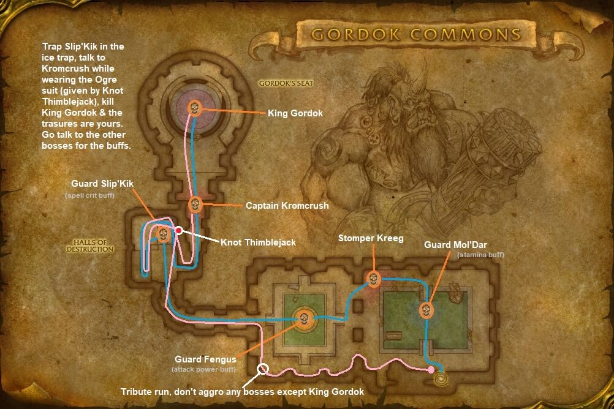

# Dire Maul North and Tribute

[All Forever dungeon guides](README.md)

**Research snapshot: 31 October 2026.** Tactics and annotated layouts use Classic references. Forever loot reports and Classic drop tables are listed separately.

**Level:** Client Dire Maul level 54; Classic planning level 60. **Location:** Feralas. **Group:** 5. Client level is a listing value, not a promise that a group at that level can finish the dungeon. [Forever listing](https://playfulls.com/loot-tables/dungeons/dire-maul).

## Before entering

Classic reference: Crescent Key opens the entrance. If skipping Mol'dar, arrange Lockpicking 300, a Large Seaforium Charge or Truesilver Skeleton Key for the inner door. Take the courtyard key from Fengus's Chest. Bring Frost Oil and a Thorium Widget for Slip'kik's trap. Make the Gordok Ogre Suit before freeing Knot. Preserve guards for stronger tribute; tribute and Knot's cache are chest rewards. [Classic preparation reference](https://www.wowhead.com/classic/guide/dire-maul-north-dungeon-strategy-wow-classic).

## Layout and route

Annotated Classic reference layout; Forever details may differ. [Full-size map](https://eintr.net/WoW/images/Dire-Maul-North-walkthrough-map.jpg) / [Map source](https://eintr.net/WoW/World-of-Warcraft-Classic-Dungeon-Walkthrough.html).

Enter the northern courtyard gate. Decide between killing every boss and a tribute run before pulling. A Classic tribute route bypasses Mol'dar/Fengus, freezes Slip'kik, disguises past Kromcrush and kills King Gordok while keeping Cho'Rush alive. Speak to Mizzle afterward to claim tribute and become king. [Classic route reference](https://www.wowhead.com/classic/guide/dire-maul-north-dungeon-strategy-wow-classic).

- [Annotated Classic layout and route](https://eintr.net/WoW/images/Dire-Maul-North-walkthrough-map.jpg) — Classic reference; Forever changes unverified. [Map source](https://eintr.net/WoW/World-of-Warcraft-Classic-Dungeon-Walkthrough.html).
- [Dire Maul](https://playfulls.com/dungeonmaps/dire-maul-1.webp) — Community-hosted dungeon map; boss pins may be approximate or incomplete. [Map source](https://playfulls.com/loot-tables/dungeons/dire-maul).

## Bosses and tactics

Use these as Classic-based tactical prompts, not verified Forever combat logs. “Client listed” means the current community client roster names the encounter; additional rares, companions and summons are included for planning. [Current roster](https://playfulls.com/loot-tables/dungeons/dire-maul), [tactical reference](https://www.wowhead.com/classic/guide/dire-maul-north-dungeon-strategy-wow-classic).

| Boss / encounter | Status | Action |
| --- | --- | --- |
| Guard Mol'dar | Client listed; main encounter | Control adds; avoid if doing tribute. |
| Stomper Kreeg | Client listed; optional | Avoid optional fight on tribute run. |
| Guard Fengus | Client listed; main encounter | Watch patrol; bypass for tribute. |
| Guard Slip'kik | Client listed; main encounter | Use repaired trap for tribute. |
| Captain Kromcrush | Client listed; main encounter | Control guards; disguise past for tribute. |
| Cho'Rush the Observer | Client listed; main encounter | Separate; interrupt heals; preserve for tribute. |
| King Gordok | Client listed; main encounter | Face away; manage knockback and Mortal Strike. |

Outside the instances, the arena can host The Razza, Skarr the Unbreakable or Mushgog. These outdoor rares are separate from the North-wing clear and tribute. [Classic courtyard reference](https://www.wowhead.com/classic/guide/dire-maul-dungeon-strategy-wow-classic).

## Forever loot currently documented

The following is the complete boss-associated list recovered from the linked Playfulls page for this wing, not a complete Forever drop table. These are community loot associations checked against client item data; a client item existing does not by itself prove its drop source. Drop percentages are intentionally omitted because the source marks them unconfirmed in Forever. [Live loot source](https://playfulls.com/loot-tables/dungeons/dire-maul).

| Boss | Linked items |
| --- | --- |
| Guard Mol'dar | [Gordok Inner Door Key](https://playfulls.com/item/18268-gordok-inner-door-key) (Access); [Gordok Shackle Key](https://playfulls.com/item/18250-gordok-shackle-key) (Access) |
| Guard Fengus | [Gordok Shackle Key](https://playfulls.com/item/18250-gordok-shackle-key) (Access) |
| Guard Slip'kik | [Gordok Shackle Key](https://playfulls.com/item/18250-gordok-shackle-key) (Access) |
| King Gordok | [Ace of Warlords](https://playfulls.com/item/19258-ace-of-warlords) (Card); [Top Half of Advanced Armorsmithing: Volume I](https://playfulls.com/item/18780-top-half-of-advanced-armorsmithing-volume-i) |

Bosses absent from this section have no recovered Forever loot association in this source. The table below supplies a separately labeled Classic reference. Dungeon-wide random drops, quest turn-in rewards and event chests are not silently counted as boss loot.

## Classic loot reference

**These drops are not confirmed for Forever.**

Direct links open Classic item records. Each boss name links to the database or guide supporting its Classic drop association. Named equipment and recipes are listed; ordinary grey/white items and broad random world-drop pools are omitted. A missing entry means the retrieved sources did not supply a dedicated table. Rare spawns and quest summons may require different access or may change in Forever.

| Boss / encounter | Linked items |
| --- | --- |
| [Guard Mol'dar](https://classicdb.ch/?npc=14326) | [Libram of Rapidity](https://classicdb.ch/?item=18332); [Libram of Focus](https://classicdb.ch/?item=18333); [Libram of Protection](https://classicdb.ch/?item=18334); [Robe of Combustion](https://classicdb.ch/?item=18450); [Hyena Hide Belt](https://classicdb.ch/?item=18451); [Modest Armguards](https://classicdb.ch/?item=18458); [Gallant's Wristguards](https://classicdb.ch/?item=18459); [Unsophisticated Hand Cannon](https://classicdb.ch/?item=18460); [Jagged Bone Fist](https://classicdb.ch/?item=18462); [Ogre Pocket Knife](https://classicdb.ch/?item=18463); [Gordok Nose Ring](https://classicdb.ch/?item=18464); [Bulky Iron Spaulders](https://classicdb.ch/?item=18493); [Denwatcher's Shoulders](https://classicdb.ch/?item=18494); [Heliotrope Cloak](https://classicdb.ch/?item=18496); [Sublime Wristguards](https://classicdb.ch/?item=18497); [Hedgecutter](https://classicdb.ch/?item=18498) **Quest / access / other:** [Gordok Shackle Key](https://classicdb.ch/?item=18250) |
| [Stomper Kreeg](https://classicdb.ch/?npc=14322) | [Libram of Rapidity](https://classicdb.ch/?item=18332); [Libram of Focus](https://classicdb.ch/?item=18333); [Libram of Protection](https://classicdb.ch/?item=18334); [Kreeg's Mug](https://classicdb.ch/?item=18425) |
| [Guard Fengus](https://classicdb.ch/?npc=14321) | [Libram of Rapidity](https://classicdb.ch/?item=18332); [Libram of Focus](https://classicdb.ch/?item=18333); [Libram of Protection](https://classicdb.ch/?item=18334); [Robe of Combustion](https://classicdb.ch/?item=18450); [Hyena Hide Belt](https://classicdb.ch/?item=18451); [Modest Armguards](https://classicdb.ch/?item=18458); [Gallant's Wristguards](https://classicdb.ch/?item=18459); [Unsophisticated Hand Cannon](https://classicdb.ch/?item=18460); [Jagged Bone Fist](https://classicdb.ch/?item=18462); [Ogre Pocket Knife](https://classicdb.ch/?item=18463); [Gordok Nose Ring](https://classicdb.ch/?item=18464) **Quest / access / other:** [Gordok Shackle Key](https://classicdb.ch/?item=18250); [Garona: A Study on Stealth and Treachery](https://classicdb.ch/?item=18356); [Codex of Defense](https://classicdb.ch/?item=18357); [The Arcanist's Cookbook](https://classicdb.ch/?item=18358); [The Light and How to Swing It](https://classicdb.ch/?item=18359); [Harnessing Shadows](https://classicdb.ch/?item=18360); [The Greatest Race of Hunters](https://classicdb.ch/?item=18361); [Holy Bologna: What the Light Won't Tell You](https://classicdb.ch/?item=18362); [Frost Shock and You](https://classicdb.ch/?item=18363); [The Emerald Dream](https://classicdb.ch/?item=18364); [Foror's Compendium of Dragon Slaying](https://classicdb.ch/?item=18401) |
| [Guard Slip'kik](https://classicdb.ch/?npc=14323) | [Libram of Rapidity](https://classicdb.ch/?item=18332); [Libram of Focus](https://classicdb.ch/?item=18333); [Libram of Protection](https://classicdb.ch/?item=18334); [Robe of Combustion](https://classicdb.ch/?item=18450); [Hyena Hide Belt](https://classicdb.ch/?item=18451); [Modest Armguards](https://classicdb.ch/?item=18458); [Gallant's Wristguards](https://classicdb.ch/?item=18459); [Unsophisticated Hand Cannon](https://classicdb.ch/?item=18460); [Jagged Bone Fist](https://classicdb.ch/?item=18462); [Ogre Pocket Knife](https://classicdb.ch/?item=18463); [Gordok Nose Ring](https://classicdb.ch/?item=18464); [Bulky Iron Spaulders](https://classicdb.ch/?item=18493); [Denwatcher's Shoulders](https://classicdb.ch/?item=18494); [Heliotrope Cloak](https://classicdb.ch/?item=18496); [Sublime Wristguards](https://classicdb.ch/?item=18497); [Hedgecutter](https://classicdb.ch/?item=18498) **Quest / access / other:** [Gordok Shackle Key](https://classicdb.ch/?item=18250); [Garona: A Study on Stealth and Treachery](https://classicdb.ch/?item=18356); [Codex of Defense](https://classicdb.ch/?item=18357); [The Arcanist's Cookbook](https://classicdb.ch/?item=18358); [The Light and How to Swing It](https://classicdb.ch/?item=18359); [Harnessing Shadows](https://classicdb.ch/?item=18360); [The Greatest Race of Hunters](https://classicdb.ch/?item=18361); [Holy Bologna: What the Light Won't Tell You](https://classicdb.ch/?item=18362); [Frost Shock and You](https://classicdb.ch/?item=18363); [The Emerald Dream](https://classicdb.ch/?item=18364); [Foror's Compendium of Dragon Slaying](https://classicdb.ch/?item=18401) |
| [Captain Kromcrush](https://classicdb.ch/?npc=14325) | [Libram of Rapidity](https://classicdb.ch/?item=18332); [Libram of Focus](https://classicdb.ch/?item=18333); [Libram of Protection](https://classicdb.ch/?item=18334); [Monstrous Glaive](https://classicdb.ch/?item=18502); [Kromcrush's Chestplate](https://classicdb.ch/?item=18503); [Mugger's Belt](https://classicdb.ch/?item=18505); [Boots of the Full Moon](https://classicdb.ch/?item=18507) **Quest / access / other:** [Gordok Shackle Key](https://classicdb.ch/?item=18250); [Garona: A Study on Stealth and Treachery](https://classicdb.ch/?item=18356); [Codex of Defense](https://classicdb.ch/?item=18357); [The Arcanist's Cookbook](https://classicdb.ch/?item=18358); [The Light and How to Swing It](https://classicdb.ch/?item=18359); [Harnessing Shadows](https://classicdb.ch/?item=18360); [The Greatest Race of Hunters](https://classicdb.ch/?item=18361); [Holy Bologna: What the Light Won't Tell You](https://classicdb.ch/?item=18362); [Frost Shock and You](https://classicdb.ch/?item=18363); [The Emerald Dream](https://classicdb.ch/?item=18364); [Foror's Compendium of Dragon Slaying](https://classicdb.ch/?item=18401) |
| [Cho'Rush the Observer](https://classicdb.ch/?npc=14324) | [Libram of Rapidity](https://classicdb.ch/?item=18332); [Libram of Focus](https://classicdb.ch/?item=18333); [Libram of Protection](https://classicdb.ch/?item=18334); [Mana Channeling Wand](https://classicdb.ch/?item=18483); [Cho'Rush's Blade](https://classicdb.ch/?item=18484); [Observer's Shield](https://classicdb.ch/?item=18485); [Insightful Hood](https://classicdb.ch/?item=18490) **Quest / access / other:** [Garona: A Study on Stealth and Treachery](https://classicdb.ch/?item=18356); [Codex of Defense](https://classicdb.ch/?item=18357); [The Arcanist's Cookbook](https://classicdb.ch/?item=18358); [The Light and How to Swing It](https://classicdb.ch/?item=18359); [Harnessing Shadows](https://classicdb.ch/?item=18360); [The Greatest Race of Hunters](https://classicdb.ch/?item=18361); [Holy Bologna: What the Light Won't Tell You](https://classicdb.ch/?item=18362); [Frost Shock and You](https://classicdb.ch/?item=18363); [The Emerald Dream](https://classicdb.ch/?item=18364); [Foror's Compendium of Dragon Slaying](https://classicdb.ch/?item=18401) |
| [King Gordok](https://classicdb.ch/?npc=11501) | [Libram of Rapidity](https://classicdb.ch/?item=18332); [Libram of Focus](https://classicdb.ch/?item=18333); [Libram of Protection](https://classicdb.ch/?item=18334); [Barbarous Blade](https://classicdb.ch/?item=18520); [Grimy Metal Boots](https://classicdb.ch/?item=18521); [Band of the Ogre King](https://classicdb.ch/?item=18522); [Brightly Glowing Stone](https://classicdb.ch/?item=18523); [Leggings of Destruction](https://classicdb.ch/?item=18524); [Bracers of Prosperity](https://classicdb.ch/?item=18525); [Crown of the Ogre King](https://classicdb.ch/?item=18526); [Harmonious Gauntlets](https://classicdb.ch/?item=18527) **Quest / access / other:** [Garona: A Study on Stealth and Treachery](https://classicdb.ch/?item=18356); [Codex of Defense](https://classicdb.ch/?item=18357); [The Arcanist's Cookbook](https://classicdb.ch/?item=18358); [The Light and How to Swing It](https://classicdb.ch/?item=18359); [Harnessing Shadows](https://classicdb.ch/?item=18360); [The Greatest Race of Hunters](https://classicdb.ch/?item=18361); [Holy Bologna: What the Light Won't Tell You](https://classicdb.ch/?item=18362); [Frost Shock and You](https://classicdb.ch/?item=18363); [The Emerald Dream](https://classicdb.ch/?item=18364); [Foror's Compendium of Dragon Slaying](https://classicdb.ch/?item=18401); [Top Half of Advanced Armorsmithing: Volume I](https://classicdb.ch/?item=18780); [Ace of Warlords](https://classicdb.ch/?item=19258); [Ogre Warbeads](https://classicdb.ch/?item=21982) |

**Gordok Tribute equipment (Classic chest):** [Oddly Magical Belt](https://classicdb.ch/?item=18475); [Mud Stained Boots](https://classicdb.ch/?item=18476); [Shaggy Leggings](https://classicdb.ch/?item=18477); [Hyena Hide Jerkin](https://classicdb.ch/?item=18478); [Carrion Scorpid Helm](https://classicdb.ch/?item=18479); [Scarab Plate Helm](https://classicdb.ch/?item=18480); [Skullcracking Mace](https://classicdb.ch/?item=18481); [Ogre Toothpick Shooter](https://classicdb.ch/?item=18482); [Schematic: Major Recombobulator](https://classicdb.ch/?item=18655); [Redoubt Cloak](https://classicdb.ch/?item=18495); [Barrier Shield](https://classicdb.ch/?item=18499); [Tarnished Elven Ring](https://classicdb.ch/?item=18500); [Cyclone Spaulders](https://classicdb.ch/?item=18528); [Elemental Plate Girdle](https://classicdb.ch/?item=18529); [Ogre Forged Hauberk](https://classicdb.ch/?item=18530); [Unyielding Maul](https://classicdb.ch/?item=18531); [Mindsurge Robe](https://classicdb.ch/?item=18532); [Gordok Bracers of Power](https://classicdb.ch/?item=18533); [Rod of the Ogre Magi](https://classicdb.ch/?item=18534); [Counterattack Lodestone](https://classicdb.ch/?item=18537). [Chest source](https://classicdb.ch/?object=179564).

**Knot Thimblejack's Cache recipes (Classic chest; materials omitted):** [Pattern: Belt of the Archmage](https://classicdb.ch/?item=18414); [Pattern: Felcloth Gloves](https://classicdb.ch/?item=18415); [Pattern: Inferno Gloves](https://classicdb.ch/?item=18416); [Pattern: Mooncloth Gloves](https://classicdb.ch/?item=18417); [Pattern: Cloak of Warding](https://classicdb.ch/?item=18418); [Pattern: Girdle of Insight](https://classicdb.ch/?item=18514); [Pattern: Mongoose Boots](https://classicdb.ch/?item=18515); [Pattern: Swift Flight Bracers](https://classicdb.ch/?item=18516); [Pattern: Chromatic Cloak](https://classicdb.ch/?item=18517); [Pattern: Hide of the Wild](https://classicdb.ch/?item=18518); [Pattern: Shifting Cloak](https://classicdb.ch/?item=18519). [Chest source](https://classicdb.ch/?object=179501).

**Vendor and access corrections:** [Gordok Green Grog](https://playfulls.com/item/18269-gordok-green-grog); [Kreeg's Stout Beatdown](https://playfulls.com/item/18284-kreegs-stout-beatdown); [Evermurky](https://playfulls.com/item/18287-evermurky); [Molasses Firewater](https://playfulls.com/item/18288-molasses-firewater); [Volatile Rum](https://playfulls.com/item/9260-volatile-rum) are Stomper Kreeg's vendor drinks when the tribute outcome makes him friendly; they are not equipment drops. Gordok Courtyard Key comes from Fengus's Chest. [Classic tribute and access guide](https://www.wowhead.com/classic/guide/dire-maul-north-dungeon-strategy-wow-classic).
