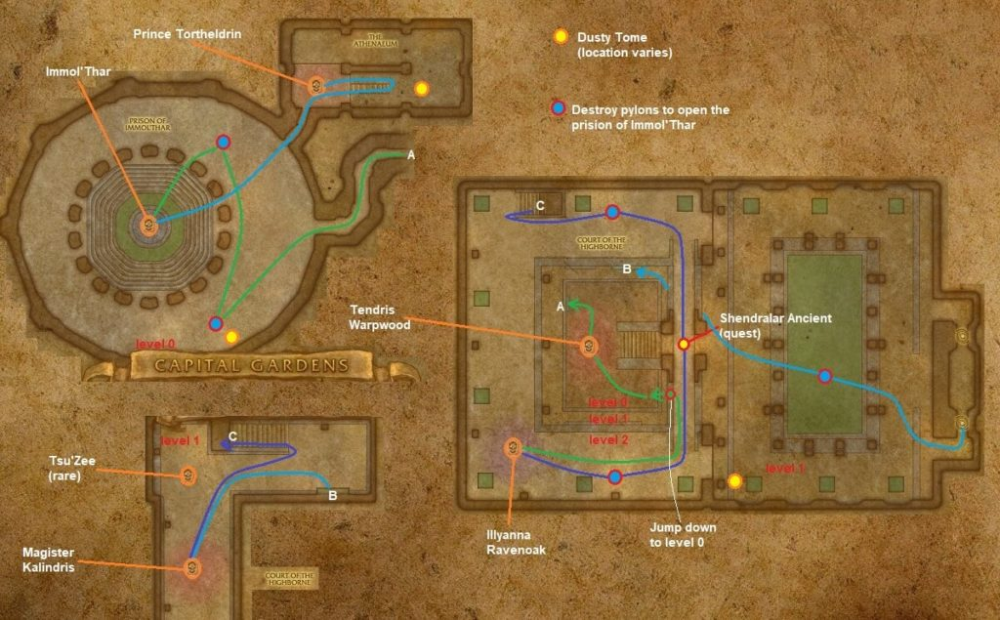

# Dire Maul West

[All Forever dungeon guides](README.md)

**Research snapshot: 31 October 2026.** Tactics and annotated layouts use Classic references. Forever loot reports and Classic drop tables are listed separately.

**Level:** Client Dire Maul level 54; Classic planning level 60. **Location:** Feralas. **Group:** 5. Client level is a listing value, not a promise that a group at that level can finish the dungeon. [Forever listing](https://playfulls.com/loot-tables/dungeons/dire-maul).

## Before entering

Classic reference: bring Crescent Key from Pusillin, or appropriate lockpicking. Clear nearby trees before Tendris because he can draw them into combat. Lord Hel'nurath belongs to the warlock epic-mount ritual; ordinary runs cannot assume access to him. [Classic preparation reference](https://www.wowhead.com/classic/guide/dire-maul-west-dungeon-strategy-wow-classic).

## Layout and route

Annotated Classic reference layout; Forever details may differ. [Full-size map](https://eintr.net/WoW/images/Dire-Maul-West-walkthrough-map-1024x635.jpg) / [Map source](https://eintr.net/WoW/World-of-Warcraft-Classic-Dungeon-Walkthrough.html).

Use the western courtyard entrance. Clear every guardian around all five pylons to lower Immol'thar's prison: one in the main courtyard, two upstairs, two near the prison. Defeat Immol'thar, then visit the library for Prince Tortheldrin. Kalendris, Illyanna and optional Tsu'zee lie on the route's branches. [Classic route reference](https://www.wowhead.com/classic/guide/dire-maul-west-dungeon-strategy-wow-classic).

- [Annotated Classic layout and route](https://eintr.net/WoW/images/Dire-Maul-West-walkthrough-map-1024x635.jpg) — Classic reference; Forever changes unverified. [Map source](https://eintr.net/WoW/World-of-Warcraft-Classic-Dungeon-Walkthrough.html).
- [Dire Maul](https://playfulls.com/dungeonmaps/dire-maul-1.webp) — Community-hosted dungeon map; boss pins may be approximate or incomplete. [Map source](https://playfulls.com/loot-tables/dungeons/dire-maul).

## Bosses and tactics

Use these as Classic-based tactical prompts, not verified Forever combat logs. “Client listed” means the current community client roster names the encounter; additional rares, companions and summons are included for planning. [Current roster](https://playfulls.com/loot-tables/dungeons/dire-maul), [tactical reference](https://www.wowhead.com/classic/guide/dire-maul-west-dungeon-strategy-wow-classic).

| Boss / encounter | Status | Action |
| --- | --- | --- |
| Tendris Warpwood | Client listed; main encounter | Clear trees first; escape roots and stomp. |
| Illyanna Ravenoak | Client listed; main encounter | Control Ferra; close distance after knockback. |
| Ferra | Classic reference; companion | Tank/control companion bear. |
| Magister Kalendris | Client listed; main encounter | Interrupt casts; control mind-controlled ally. |
| Tsu'zee | Client listed; rare | Optional rare; clear surrounding undead. |
| Immol'thar | Client listed; main encounter | Kill eyes; prepare tank mitigation during enrage. |
| Prince Tortheldrin | Client listed; main encounter | Tank by wall; melee retreat from Whirlwind. |
| Lord Hel'nurath | Client listed; quest | Complete ritual; handle dreadsteed/adds. |

## Forever loot currently documented

The following is the complete boss-associated list recovered from the linked Playfulls page for this wing, not a complete Forever drop table. These are community loot associations checked against client item data; a client item existing does not by itself prove its drop source. Drop percentages are intentionally omitted because the source marks them unconfirmed in Forever. [Live loot source](https://playfulls.com/loot-tables/dungeons/dire-maul).

| Boss | Linked items |
| --- | --- |
| Magister Kalendris | [Pattern: Big Bag of Enchantment](https://playfulls.com/item/22309-pattern-big-bag-of-enchantment) (Recipe) |

Bosses absent from this section have no recovered Forever loot association in this source. The table below supplies a separately labeled Classic reference. Dungeon-wide random drops, quest turn-in rewards and event chests are not silently counted as boss loot.

## Classic loot reference

**These drops are not confirmed for Forever.**

Direct links open Classic item records. Each boss name links to the database or guide supporting its Classic drop association. Named equipment and recipes are listed; ordinary grey/white items and broad random world-drop pools are omitted. A missing entry means the retrieved sources did not supply a dedicated table. Rare spawns and quest summons may require different access or may change in Forever.

| Boss / encounter | Linked items |
| --- | --- |
| [Tendris Warpwood](https://classicdb.ch/?npc=11489) | [Libram of Rapidity](https://classicdb.ch/?item=18332); [Libram of Focus](https://classicdb.ch/?item=18333); [Libram of Protection](https://classicdb.ch/?item=18334); [Petrified Bark Shield](https://classicdb.ch/?item=18352); [Stoneflower Staff](https://classicdb.ch/?item=18353); [Tanglemoss Leggings](https://classicdb.ch/?item=18390); [Warpwood Binding](https://classicdb.ch/?item=18393) **Quest / access / other:** [Garona: A Study on Stealth and Treachery](https://classicdb.ch/?item=18356); [Codex of Defense](https://classicdb.ch/?item=18357); [The Arcanist's Cookbook](https://classicdb.ch/?item=18358); [The Light and How to Swing It](https://classicdb.ch/?item=18359); [Harnessing Shadows](https://classicdb.ch/?item=18360); [The Greatest Race of Hunters](https://classicdb.ch/?item=18361); [Holy Bologna: What the Light Won't Tell You](https://classicdb.ch/?item=18362); [Frost Shock and You](https://classicdb.ch/?item=18363); [The Emerald Dream](https://classicdb.ch/?item=18364); [Foror's Compendium of Dragon Slaying](https://classicdb.ch/?item=18401) |
| [Illyanna Ravenoak](https://classicdb.ch/?npc=11488) | [Libram of Rapidity](https://classicdb.ch/?item=18332); [Libram of Focus](https://classicdb.ch/?item=18333); [Libram of Protection](https://classicdb.ch/?item=18334); [Well Balanced Axe](https://classicdb.ch/?item=18347); [Gauntlets of Accuracy](https://classicdb.ch/?item=18349); [Force Imbued Gauntlets](https://classicdb.ch/?item=18383); [Padre's Trousers](https://classicdb.ch/?item=18386) **Quest / access / other:** [Garona: A Study on Stealth and Treachery](https://classicdb.ch/?item=18356); [Codex of Defense](https://classicdb.ch/?item=18357); [The Arcanist's Cookbook](https://classicdb.ch/?item=18358); [The Light and How to Swing It](https://classicdb.ch/?item=18359); [Harnessing Shadows](https://classicdb.ch/?item=18360); [The Greatest Race of Hunters](https://classicdb.ch/?item=18361); [Holy Bologna: What the Light Won't Tell You](https://classicdb.ch/?item=18362); [Frost Shock and You](https://classicdb.ch/?item=18363); [The Emerald Dream](https://classicdb.ch/?item=18364); [Foror's Compendium of Dragon Slaying](https://classicdb.ch/?item=18401) |
| [Ferra](https://classicdb.ch/?npc=14308) | No dedicated equipment verified in retrieved table. |
| [Magister Kalendris](https://classicdb.ch/?npc=11487) | [Libram of Rapidity](https://classicdb.ch/?item=18332); [Libram of Focus](https://classicdb.ch/?item=18333); [Libram of Protection](https://classicdb.ch/?item=18334); [Amplifying Cloak](https://classicdb.ch/?item=18350); [Magically Sealed Bracers](https://classicdb.ch/?item=18351); [Mindtap Talisman](https://classicdb.ch/?item=18371); [Flamescarred Shoulders](https://classicdb.ch/?item=18374); [Elder Magus Pendant](https://classicdb.ch/?item=18397); [Pattern: Big Bag of Enchantment](https://classicdb.ch/?item=22309) **Quest / access / other:** [Garona: A Study on Stealth and Treachery](https://classicdb.ch/?item=18356); [Codex of Defense](https://classicdb.ch/?item=18357); [The Arcanist's Cookbook](https://classicdb.ch/?item=18358); [The Light and How to Swing It](https://classicdb.ch/?item=18359); [Harnessing Shadows](https://classicdb.ch/?item=18360); [The Greatest Race of Hunters](https://classicdb.ch/?item=18361); [Holy Bologna: What the Light Won't Tell You](https://classicdb.ch/?item=18362); [Frost Shock and You](https://classicdb.ch/?item=18363); [The Emerald Dream](https://classicdb.ch/?item=18364); [Foror's Compendium of Dragon Slaying](https://classicdb.ch/?item=18401) |
| [Tsu'zee](https://classicdb.ch/?npc=11467) | [Murmuring Ring](https://classicdb.ch/?item=18345); [Threadbare Trousers](https://classicdb.ch/?item=18346); [Brightspark Gloves](https://classicdb.ch/?item=18387) |
| [Immol'thar](https://classicdb.ch/?npc=11496) | [Libram of Rapidity](https://classicdb.ch/?item=18332); [Libram of Focus](https://classicdb.ch/?item=18333); [Libram of Protection](https://classicdb.ch/?item=18334); [Vigilance Charm](https://classicdb.ch/?item=18370); [Blade of the New Moon](https://classicdb.ch/?item=18372); [Quickdraw Gloves](https://classicdb.ch/?item=18377); [Odious Greaves](https://classicdb.ch/?item=18379); [Evil Eye Pendant](https://classicdb.ch/?item=18381); [Bile-etched Spaulders](https://classicdb.ch/?item=18384); [Robe of Everlasting Night](https://classicdb.ch/?item=18385); [Cloak of the Cosmos](https://classicdb.ch/?item=18389); [Eyestalk Cord](https://classicdb.ch/?item=18391); [Demon Howl Wristguards](https://classicdb.ch/?item=18394) **Quest / access / other:** [Garona: A Study on Stealth and Treachery](https://classicdb.ch/?item=18356); [Codex of Defense](https://classicdb.ch/?item=18357); [The Arcanist's Cookbook](https://classicdb.ch/?item=18358); [The Light and How to Swing It](https://classicdb.ch/?item=18359); [Harnessing Shadows](https://classicdb.ch/?item=18360); [The Greatest Race of Hunters](https://classicdb.ch/?item=18361); [Holy Bologna: What the Light Won't Tell You](https://classicdb.ch/?item=18362); [Frost Shock and You](https://classicdb.ch/?item=18363); [The Emerald Dream](https://classicdb.ch/?item=18364); [Foror's Compendium of Dragon Slaying](https://classicdb.ch/?item=18401) |
| [Prince Tortheldrin](https://classicdb.ch/?npc=11486) | [Libram of Rapidity](https://classicdb.ch/?item=18332); [Libram of Focus](https://classicdb.ch/?item=18333); [Libram of Protection](https://classicdb.ch/?item=18334); [Chestplate of Tranquility](https://classicdb.ch/?item=18373); [Bracers of the Eclipse](https://classicdb.ch/?item=18375); [Timeworn Mace](https://classicdb.ch/?item=18376); [Silvermoon Leggings](https://classicdb.ch/?item=18378); [Eldritch Reinforced Legplates](https://classicdb.ch/?item=18380); [Fluctuating Cloak](https://classicdb.ch/?item=18382); [Stoneshatter](https://classicdb.ch/?item=18388); [Distracting Dagger](https://classicdb.ch/?item=18392); [Emerald Flame Ring](https://classicdb.ch/?item=18395); [Mind Carver](https://classicdb.ch/?item=18396) |
| [Lord Hel'nurath](https://classicdb.ch/?npc=14506) | [Fel Hardened Bracers](https://classicdb.ch/?item=18754); [Xorothian Firestick](https://classicdb.ch/?item=18755); [Dreadguard's Protector](https://classicdb.ch/?item=18756); [Diabolic Mantle](https://classicdb.ch/?item=18757) |
