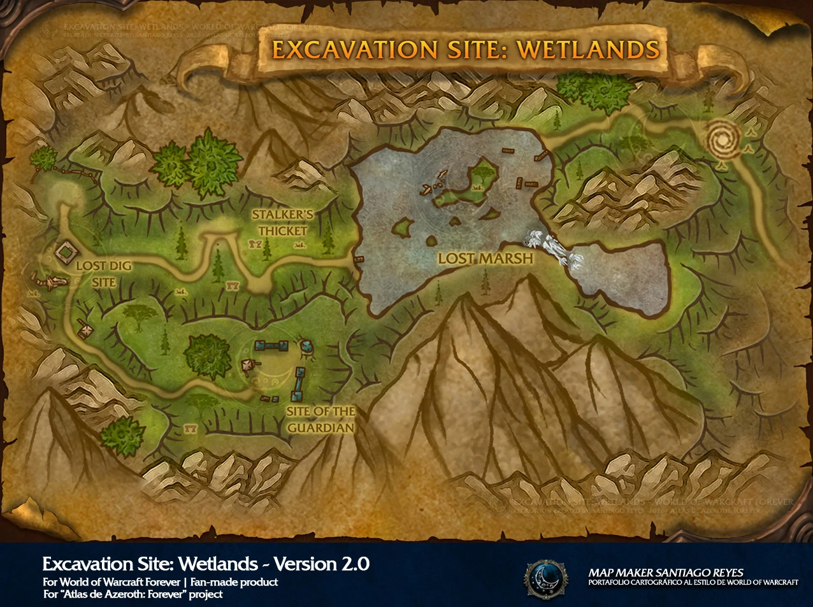

# Excavation Site: Wetlands

[All Forever dungeon guides](README.md)

**Checked 31 October 2026 · Five players · Official level band: 24–29.** These are reported Forever beta encounters and drops; the tables cover documented boss gear, recipes and named quest items, not guaranteed drop rates or every shared trash item.

[Official dungeon overview](https://news.blizzard.com/en-us/article/24301455/explore-the-new-dungeons-of-world-of-warcraft-forever).

## Entrance and preparation

Take the uphill path near Dun Algaz and south of Thelgen Rock. The latest official overview lists 24–29; earlier beta notes and guides use 26–31 or 26–33. A group in its late twenties is a practical choice, not a verified minimum entry rule.

Alliance: check Menethil Harbor, the Greenwarden and Dorin Songblade in Lakeshire. Horde: check Borstan in Orgrimmar and the Deathstalker Agent in Wetlands. Loot the final Titan Relic for its faction quest. Bring disease/poison removal and fear protection where your class allows it.

[Entrance / quest reference](https://www.method.gg/wow-forever/dungeons/excavation-site-wetlands); [Beta access details](https://www.icy-veins.com/wow-forever/excavation-site-wetlands-guide).

## Layout and route

Lost Marsh / Saltspine → Stalker’s Thicket / Shadetooth → optional Highland Horror quest encounter → Site of the Guardian / Relic Guardian. Make quest detours before finishing.

[Open full map](https://playfulls.com/dungeonmaps/excavation-site-wetlands-1.webp)

Map by Santiago Reyes, Atlas de Azeroth: Forever; hosted by Playfulls. [Map source and interactive boss overlay](https://playfulls.com/loot-tables/dungeons/excavation-site-wetlands). Playfulls has no verified Highland Horror marker; do not infer its precise location.

## Boss tactics

Keep to the path through tall grass: hidden raptors can join pulls. Focus dangerous raptors individually and cleanse Infected Wound.

| Boss | What to do |
| --- | --- |
| Saltspine | Clear nearby crocolisks. Dust Storm makes threat less reliable; ease damage if the tank loses control. |
| Shadetooth | Clear a safe area and control his two hunters. Fear can send players into hidden packs; prepare fear protection and defensive cooldowns for enrage. |
| Highland Horror | Alliance quest encounter: clear surrounding slimes before pulling. Expect roots and regeneration. Its documented unique reward is a quest item, not a gear table. |
| Relic Guardian | Activate the Archival Panel when ready. Face its frontal attack away; ranged stay clear of stomp. Watch threat after knockback; slows and stuns can help. |

[Encounter research](https://www.method.gg/wow-forever/dungeons/excavation-site-wetlands); [Mechanics cross-check](https://www.icy-veins.com/wow-forever/excavation-site-wetlands-guide).

## Documented boss drops

| Boss | Gear, recipes and quest drops |
| --- | --- |
| Saltspine | [Glinteye Slippers](https://www.wowhead.com/forever/item=273024) (Cloth Feet); [Saltscale Girdle](https://www.wowhead.com/forever/item=273023) (Mail Waist); [Supple Bellyskin Leggings](https://www.wowhead.com/forever/item=273022) (Leather Legs) |
| Shadetooth | [Raptorclaw Greaves](https://www.wowhead.com/forever/item=273025) (Mail Feet); [Raptor's Gaze](https://www.wowhead.com/forever/item=273027) (Off-hand); [Garb of Florid Feathers](https://www.wowhead.com/forever/item=273026) (Leather Chest); [Blueprint: Greenhouse](https://www.wowhead.com/forever/item=273106) (Herbalism recipe) |
| Highland Horror | [Horrible Rootcore](https://www.wowhead.com/forever/item=270180) (Quest item) |
| Relic Guardian | [Titan Relic](https://www.wowhead.com/forever/item=270865) (Quest item); [Ring of Power Regulation](https://www.wowhead.com/forever/item=273030) (Ring); [Golemsight Long Gun](https://www.wowhead.com/forever/item=273029) (Gun); [Reliquary Mantle](https://www.wowhead.com/forever/item=273028) (Mail Shoulder); [Blueprint: Rock Garden](https://www.wowhead.com/forever/item=273097) (Mining recipe); [Titan Relic (other faction version)](https://www.wowhead.com/forever/item=270866) (Quest starter) |

[Beta gear table](https://playfulls.com/loot-tables/dungeons/excavation-site-wetlands); [Recipe and encounter cross-check](https://www.icy-veins.com/wow-forever/excavation-site-wetlands-guide). Item links open the Forever edition of Wowhead.

Highland Horror has no documented unique equipment table here. Horrible Rootcore is its Alliance quest item. Greenhouse is a [reported Shadetooth blueprint drop](https://www.icy-veins.com/wow-forever/news/greenhouse-blueprint-found-how-herbalism-seeds-work-in-wow-forever/); Rock Garden and both Titan Relic variants appear in the [Relic Guardian database table](https://www.wowhead.com/forever/npc=260326/relic-guardian).
