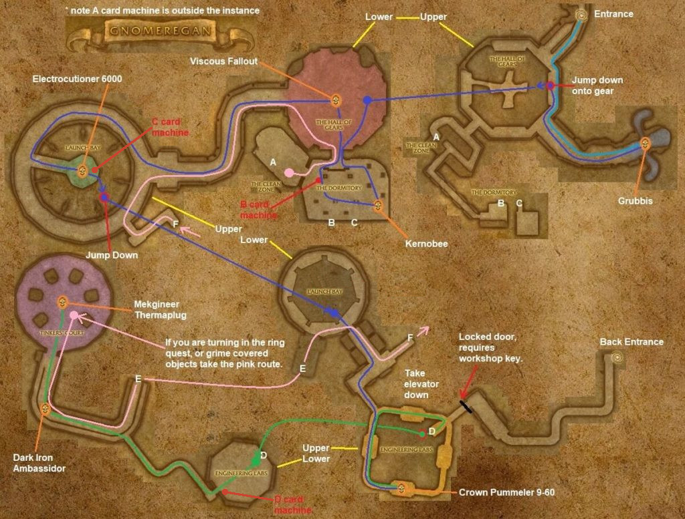

# Gnomeregan

[All Forever dungeon guides](README.md)

## Plan your run

**Planning range: 29–38 / Five players / Dun Morogh.** Researched 31 October 2026; beta details may change. Playfulls lists dungeon level 25+; that is a data label, not a verified portal-entry requirement. [Current dungeon data](https://playfulls.com/loot-tables/dungeons/gnomeregan).

Reach the northwest Dun Morogh entrance beyond Brewnall Village. Horde can unlock Scooty's Booty Bay transporter through Rig Wars, Chief Engineer Scooty and Gnomer-gooooone!

Use the main entrance for a complete clear. Begin Emi's cave event, then descend through the Hall of Gears, Launch Bay and Engineering Labs to Tinker's Court. [Entrance and route reference](https://www.icy-veins.com/wow-forever/gnomeregan-guide).

## Layout maps

Annotated Classic reference layout; Forever details may differ. [Full-size map](https://eintr.net/WoW/images/Gnomeregan-walkthrough-map-v2-1024x777.jpg) / [Map source](https://eintr.net/WoW/World-of-Warcraft-Classic-Dungeon-Walkthrough.html).

- [Map of Gnomeregan](https://playfulls.com/dungeonmaps/gnomeregan-1.webp)

Open the [interactive dungeon map](https://playfulls.com/loot-tables/dungeons/gnomeregan) for floor controls and available markers. Some boss positions are approximate or absent. [Annotated reference layout](https://foreveroth.com/en/donjons/?donjon=gnomeregan).

## Bosses and tactics

The following tactics are summarized from the Forever guide.

- **Grubbis (event):** Speak to Blastmaster Emi Shortfuse; control cave waves before the boss.
- **Viscous Fallout:** Clear a safe space before intercepting his patrol.
- **Electrocutioner 6000:** Spread; avoid the frontal Megavolt. Loot the Workshop Key.
- **Crowd Pummeler 9-60:** Avoid frontal smash; casters stay outside nearby interrupt effects.
- **Dark Iron Ambassador (rare):** Interrupt Fireball; kill Burning Servants and avoid fire damage into immunity.
- **Mekgineer Thermaplugg:** Assign dispenser buttons; ranged kill bombs. Rebuild threat after knockbacks.

[Tactics source](https://www.icy-veins.com/wow-forever/gnomeregan-guide).

## Boss loot and item links

Named equipment, boss-specific recipes, pets, bags and quest starters currently listed by the sources appear below. Drop percentages are omitted: the sites mix expectations, legacy values and beta observations. Boss associations are community reports; client item existence alone does not prove a live drop.

| Boss / encounter | Named drops |
| --- | --- |
| Grubbis | [Grubbis Paws](https://playfulls.com/item/9445-grubbis-paws); [Irradiated Shield](https://playfulls.com/item/274043-irradiated-shield); [Skullduggery Belt](https://playfulls.com/item/274042-skullduggery-belt) |
| Viscous Fallout | [Acidic Walkers](https://playfulls.com/item/9454-acidic-walkers); [Hydrocane](https://playfulls.com/item/9452-hydrocane); [Toxic Revenger](https://playfulls.com/item/9453-toxic-revenger) |
| Electrocutioner 6000 | [Electrocutioner Lagnut](https://playfulls.com/item/9447-electrocutioner-lagnut); [Electrocutioner Leg](https://playfulls.com/item/9446-electrocutioner-leg); [Spidertank Oilrag](https://playfulls.com/item/9448-spidertank-oilrag); [Workshop Key](https://playfulls.com/item/6893-workshop-key) |
| Crowd Pummeler 9-60 | [Gnomebot Operating Boots](https://playfulls.com/item/9450-gnomebot-operating-boots); [Manual Crowd Pummeler](https://playfulls.com/item/9449-manual-crowd-pummeler); [Thermaplugg Medal of Honor](https://playfulls.com/item/274068-thermaplugg-medal-of-honor); [Schematic: 9-60 Battery Pack](https://playfulls.com/item/274049-schematic-9-60-battery-pack) |
| Mekgineer Thermaplugg | [Charged Gear](https://playfulls.com/item/9461-charged-gear); [Electromagnetic Gigaflux Reactivator](https://playfulls.com/item/9492-electromagnetic-gigaflux-reactivator); [Thermaplugg's Central Core](https://playfulls.com/item/9458-thermapluggs-central-core); [Thermaplugg's Left Arm](https://playfulls.com/item/9459-thermapluggs-left-arm); [Schematic: Craftsman's Monocle](https://playfulls.com/item/4415-schematic-craftsmans-monocle); [Schematic: Discombobulator Ray](https://playfulls.com/item/4413-schematic-discombobulator-ray); [Schematic: Flame Deflector](https://playfulls.com/item/4411-schematic-flame-deflector); [Schematic: Pet Bombling](https://playfulls.com/item/11828-schematic-pet-bombling); [Schematic: Gnomish Cloaking Device](https://playfulls.com/item/7742-schematic-gnomish-cloaking-device) |
| Dark Iron Ambassador | [Emissary Cuffs](https://foreverdb.net/item/9455); [Glass Shooter](https://foreverdb.net/item/9456); [Royal Diplomatic Scepter](https://foreverdb.net/item/9457) |

[Loot source: Playfulls](https://playfulls.com/loot-tables/dungeons/gnomeregan). Supplemental rare, event or missing entries use [Icy Veins](https://www.icy-veins.com/wow-forever/gnomeregan-guide) and [WoW Source](https://wowsrc.com/loot/gnomeregan/), with individual ForeverDB item records. Shared recipe pools and generic trash/world drops remain in the [complete source table](https://playfulls.com/loot-tables/dungeons/gnomeregan); they are excluded from this boss table. See [Playfulls methodology](https://playfulls.com/methodology) for its client-versus-community distinction.

## Evidence and remaining gaps

The Workshop Key opens the alternative Workshop entrance. The boss journal has five principal encounters; the rare Ambassador and Grubbis's companion Chomper should not be mistaken for missing mandatory bosses.
