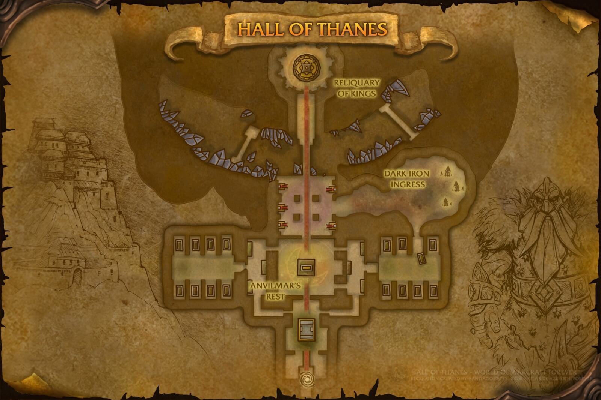

# Hall of Thanes

[All Forever dungeon guides](README.md)

**Checked 31 October 2026 · Five players · Official level band: 13–18.** These are reported Forever beta encounters and drops; the tables cover documented boss gear, recipes and named quest items, not guaranteed drop rates or every shared trash item.

[Official dungeon overview](https://news.blizzard.com/en-us/article/24301455/explore-the-new-dungeons-of-world-of-warcraft-forever).

## Entrance and preparation

From the High Seat, take the left-hand passage into Old Ironforge and descend to the portal. Alliance access is straightforward; Horde must enter hostile territory. This is a four-boss run.

Collect the entrance quests before descending. Alliance should complete the Dark Iron Map / Underground Map lead-in for Old Ironforge Incursion. Inside, find the Ghostly Attendant; after Durgen, inspect the vault tablet for The Treaty of Understanding. Quest faction labels differ between beta guides, so check availability on your character.

[Entrance / quest reference](https://www.warcraftforever.wiki/wiki/The_Hall_of_Thanes); [Beta access details](https://www.icy-veins.com/wow-forever/hall-of-thanes-guide).

## Layout and route

Entrance → Faldrim Anvilmar → Magmatus → Plunder → Durgen Dirgehammer. Clear wandering packs before starting each encounter; the final room needs space for fear.

[Open full map](https://www.method.gg/images/uploads/guides/2809032-1303242-1.jpg)

Map by Santiago Reyes, Atlas de Azeroth: Forever; hosted by Method. [Map source and interactive boss overlay](https://www.method.gg/wow-forever/dungeons/hall-of-thanes).

## Boss tactics

Interrupt Dark Iron Summoners and their summoned helpers. Move away from Engineer bomb targets. Avoid combining stone golems with another pack.

| Boss | What to do |
| --- | --- |
| Faldrim Anvilmar | Clear his patrol area. Interrupt Mind Blast and remove Anvilmar’s Curse when possible. |
| Magmatus | Kill the accompanying summoner first. Keep ranged players away from Fire Nova; avoid adding the nearby patrol. |
| Plunder | Tank against a wall in cleared ground so Knock Away cannot throw anyone into another pack. |
| Durgen Dirgehammer | Clear the room before the fear. Control the two golems, protect the tank through Rend, and use fear protection if available. |

[Encounter research](https://www.method.gg/wow-forever/dungeons/hall-of-thanes); [Mechanics cross-check](https://www.icy-veins.com/wow-forever/hall-of-thanes-guide).

## Documented boss drops

| Boss | Gear, recipes and quest drops |
| --- | --- |
| Faldrim Anvilmar | [Aetherwisp Bracers](https://www.wowhead.com/forever/item=271096) (Cloth bracers); [Spiritwraith Drape](https://www.wowhead.com/forever/item=271097) (Cloak); [Ephemeral Choker](https://www.wowhead.com/forever/item=270227) (Necklace) |
| Magmatus | [Kindlegem Girdle](https://www.wowhead.com/forever/item=270230) (Mail Waist); [Flamefist Grips](https://www.wowhead.com/forever/item=270231) (Leather Hands); [Fang of Magmatus](https://www.wowhead.com/forever/item=271095) (Main-hand dagger) |
| Plunder | [Golemheart Stave](https://www.wowhead.com/forever/item=270228) (Two-hand staff); [Golemguard Chest](https://www.wowhead.com/forever/item=271098) (Mail Chest); [Treads of the Protector Golem](https://www.wowhead.com/forever/item=270229) (Mail Feet) |
| Durgen Dirgehammer | [Durgen's Crescent Axe](https://www.wowhead.com/forever/item=270256) (Main-hand axe); [Direhammer Leggings](https://www.wowhead.com/forever/item=270260) (Leather Legs); [Robes of the Disgraced Thane](https://www.wowhead.com/forever/item=270261) (Cloth Chest); [Durgen Dirgehammer's Head](https://www.wowhead.com/forever/item=274286) (Quest item) |

[Beta gear table](https://playfulls.com/loot-tables/dungeons/hall-of-thanes); [Recipe and encounter cross-check](https://www.icy-veins.com/wow-forever/hall-of-thanes-guide). Item links open the Forever edition of Wowhead.
