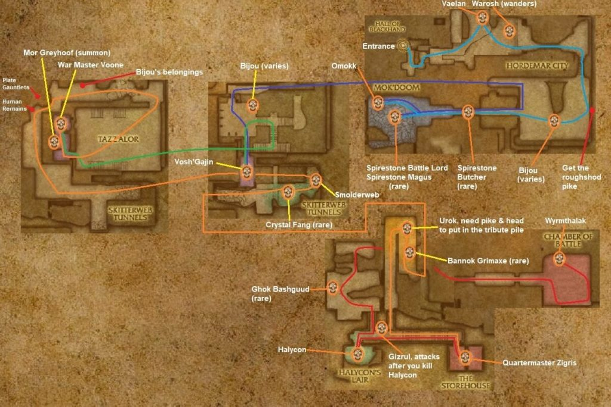

# Lower Blackrock Spire

[All Forever dungeon guides](README.md)

**Research snapshot: 31 October 2026.** Tactics and annotated layouts use Classic references. Forever loot reports and Classic drop tables are listed separately.

**Level:** Client level 53; Classic planning 57–60. **Location:** Blackrock Mountain / Burning Steppes. **Group:** 5. Client level is a listing value, not a promise that a group at that level can finish the dungeon. [Forever listing](https://playfulls.com/loot-tables/dungeons/blackrock-spire).

## Before entering

Classic reference: no Seal of Ascension is needed for Lower. For Upper access collect the Unadorned Seal and gemstones from Omokk, Voone and Wyrmthalak for Vaelan's chain. Urok requires Omokk's Head plus the Roughshod Pike; clear his platform before activating the skull pile. [Classic preparation reference](https://www.wowhead.com/classic/guide/lower-blackrock-spire-lbrs-dungeon-strategy-wow-classic).

## Layout and route

Annotated Classic reference layout; Forever details may differ. [Full-size map](https://eintr.net/WoW/images/Blackrock-Spire-Lower-walkthrough-map-1-1024x684.jpg) / [Map source](https://eintr.net/WoW/World-of-Warcraft-Classic-Dungeon-Walkthrough.html).

Use Blackrock Spire's entrance high inside Blackrock Mountain; follow the lower route. Clear Omokk, troll chambers for Vosh'gajin/Voone, spider tunnels, Urok's platform if summoning, Zigris, the wolf den and Wyrmthalak. Keep pets controlled around ledges and pull patrols into cleared ground. [Classic route reference](https://www.wowhead.com/classic/guide/lower-blackrock-spire-lbrs-dungeon-strategy-wow-classic).

- [Annotated Classic layout and route](https://eintr.net/WoW/images/Blackrock-Spire-Lower-walkthrough-map-1-1024x684.jpg) — Classic reference; Forever changes unverified. [Map source](https://eintr.net/WoW/World-of-Warcraft-Classic-Dungeon-Walkthrough.html).
- [Blackrock Spire](https://playfulls.com/dungeonmaps/blackrock-spire-1.webp) — Community-hosted dungeon map; boss pins may be approximate or incomplete. [Map source](https://playfulls.com/loot-tables/dungeons/blackrock-spire).

## Bosses and tactics

Use these as Classic-based tactical prompts, not verified Forever combat logs. “Client listed” means the current community client roster names the encounter; additional rares, companions and summons are included for planning. [Current roster](https://playfulls.com/loot-tables/dungeons/blackrock-spire), [tactical reference](https://www.wowhead.com/classic/guide/lower-blackrock-spire-lbrs-dungeon-strategy-wow-classic).

| Boss / encounter | Status | Action |
| --- | --- | --- |
| Highlord Omokk | Client listed; main encounter | Back to wall; heal through frenzy. |
| Shadow Hunter Vosh'gajin | Client listed; main encounter | Ranged stay outside Hex range. |
| War Master Voone | Client listed; main encounter | Face away; prepare for Mortal Strike. |
| Mother Smolderweb | Client listed; main encounter | Cure poison; spread; collect death-spawned spiders. |
| Urok Doomhowl | Client listed; summoned | Prepare for waves; reuse head on ogres. |
| Quartermaster Zigris | Client listed; main encounter | Close distance; interrupt healing. |
| Halycon | Client listed; main encounter | Clear wolves; conserve resources for Gizrul. |
| Gizrul the Slavener | Client listed; main encounter | Incoming after Halycon; keep tank ready. |
| Overlord Wyrmthalak | Client listed; main encounter | Clear room; collect adds at low health. |
| Spirestone Butcher | Classic reference; rare | Isolate rare; face cleave away. |
| Spirestone Battle Lord | Classic reference; rare | Isolate rare; prepare tank mitigation. |
| Spirestone Lord Magus | Classic reference; rare | Interrupt casts; remove magic effects. |
| Bannok Grimaxe | Classic reference; rare | Clear nearby patrols; interrupt casts. |
| Ghok Bashguud | Classic reference; rare | Face away; heal tank burst. |
| Crystal Fang | Classic reference; rare | Remove poison; keep healer clear. |
| Mor Grayhoof | Classic reference; quest | Classic dungeon-set summoned encounter. |

## Forever loot currently documented

The following is the complete boss-associated list recovered from the linked Playfulls page for this wing, not a complete Forever drop table. These are community loot associations checked against client item data; a client item existing does not by itself prove its drop source. Drop percentages are intentionally omitted because the source marks them unconfirmed in Forever. [Live loot source](https://playfulls.com/loot-tables/dungeons/blackrock-spire).

| Boss | Linked items |
| --- | --- |
| Highlord Omokk | [Boots of Elements](https://playfulls.com/item/16670-boots-of-elements); [Gemstone of Spirestone](https://playfulls.com/item/12336-gemstone-of-spirestone) (Quest / conditional); [Omokk's Head](https://playfulls.com/item/12534-omokks-head) (Quest / conditional) |
| Shadow Hunter Vosh'gajin | [Shadowcraft Gloves](https://playfulls.com/item/16712-shadowcraft-gloves) |
| War Master Voone | [Beaststalker's Gloves](https://playfulls.com/item/16676-beaststalkers-gloves); [Gemstone of Smolderthorn](https://playfulls.com/item/12335-gemstone-of-smolderthorn) (Quest / conditional) |
| Mother Smolderweb | [Wildheart Boots](https://playfulls.com/item/16715-wildheart-boots) |
| Urok Doomhowl | [Top Half of Advanced Armorsmithing: Volume III](https://playfulls.com/item/18784-top-half-of-advanced-armorsmithing-volume-iii) |
| Quartermaster Zigris | [Plans: Annihilator](https://playfulls.com/item/12835-plans-annihilator) (Recipe); [Quartermaster Zigris' Footlocker](https://playfulls.com/item/13247-quartermaster-zigris-footlocker) (Container) |
| Gizrul the Slavener | [Wildheart Spaulders](https://playfulls.com/item/16718-wildheart-spaulders) |
| Overlord Wyrmthalak | [Beaststalker's Mantle](https://playfulls.com/item/16679-beaststalkers-mantle); [Heart of the Scale](https://playfulls.com/item/13164-heart-of-the-scale) (Quest / conditional); [Gemstone of Bloodaxe](https://playfulls.com/item/12337-gemstone-of-bloodaxe) (Quest / conditional); [General Drakkisath's Command](https://playfulls.com/item/12780-general-drakkisaths-command) |

Bosses absent from this section have no recovered Forever loot association in this source. The table below supplies a separately labeled Classic reference. Dungeon-wide random drops, quest turn-in rewards and event chests are not silently counted as boss loot.

## Classic loot reference

**These drops are not confirmed for Forever.**

Direct links open Classic item records. Each boss name links to the database or guide supporting its Classic drop association. Named equipment and recipes are listed; ordinary grey/white items and broad random world-drop pools are omitted. A missing entry means the retrieved sources did not supply a dedicated table. Rare spawns and quest summons may require different access or may change in Forever.

| Boss / encounter | Linked items |
| --- | --- |
| [Highlord Omokk](https://classicdb.ch/?npc=9196) | [Slamshot Shoulders](https://classicdb.ch/?item=13166); [Fist of Omokk](https://classicdb.ch/?item=13167); [Plate of the Shaman King](https://classicdb.ch/?item=13168); [Tressermane Leggings](https://classicdb.ch/?item=13169); [Skyshroud Leggings](https://classicdb.ch/?item=13170); [Boots of Elements](https://classicdb.ch/?item=16670) **Quest / access / other:** [Unadorned Seal of Ascension](https://classicdb.ch/?item=12219); [Gemstone of Spirestone](https://classicdb.ch/?item=12336); [Omokk's Head](https://classicdb.ch/?item=12534); [Ogre Warbeads](https://classicdb.ch/?item=21982) |
| [Shadow Hunter Vosh'gajin](https://classicdb.ch/?npc=9236) | [Funeral Cuffs](https://classicdb.ch/?item=12626); [Blackcrow](https://classicdb.ch/?item=12651); [Riphook](https://classicdb.ch/?item=12653); [Trueaim Gauntlets](https://classicdb.ch/?item=13255); [Demonic Runed Spaulders](https://classicdb.ch/?item=13257); [Shadowcraft Gloves](https://classicdb.ch/?item=16712) **Quest / access / other:** [Unadorned Seal of Ascension](https://classicdb.ch/?item=12219); [Doomshot](https://classicdb.ch/?item=12654); [Vosh'gajin's Snakestone](https://classicdb.ch/?item=13352) |
| [War Master Voone](https://classicdb.ch/?npc=9237) | [Keris of Zul'Serak](https://classicdb.ch/?item=12582); [Talisman of Evasion](https://classicdb.ch/?item=13177); [Brazecore Armguards](https://classicdb.ch/?item=13179); [Beaststalker's Gloves](https://classicdb.ch/?item=16676); [Kayser's Boots of Precision](https://classicdb.ch/?item=22231) **Quest / access / other:** [Unadorned Seal of Ascension](https://classicdb.ch/?item=12219); [Gemstone of Smolderthorn](https://classicdb.ch/?item=12335) |
| [Mother Smolderweb](https://classicdb.ch/?npc=10596) | [Venomspitter](https://classicdb.ch/?item=13183); [Smolderweb's Eye](https://classicdb.ch/?item=13213); [Gilded Gauntlets](https://classicdb.ch/?item=13244); [Wildheart Boots](https://classicdb.ch/?item=16715) |
| [Urok Doomhowl](https://classicdb.ch/?npc=10584) | [Rosewine Circle](https://classicdb.ch/?item=13178); [Slaghide Gauntlets](https://classicdb.ch/?item=13258); [Ribsteel Footguards](https://classicdb.ch/?item=13259); [Marksman's Girdle](https://classicdb.ch/?item=22232) **Quest / access / other:** [Unadorned Seal of Ascension](https://classicdb.ch/?item=12219); [Top Half of Advanced Armorsmithing: Volume III](https://classicdb.ch/?item=18784); [Ogre Warbeads](https://classicdb.ch/?item=21982) |
| [Quartermaster Zigris](https://classicdb.ch/?npc=9736) | [Plans: Annihilator](https://classicdb.ch/?item=12835); [Cloudrunner Girdle](https://classicdb.ch/?item=13252); [Hands of Power](https://classicdb.ch/?item=13253) **Quest / access / other:** [Unadorned Seal of Ascension](https://classicdb.ch/?item=12219); [Blackrock Bracer](https://classicdb.ch/?item=22138) |
| [Halycon](https://classicdb.ch/?npc=10220) | [Pads of the Dread Wolf](https://classicdb.ch/?item=13210); [Slashclaw Bracers](https://classicdb.ch/?item=13211); [Halycon's Spiked Collar](https://classicdb.ch/?item=13212); [Ironweave Bracers](https://classicdb.ch/?item=22313) |
| [Gizrul the Slavener](https://classicdb.ch/?npc=10268) | [Rhombeard Protector](https://classicdb.ch/?item=13205); [Wolfshear Leggings](https://classicdb.ch/?item=13206); [Bleak Howler Armguards](https://classicdb.ch/?item=13208); [Wildheart Spaulders](https://classicdb.ch/?item=16718) |
| [Overlord Wyrmthalak](https://classicdb.ch/?npc=9568) | [Mark of the Dragon Lord](https://classicdb.ch/?item=13143); [Trindlehaven Staff](https://classicdb.ch/?item=13161); [Reiver Claws](https://classicdb.ch/?item=13162); [Relentless Scythe](https://classicdb.ch/?item=13163); [Beaststalker's Mantle](https://classicdb.ch/?item=16679); [Heart of Wyrmthalak](https://classicdb.ch/?item=22321) **Quest / access / other:** [Unadorned Seal of Ascension](https://classicdb.ch/?item=12219); [Gemstone of Bloodaxe](https://classicdb.ch/?item=12337); [General Drakkisath's Command](https://classicdb.ch/?item=12780); [Black Dragonspawn Eye](https://classicdb.ch/?item=16786) |
| [Spirestone Butcher](https://classicdb.ch/?npc=9219) | [Butcher's Apron](https://classicdb.ch/?item=12608); [Rivenspike](https://classicdb.ch/?item=13286) **Quest / access / other:** [Unadorned Seal of Ascension](https://classicdb.ch/?item=12219); [Ogre Warbeads](https://classicdb.ch/?item=21982) |
| [Spirestone Battle Lord](https://classicdb.ch/?npc=9218) | [Swiftdart Battleboots](https://classicdb.ch/?item=13284); [The Nicker](https://classicdb.ch/?item=13285) **Quest / access / other:** [Unadorned Seal of Ascension](https://classicdb.ch/?item=12219); [Ogre Warbeads](https://classicdb.ch/?item=21982) |
| [Spirestone Lord Magus](https://classicdb.ch/?npc=9217) | [Globe of D'sak](https://classicdb.ch/?item=13261); [Ogreseer Tower Boots](https://classicdb.ch/?item=13282); [Magus Ring](https://classicdb.ch/?item=13283) **Quest / access / other:** [Unadorned Seal of Ascension](https://classicdb.ch/?item=12219); [Ogre Warbeads](https://classicdb.ch/?item=21982) |
| [Bannok Grimaxe](https://classicdb.ch/?npc=9596) | [Demonfork](https://classicdb.ch/?item=12621); [Chiselbrand Girdle](https://classicdb.ch/?item=12634); [Backusarian Gauntlets](https://classicdb.ch/?item=12637); [Plans: Arcanite Reaper](https://classicdb.ch/?item=12838) **Quest / access / other:** [Unadorned Seal of Ascension](https://classicdb.ch/?item=12219); [Blackrock Bracer](https://classicdb.ch/?item=22138) |
| [Ghok Bashguud](https://classicdb.ch/?npc=9718) | [Hurd Smasher](https://classicdb.ch/?item=13198); [Armswake Cloak](https://classicdb.ch/?item=13203); [Bashguuder](https://classicdb.ch/?item=13204) **Quest / access / other:** [Unadorned Seal of Ascension](https://classicdb.ch/?item=12219); [Blackrock Bracer](https://classicdb.ch/?item=22138) |
| [Crystal Fang](https://classicdb.ch/?npc=10376) | [Fallbrush Handgrips](https://classicdb.ch/?item=13184); [Sunderseer Mantle](https://classicdb.ch/?item=13185); [Fang of the Crystal Spider](https://classicdb.ch/?item=13218) |
| [Mor Grayhoof](https://classicdb.ch/?npc=16080) | [Ironweave Belt](https://classicdb.ch/?item=22306); [Tome of Divine Right](https://classicdb.ch/?item=22319); [The Jaw Breaker](https://classicdb.ch/?item=22322); [Belt of the Trickster](https://classicdb.ch/?item=22325); [Idol of Rejuvenation](https://classicdb.ch/?item=22398) **Quest / access / other:** [Left Piece of Lord Valthalak's Amulet](https://classicdb.ch/?item=21984); [Right Piece of Lord Valthalak's Amulet](https://classicdb.ch/?item=22046) |
