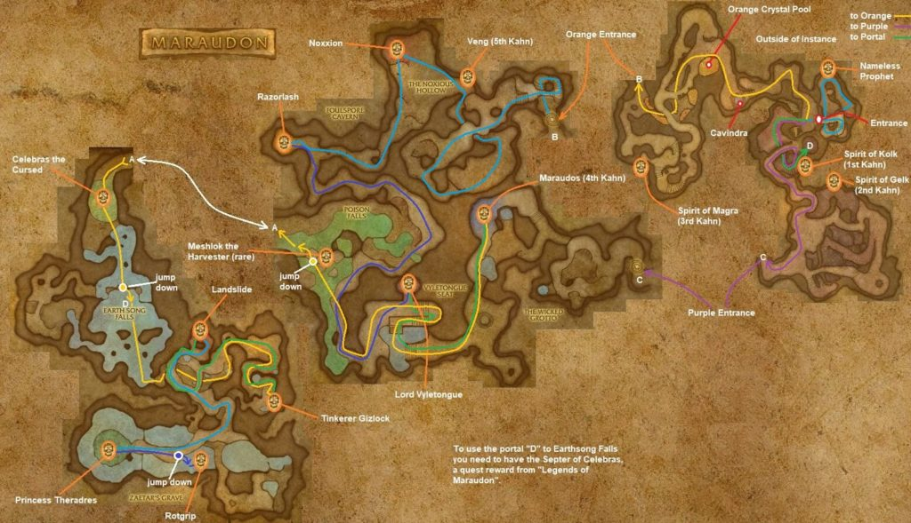

# Maraudon

[All Forever dungeon guides](README.md)

**Research snapshot: 31 October 2026.** Tactics and annotated layouts use Classic references. Forever loot reports and Classic drop tables are listed separately.

**Level:** Client level 42; reported entry minimum 25; Classic full-clear planning 45–52. **Location:** Desolace. **Group:** 5. Client level is a listing value, not a promise that a group at that level can finish the dungeon. [Forever listing](https://playfulls.com/loot-tables/dungeons/maraudon).
[Entry-level source](https://wowfdb.com/zones/maraudon/).

## Before entering

Classic reference: Legends of Maraudon requires Noxxion's Celebrian Rod and Vyletongue's Celebrian Diamond; Celebras then enables the Scepter of Celebras portal shortcut. Bring poison removal and fear protection. Collect Corruption of Earth and Seed before going; Thrash Blade is a quest reward, not a boss drop. [Classic preparation reference](https://www.wowhead.com/classic/guide/maraudon-dungeon-strategy-wow-classic).

## Layout and route

Annotated Classic reference layout; Forever details may differ. [Full-size map](https://eintr.net/WoW/images/Maraudon-walkthrough-map-1024x589.jpg) / [Map source](https://eintr.net/WoW/World-of-Warcraft-Classic-Dungeon-Walkthrough.html).

Use the Valley of Spears entrance. Orange leads through Noxxion and Razorlash; purple leads to Vyletongue. Both join near Celebras. Continue into Earth Song Falls for Landslide, Gizlock's side path, Theradras and Rotgrip. A full clear includes both colored branches; a Princess run skips much of the outer dungeon. [Classic route reference](https://www.wowhead.com/classic/guide/maraudon-dungeon-strategy-wow-classic).

- [Annotated Classic layout and route](https://eintr.net/WoW/images/Maraudon-walkthrough-map-1024x589.jpg) — Classic reference; Forever changes unverified. [Map source](https://eintr.net/WoW/World-of-Warcraft-Classic-Dungeon-Walkthrough.html).
- [Maraudon](https://playfulls.com/dungeonmaps/maraudon-1.webp) — Community-hosted dungeon map; boss pins may be approximate or incomplete. [Map source](https://playfulls.com/loot-tables/dungeons/maraudon).

## Bosses and tactics

Use these as Classic-based tactical prompts, not verified Forever combat logs. “Client listed” means the current community client roster names the encounter; additional rares, companions and summons are included for planning. [Current roster](https://playfulls.com/loot-tables/dungeons/maraudon), [tactical reference](https://www.wowhead.com/classic/guide/maraudon-dungeon-strategy-wow-classic).

| Boss / encounter | Status | Action |
| --- | --- | --- |
| Noxxion | Client listed; main encounter | Remove poison; kill spawns during his split. |
| Razorlash | Client listed; main encounter | Face cleave away; heal the bleed. |
| Lord Vyletongue | Client listed; main encounter | Clear doorway guards; follow his blink. |
| Meshlok the Harvester | Classic reference; rare | Optional rare; avoid additional plant pulls. |
| Celebras the Cursed | Client listed; main encounter | Interrupt Wrath and Roots; control summoned trees. |
| Landslide | Client listed; main encounter | Keep adds off healer; focus boss. |
| Tinkerer Gizlock | Client listed; main encounter | Avoid bombs and Dragon Gun's cone. |
| Princess Theradras | Client listed; main encounter | Back toward terrain; ranged avoid Dust Field. |
| Rotgrip | Client listed; main encounter | Bring to shallow water; heal heavy bleeds. |

Quest-route extras: the Nameless Prophet and the five centaur khans (Kolk, Gelk, Magra, Maraudos and Veng) belong to The Pariah's Instructions. They are not additional standard equipment bosses.

## Forever loot currently documented

The following is the complete boss-associated list recovered from the linked Playfulls page for this wing, not a complete Forever drop table. These are community loot associations checked against client item data; a client item existing does not by itself prove its drop source. Drop percentages are intentionally omitted because the source marks them unconfirmed in Forever. [Live loot source](https://playfulls.com/loot-tables/dungeons/maraudon).

No boss equipment drops are documented in the retrieved Forever table. This is an evidence gap, not a claim that bosses drop nothing.

A second community source lists Noxxion → [Celebrian Rod](https://classicdb.ch/?item=17702), Vyletongue → [Celebrian Diamond](https://classicdb.ch/?item=17703), and dungeon enemies → [Theradric Crystal Carving](https://classicdb.ch/?item=17684). These are quest items, not equipment; item links are Classic references. [Forever loot evidence](https://wowfdb.com/zones/maraudon/loot/).

Bosses absent from this section have no recovered Forever loot association in this source. The table below supplies a separately labeled Classic reference. Dungeon-wide random drops, quest turn-in rewards and event chests are not silently counted as boss loot.

## Classic loot reference

**These drops are not confirmed for Forever.**

Direct links open Classic item records. Each boss name links to the database or guide supporting its Classic drop association. Named equipment and recipes are listed; ordinary grey/white items and broad random world-drop pools are omitted. A missing entry means the retrieved sources did not supply a dedicated table. Rare spawns and quest summons may require different access or may change in Forever.

| Boss / encounter | Linked items |
| --- | --- |
| [Noxxion](https://classicdb.ch/?npc=13282) | [Heart of Noxxion](https://classicdb.ch/?item=17744); [Noxious Shooter](https://classicdb.ch/?item=17745); [Noxxion's Shackles](https://classicdb.ch/?item=17746) **Quest / access / other:** [Celebrian Rod](https://classicdb.ch/?item=17702) |
| [Razorlash](https://classicdb.ch/?npc=12258) | [Vinerot Sandals](https://classicdb.ch/?item=17748); [Phytoskin Spaulders](https://classicdb.ch/?item=17749); [Chloromesh Girdle](https://classicdb.ch/?item=17750); [Brusslehide Leggings](https://classicdb.ch/?item=17751) **Quest / access / other:** [Well Stone](https://classicdb.ch/?item=4808) |
| [Lord Vyletongue](https://classicdb.ch/?npc=12236) | [Satyr's Lash](https://classicdb.ch/?item=17752); [Infernal Trickster Leggings](https://classicdb.ch/?item=17754); [Satyrmane Sash](https://classicdb.ch/?item=17755) **Quest / access / other:** [Celebrian Diamond](https://classicdb.ch/?item=17703) |
| [Meshlok the Harvester](https://classicdb.ch/?npc=12237) | [Nature's Embrace](https://classicdb.ch/?item=17741); [Fungus Shroud Armor](https://classicdb.ch/?item=17742); [Bloomsprout Headpiece](https://classicdb.ch/?item=17767) |
| [Celebras the Cursed](https://classicdb.ch/?npc=12225) | [Claw of Celebras](https://classicdb.ch/?item=17738); [Grovekeeper's Drape](https://classicdb.ch/?item=17739); [Soothsayer's Headdress](https://classicdb.ch/?item=17740) |
| [Landslide](https://classicdb.ch/?npc=12203) | [Helm of the Mountain](https://classicdb.ch/?item=17734); [Rockgrip Gauntlets](https://classicdb.ch/?item=17736); [Cloud Stone](https://classicdb.ch/?item=17737); [Fist of Stone](https://classicdb.ch/?item=17943) |
| [Tinkerer Gizlock](https://classicdb.ch/?npc=13601) | [Megashot Rifle](https://classicdb.ch/?item=17717); [Gizlock's Hypertech Buckler](https://classicdb.ch/?item=17718); [Inventor's Focal Sword](https://classicdb.ch/?item=17719) |
| [Princess Theradras](https://classicdb.ch/?npc=12201) | [Gemshard Heart](https://classicdb.ch/?item=17707); [Charstone Dirk](https://classicdb.ch/?item=17710); [Elemental Rockridge Leggings](https://classicdb.ch/?item=17711); [Blackstone Ring](https://classicdb.ch/?item=17713); [Bracers of the Stone Princess](https://classicdb.ch/?item=17714); [Eye of Theradras](https://classicdb.ch/?item=17715); [Princess Theradras' Scepter](https://classicdb.ch/?item=17766); [Blade of Eternal Darkness](https://classicdb.ch/?item=17780) |
| [Rotgrip](https://classicdb.ch/?npc=13596) | [Albino Crocscale Boots](https://classicdb.ch/?item=17728); [Gatorbite Axe](https://classicdb.ch/?item=17730); [Rotgrip Mantle](https://classicdb.ch/?item=17732) |
