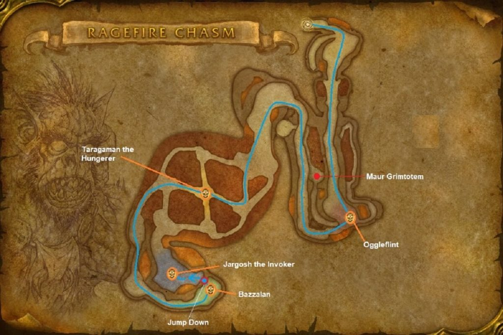

# Ragefire Chasm

[All Forever dungeon guides](README.md)

## Plan your run

**Planning range: 13–18 / Five players / Orgrimmar.** Researched 31 October 2026; beta details may change. Playfulls lists dungeon level 13+; that is a data label, not a verified portal-entry requirement. [Current dungeon data](https://playfulls.com/loot-tables/dungeons/ragefire-chasm).

Enter the lowest level of the Cleft of Shadow. Horde access is straightforward; Alliance must cross a hostile capital.

Clear trogg approaches, defeat Oggleflint, cross to Taragaman, then climb through the cultist area to Jergosh and Bazzalan. Assign crowd control before cultist pulls. [Entrance and route reference](https://www.icy-veins.com/wow-forever/ragefire-chasm-guide).

## Layout maps

Annotated Classic reference layout; Forever details may differ. [Full-size map](https://eintr.net/WoW/images/Ragefire-Chasm-walkthrough-map-1024x683.jpg) / [Map source](https://eintr.net/WoW/World-of-Warcraft-Classic-Dungeon-Walkthrough.html).

- [Map of Ragefire Chasm](https://playfulls.com/dungeonmaps/ragefire-chasm-1.webp)

Open the [interactive dungeon map](https://playfulls.com/loot-tables/dungeons/ragefire-chasm) for floor controls and available markers. Some boss positions are approximate or absent. [Annotated reference layout](https://foreveroth.com/en/donjons/?donjon=ragefire-chasm).

## Bosses and tactics

The following tactics are summarized from the Forever guide.

- **Oggleflint:** Face his cleave away; avoid pulling neighboring troggs.
- **Taragaman the Hungerer:** Tank away from lava edges; ranged avoid Fire Nova.
- **Jergosh the Invoker:** Control his two companions; remove Immolate and Curse of Weakness.
- **Bazzalan:** Control both adds, focus the boss, and remove poison.

[Tactics source](https://www.icy-veins.com/wow-forever/ragefire-chasm-guide).

## Boss loot and item links

Named equipment, boss-specific recipes, pets, bags and quest starters currently listed by the sources appear below. Drop percentages are omitted: the sites mix expectations, legacy values and beta observations. Boss associations are community reports; client item existence alone does not prove a live drop.

| Boss / encounter | Named drops |
| --- | --- |
| Oggleflint | [Barbaric Crossbow](https://playfulls.com/item/272999-barbaric-crossbow); [Bone Knuckles](https://playfulls.com/item/272998-bone-knuckles); [Trogg Scepter](https://playfulls.com/item/272996-trogg-scepter); [Pattern: Stormrider's Leather Gloves](https://playfulls.com/item/252781-pattern-stormriders-leather-gloves) |
| Taragaman the Hungerer | [Crystalline Cuffs](https://playfulls.com/item/14148-crystalline-cuffs); [Cursed Felblade](https://playfulls.com/item/14145-cursed-felblade); [Subterranean Cape](https://playfulls.com/item/14149-subterranean-cape); [Plans: Acolyte's Gloves](https://playfulls.com/item/251363-plans-acolytes-gloves); [Plans: Guard's Gloves](https://playfulls.com/item/251361-plans-guards-gloves) |
| Jergosh the Invoker | [Cavedweller Bracers](https://playfulls.com/item/14147-cavedweller-bracers); [Chanting Blade](https://playfulls.com/item/14151-chanting-blade); [Robe of Evocation](https://playfulls.com/item/14150-robe-of-evocation) |
| Bazzalan | [Chasm Walkers](https://playfulls.com/item/273007-chasm-walkers); [Satyrskin Cloak](https://playfulls.com/item/273005-satyrskin-cloak); [Searing Dagger](https://playfulls.com/item/273003-searing-dagger); [Pattern: Filigreed Pearly Gown](https://playfulls.com/item/253910-pattern-filigreed-pearly-gown); [Pattern: Filigreed Shadow Gown](https://playfulls.com/item/253908-pattern-filigreed-shadow-gown) |

[Loot source: Playfulls](https://playfulls.com/loot-tables/dungeons/ragefire-chasm). Shared recipe pools and generic trash/world drops remain in the [complete source table](https://playfulls.com/loot-tables/dungeons/ragefire-chasm); they are excluded from this boss table. See [Playfulls methodology](https://playfulls.com/methodology) for its client-versus-community distinction.
