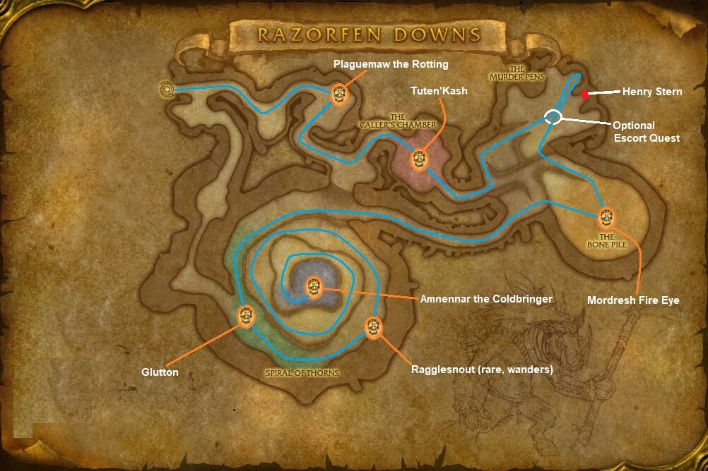

# Razorfen Downs

[All Forever dungeon guides](README.md)

## Plan your run

**Planning range: 37–46 / Five players / The Barrens.** Researched 31 October 2026; beta details may change. Playfulls lists dungeon level 34+; that is a data label, not a verified portal-entry requirement. [Current dungeon data](https://playfulls.com/loot-tables/dungeons/razorfen-downs).

Use the eastern thorn-covered dungeon near the Great Lift in southern Barrens. Bring interrupts, poison/curse removal and control.

Ring the gong and clear its waves for Tuten'kash. Continue through Mordresh and Glutton toward the spiral summit. Belnistrasz's optional escort backtracks for Plaguemaw. [Entrance and route reference](https://www.icy-veins.com/wow-classic/razorfen-downs-dungeon-guide).

## Layout maps

Annotated Classic reference layout; Forever details may differ. [Full-size map](https://eintr.net/WoW/images/Razorfen-Downs-walkthrough-map.jpg) / [Map source](https://eintr.net/WoW/World-of-Warcraft-Classic-Dungeon-Walkthrough.html).

- [Map of Razorfen Downs](https://playfulls.com/dungeonmaps/razorfen-downs-1.webp)

Open the [interactive dungeon map](https://playfulls.com/loot-tables/dungeons/razorfen-downs) for floor controls and available markers. Some boss positions are approximate or absent. [Annotated reference layout](https://foreveroth.com/en/donjons/?donjon=razorfen-downs).

## Bosses and tactics

**Classic planning reference:** these mechanics are not fully verified for Forever.

- **Tuten'kash (gong event):** Finish each wave before using the gong again; handle poison and slowing curse.
- **Mordresh Fire Eye:** Interrupt Fireball; keep ranged away from Fire Nova.
- **Glutton:** Prepare for enrage and disease-area damage.
- **Ragglesnout (rare):** Control mind-controlled allies safely and interrupt Heal.
- **Plaguemaw the Rotting (escort):** Protect Belnistrasz through the escort; heal through the final undead encounter.
- **Amnennar the Coldbringer:** Tank with solid cover behind you; collect Frost Spectres and avoid knockback off the summit.

[Tactics source](https://www.icy-veins.com/wow-classic/razorfen-downs-dungeon-guide).

## Boss loot and item links

Named equipment, boss-specific recipes, pets, bags and quest starters currently listed by the sources appear below. Drop percentages are omitted: the sites mix expectations, legacy values and beta observations. Boss associations are community reports; client item existence alone does not prove a live drop.

| Boss / encounter | Named drops |
| --- | --- |
| Tuten'kash | [Arachnid Gloves](https://playfulls.com/item/10777-arachnid-gloves); [Carapace of Tuten'kash](https://playfulls.com/item/10775-carapace-of-tutenkash); [Silky Spider Cape](https://playfulls.com/item/10776-silky-spider-cape) |
| Mordresh Fire Eye | [Deathmage Sash](https://playfulls.com/item/10771-deathmage-sash); [Glowing Eye of Mordresh](https://playfulls.com/item/10769-glowing-eye-of-mordresh); [Mordresh's Lifeless Skull](https://playfulls.com/item/10770-mordreshs-lifeless-skull) |
| Glutton | [Fleshhide Shoulders](https://playfulls.com/item/10774-fleshhide-shoulders); [Glutton's Cleaver](https://playfulls.com/item/10772-gluttons-cleaver) |
| Amnennar the Coldbringer | [Icemetal Barbute](https://playfulls.com/item/10763-icemetal-barbute); [Robes of the Lich](https://playfulls.com/item/10762-robes-of-the-lich); [Coldrage Dagger](https://foreverdb.net/item/10761); [Deathchill Armor](https://foreverdb.net/item/10764); [Bonefingers](https://foreverdb.net/item/10765) |
| Ragglesnout | [Boar Champion's Belt](https://foreverdb.net/item/10768); [Savage Boar's Guard](https://wowclassicdb.com/item/10767) (Classic reference); [X'caliboar](https://wowclassicdb.com/item/10758) (Classic reference) |
| Plaguemaw the Rotting | [Swine Fists](https://wowclassicdb.com/item/10760) (Classic reference); [Plaguerot Sprig](https://wowclassicdb.com/item/10766) (Classic reference) |

[Loot source: Playfulls](https://playfulls.com/loot-tables/dungeons/razorfen-downs). Supplemental rare, event or missing entries use [Icy Veins](https://www.icy-veins.com/wow-classic/razorfen-downs-dungeon-guide) and [WoW Source](https://wowsrc.com/loot/razorfen-downs/), with individual ForeverDB item records. Shared recipe pools and generic trash/world drops remain in the [complete source table](https://playfulls.com/loot-tables/dungeons/razorfen-downs); they are excluded from this boss table. See [Playfulls methodology](https://playfulls.com/methodology) for its client-versus-community distinction.

## Evidence and remaining gaps

Playfulls currently records four principal encounters and ten boss items. WoW Source additionally lists rare/escort drops, shown above as supplemental reports. Four unavailable Forever item records use explicitly marked Classic links. [Supplemental table](https://wowsrc.com/loot/razorfen-downs/).

**Unverified event encounter: Lady Falther'ess.** Listed historical rewards: [Lady Falther'ess' Finger](https://wowclassicdatabase.com/item/lady-faltheress-finger) and [Mantle of Lady Falther'ess](https://wowclassicdatabase.com/item/mantle-of-lady-faltheress), both Classic references. Her Forever availability is unconfirmed; [GearInsight explicitly marks these items absent from the beta](https://gearinsight.app/wow/en/forever/dungeons/razorfen-downs).
