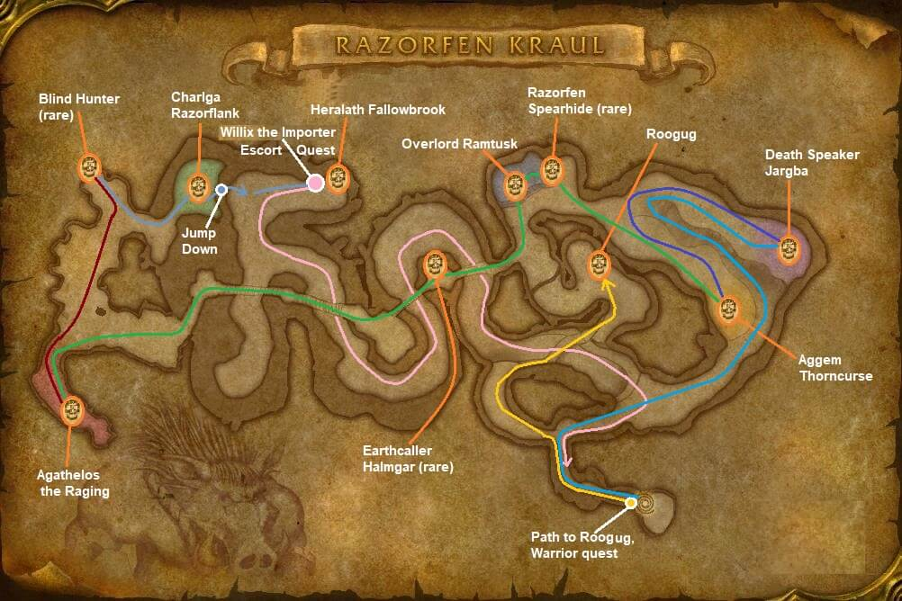

# Razorfen Kraul

[All Forever dungeon guides](README.md)

## Plan your run

**Planning range: 29–38 / Five players / The Barrens.** Researched 31 October 2026; beta details may change. Playfulls lists dungeon level 24+; that is a data label, not a verified portal-entry requirement. [Current dungeon data](https://playfulls.com/loot-tables/dungeons/razorfen-kraul).

Use the western thorn-covered entrance at the far southern end of the Barrens. Bring crowd control and dispels.

Visit Roogug's side branch if needed, then work through chieftain platforms and the boar area toward Charlga. Check side platforms and the bat area for rares. [Entrance and route reference](https://www.icy-veins.com/wow-forever/razorfen-kraul-guide).

## Layout maps

Annotated Classic reference layout; Forever details may differ. [Full-size map](https://eintr.net/WoW/images/Razorfen-Kraul-walkthrough-map.jpg) / [Map source](https://eintr.net/WoW/World-of-Warcraft-Classic-Dungeon-Walkthrough.html).

- [Map of Razorfen Kraul](https://playfulls.com/dungeonmaps/razorfen-kraul-1.webp)

Open the [interactive dungeon map](https://playfulls.com/loot-tables/dungeons/razorfen-kraul) for floor controls and available markers. Some boss positions are approximate or absent. [Annotated reference layout](https://foreveroth.com/en/donjons/?donjon=razorfen-kraul).

## Bosses and tactics

The following tactics are summarized from the Forever guide.

- **Roogug (optional):** Control the elemental and clear nearby enemies.
- **Aggem Thorncurse:** Switch to summoned Boar Spirits.
- **Death Speaker Jargba:** Control or kill caster escorts; disable mind-controlled allies safely.
- **Overlord Ramtusk:** Control Spearhides and prepare for strong melee damage.
- **Earthcaller Halmgar (rare):** Control the elemental; destroy Earthbind Totems.
- **Agathelos the Raging:** Prepare healing for the hit following his charge.
- **Blind Hunter (rare):** Keep casters away from Sonic Burst.
- **Charlga Razorflank:** Pull off her platform, interrupt casts, and wait out immunity.

[Tactics source](https://www.icy-veins.com/wow-forever/razorfen-kraul-guide).

## Boss loot and item links

Named equipment, boss-specific recipes, pets, bags and quest starters currently listed by the sources appear below. Drop percentages are omitted: the sites mix expectations, legacy values and beta observations. Boss associations are community reports; client item existence alone does not prove a live drop.

| Boss / encounter | Named drops |
| --- | --- |
| Roogug | [Geomancer Headdress](https://playfulls.com/item/274155-geomancer-headdress); [Roogug's Severed Head](https://playfulls.com/item/274152-roogugs-severed-head); [Thornweaver Drape](https://playfulls.com/item/274149-thornweaver-drape) |
| Aggem Thorncurse | [Death Prophet Spine](https://playfulls.com/item/274158-death-prophet-spine); [Thorncursed Grips](https://playfulls.com/item/274159-thorncursed-grips); [Thornspike](https://playfulls.com/item/6681-thornspike) |
| Death Speaker Jargba | [Death Speaker Mantle](https://playfulls.com/item/6685-death-speaker-mantle); [Death Speaker Robes](https://playfulls.com/item/6682-death-speaker-robes); [Death Speaker Scepter](https://playfulls.com/item/2816-death-speaker-scepter) |
| Overlord Ramtusk | [Corpsemaker](https://playfulls.com/item/6687-corpsemaker); [Quillord Mail Leggings](https://playfulls.com/item/274161-quillord-mail-leggings); [Tusken Helm](https://playfulls.com/item/6686-tusken-helm); [Plans: Crusader's Silvered Chain Leggings](https://playfulls.com/item/251379-plans-crusaders-silvered-chain-leggings) |
| Agathelos the Raging | [Ferine Leggings](https://playfulls.com/item/6690-ferine-leggings); [Quilrager Throwing Axe](https://playfulls.com/item/274160-quilrager-throwing-axe); [Swinetusk Shank](https://playfulls.com/item/6691-swinetusk-shank); [Plans: Acolyte's Silvered Chain Leggings](https://playfulls.com/item/251378-plans-acolytes-silvered-chain-leggings) |
| Charlga Razorflank | [Agamaggan's Clutch](https://playfulls.com/item/6693-agamaggans-clutch); [Heart of Agamaggan](https://playfulls.com/item/6694-heart-of-agamaggan); [Pronged Reaver](https://playfulls.com/item/6692-pronged-reaver); [Blueprint: Arcane Salvager](https://playfulls.com/item/273103-blueprint-arcane-salvager); [Small Scroll](https://playfulls.com/item/17008-small-scroll) |
| Blind Hunter | [Stygian Bone Amulet](https://foreverdb.net/item/6695); [Batwing Mantle](https://foreverdb.net/item/6697); [Nightstalker Bow](https://foreverdb.net/item/6696) |
| Earthcaller Halmgar | [Whisperwind Headdress](https://foreverdb.net/item/6688); [Wind Spirit Staff](https://foreverdb.net/item/6689) |

[Loot source: Playfulls](https://playfulls.com/loot-tables/dungeons/razorfen-kraul). Supplemental rare, event or missing entries use [Icy Veins](https://www.icy-veins.com/wow-forever/razorfen-kraul-guide) and [WoW Source](https://wowsrc.com/loot/razorfen-kraul/), with individual ForeverDB item records. Shared recipe pools and generic trash/world drops remain in the [complete source table](https://playfulls.com/loot-tables/dungeons/razorfen-kraul); they are excluded from this boss table. See [Playfulls methodology](https://playfulls.com/methodology) for its client-versus-community distinction.

## Evidence and remaining gaps

Pattern: Brawler's Leather Legguards (252820) and Pattern: Defender's Leather Kilt (252822) are vendor-sold recipes with sparse community drop reports, so they remain outside the targeted boss table. [Wowhead reports the kilt pattern from Thalnos](https://www.wowhead.com/forever/item=252822/pattern-defenders-leather-kilt) and [the legguards pattern from Gelihast](https://www.wowhead.com/forever/npc=6243/gelihast). These reports do not establish reliable targeted boss loot.
