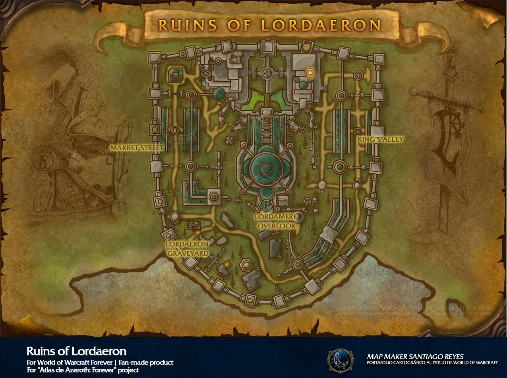

# Ruins of Lordaeron

[All Forever dungeon guides](README.md)

**Checked 31 October 2026 · Five players · Official level band: 15–20.** These are reported Forever beta encounters and drops; the tables cover documented boss gear, recipes and named quest items, not guaranteed drop rates or every shared trash item.

[Official dungeon overview](https://news.blizzard.com/en-us/article/24301455/explore-the-new-dungeons-of-world-of-warcraft-forever).

## Entrance and preparation

The portal is in the ruined city above Undercity, left of the approach to the Ruins area. Expect six regular bosses plus the rare Lordaeron Captain. Horde reaches it easily; Alliance must cross hostile territory.

Horde quest pickups include Brill, the Sepulcher and Undercity; several quests also begin inside. Watch for the Crest of Lordaeron and quest-starting drops. Alliance has separate objectives, including The Baron. Use the linked quest list to check faction prerequisites before travel.

[Entrance / quest reference](https://www.icy-veins.com/wow-forever/ruins-of-lordaeron-quests); [Beta access details](https://www.icy-veins.com/wow-forever/ruins-of-lordaeron-guide).

## Layout and route

A practical circuit is Witherfang → The Baron → optional Viktor event → The Abandoned event → Bjork → Rath’mael. Database ordering is not a required route. Recheck the western section for the rare Captain.

[Open full map](https://playfulls.com/dungeonmaps/ruins-of-lordaeron-1.webp)

Map by Santiago Reyes, Atlas de Azeroth: Forever; hosted by Playfulls. [Map source and interactive boss overlay](https://playfulls.com/loot-tables/dungeons/ruins-of-lordaeron).

## Boss tactics

Pull spider patrols back. Avoid combining ghoul packs; keep knockbacks away from uncleared enemies.

| Boss | What to do |
| --- | --- |
| Witherfang | Clear the spiders on her patrol. Handle the adds and cleanse poison on the tank. |
| The Baron | Keep the tank healthy for Knockout. Face his cleave away from the group and recover threat after knockbacks. |
| Viktor the Vile | Optional: activate the fireplace in the southwestern house. Conserve healer mana through the waves before Viktor appears. |
| The Abandoned | Approaching the Market Square statue triggers waves. Interrupt or stun Life Drain and expect Frost Nova. |
| Bjork | Pull away from nearby ghouls. Avoid knockbacks into trash and wait out the brief anti-magic shield. |
| Rath'Mael | Clear the graveyard. Interrupt or stun Flamestrike and leave its ground effect. |
| Lordaeron Captain | Rare and friendly to Alliance; Horde can fight him. Clear his long patrol before pulling. Reported spawn conditions are not guaranteed. |

[Encounter research](https://www.method.gg/wow-forever/dungeons/ruins-of-lordaeron); [Mechanics cross-check](https://www.icy-veins.com/wow-forever/ruins-of-lordaeron-guide).

## Documented boss drops

| Boss | Gear, recipes and quest drops |
| --- | --- |
| Witherfang | [Atrophic Girdle](https://www.wowhead.com/forever/item=271201) (Mail Waist); [Segmented Spider Leg](https://www.wowhead.com/forever/item=271203) (Two-hand staff); [Witherbite Bracers](https://www.wowhead.com/forever/item=271202) (Leather bracers); [Highly Toxic Strain](https://www.wowhead.com/forever/item=275443) (Quest item) |
| The Baron | [Meathook Slicer](https://www.wowhead.com/forever/item=271204) (One-hand dagger); [Abomination Bones](https://www.wowhead.com/forever/item=271205) (Mail Chest); [Leftover Abomination Skin](https://www.wowhead.com/forever/item=271206) (Cloth Chest); [Abominable Head](https://www.wowhead.com/forever/item=280438) (Quest starter); [Head of the Baron](https://www.wowhead.com/forever/item=268518) (Alliance quest item) |
| Viktor the Vile | [Vileblood Scimitar](https://www.wowhead.com/forever/item=271218) (One-hand sword); [Bloodied Chestwraps](https://www.wowhead.com/forever/item=271212) (Leather Chest); [Vilewalkers](https://www.wowhead.com/forever/item=271211) (Mail Feet) |
| The Abandoned | [Scepter of the Abandoned](https://www.wowhead.com/forever/item=271216) (Main-hand mace); [Grip of Fear](https://www.wowhead.com/forever/item=271208) (Mail Hands); [Rotmender's Leggings](https://www.wowhead.com/forever/item=271207) (Cloth Legs) |
| Bjork | [Corpse Chopper](https://www.wowhead.com/forever/item=271217) (Two-hand axe); [Bonerust Leggings](https://www.wowhead.com/forever/item=271209) (Mail Legs); [Tuskwrap Belt](https://www.wowhead.com/forever/item=271210) (Cloth Waist) |
| Rath'Mael | [Mirror of Rath'mael](https://www.wowhead.com/forever/item=271213) (Shield); [Coldspire Staff](https://www.wowhead.com/forever/item=271215) (Two-hand staff); [Rotmender's Treads](https://www.wowhead.com/forever/item=271214) (Cloth Feet); [Blueprint: Fermenter](https://www.wowhead.com/forever/item=273085) (Alchemy recipe); [Blueprint: Arcane Salvager](https://www.wowhead.com/forever/item=273103) (Enchanting recipe) |
| Lordaeron Captain | [Haunting Blade](https://www.wowhead.com/forever/item=6641) (Two-hand sword); [Phantom Armor](https://www.wowhead.com/forever/item=6642) (Mail chest) |

[Beta gear table](https://playfulls.com/loot-tables/dungeons/ruins-of-lordaeron); [Recipe and encounter cross-check](https://www.icy-veins.com/wow-forever/ruins-of-lordaeron-guide). Item links open the Forever edition of Wowhead.

Rath’mael’s two blueprints are independently listed by [Warcraft Wiki](https://warcraft.wiki.gg/wiki/Rath%27mael). The Captain is a rare Horde encounter; his loot is also reported by [ForeverChanges](https://foreverchanges.pro/item/6641/haunting-blade). Shared trash drops are separate from this boss table.
