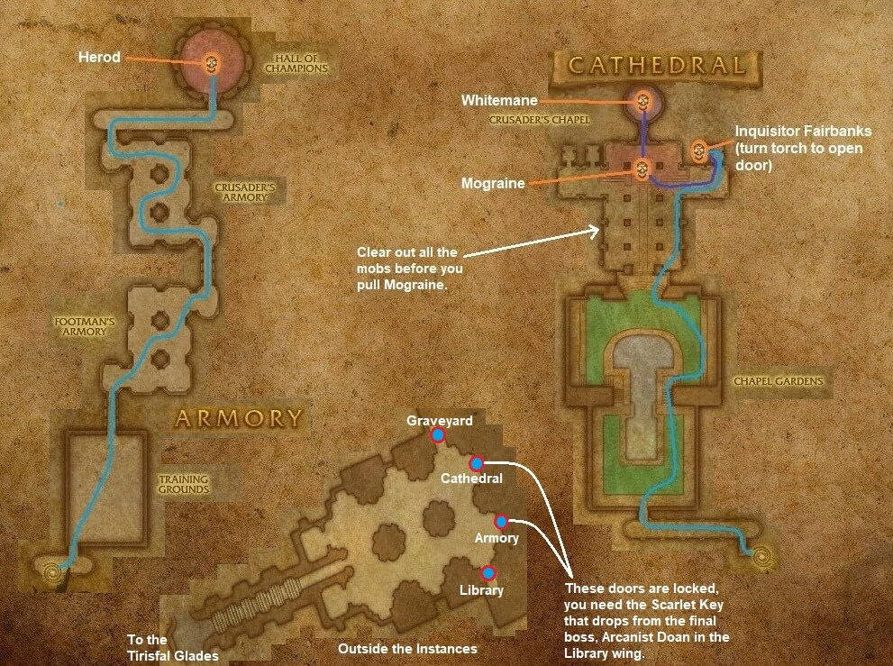

# Scarlet Monastery: Armory

[All Forever dungeon guides](README.md)

## Plan your run

**Planning range: 36–44 / Five players / Tirisfal Glades.** Researched 31 October 2026; beta details may change. Playfulls lists dungeon level 30+; that is a data label, not a verified portal-entry requirement. [Current dungeon data](https://playfulls.com/loot-tables/dungeons/scarlet-monastery).

Use the locked inner-right monastery door. Obtain the Scarlet Key from the chest behind Doan in Library.

This wing follows a single corridor sequence. Pull patrols back, stop runners, and clear safely into Herod's arena. Prepare area damage for the post-boss rush. [Entrance and route reference](https://www.icy-veins.com/wow-classic/scarlet-monastery-armory-dungeon-guide).

## Layout maps

Annotated Classic reference layout; Forever details may differ. [Full-size map](https://eintr.net/WoW/images/SM-Armory-Cathedral-entrance-walkthrough-map.jpg) / [Map source](https://eintr.net/WoW/World-of-Warcraft-Classic-Dungeon-Walkthrough.html).

- [Map of Scarlet Monastery, Armory](https://playfulls.com/dungeonmaps/scarlet-monastery-3.webp)

Open the [interactive dungeon map](https://playfulls.com/loot-tables/dungeons/scarlet-monastery) for floor controls and available markers. Some boss positions are approximate or absent. [Annotated reference layout](https://foreveroth.com/en/donjons/?donjon=scarlet-monastery-armory).

## Bosses and tactics

**Classic planning reference:** these mechanics are not fully verified for Forever.

- **Herod:** Face cleave away. Tank and melee retreat during Whirlwind; save defensives for enrage. After his death, let the tank collect trainees before area attacks.

[Tactics source](https://www.icy-veins.com/wow-classic/scarlet-monastery-armory-dungeon-guide).

## Boss loot and item links

Named equipment, boss-specific recipes, pets, bags and quest starters currently listed by the sources appear below. Drop percentages are omitted: the sites mix expectations, legacy values and beta observations. Boss associations are community reports; client item existence alone does not prove a live drop.

| Boss / encounter | Named drops |
| --- | --- |
| Herod | [Herod's Shoulder](https://playfulls.com/item/7718-herods-shoulder); [Raging Berserker's Helm](https://playfulls.com/item/7719-raging-berserkers-helm); [Ravager](https://playfulls.com/item/7717-ravager); [Scarlet Leggings](https://playfulls.com/item/10330-scarlet-leggings) |

[Loot source: Playfulls](https://playfulls.com/loot-tables/dungeons/scarlet-monastery). Shared recipe pools and generic trash/world drops remain in the [complete source table](https://playfulls.com/loot-tables/dungeons/scarlet-monastery); they are excluded from this boss table. See [Playfulls methodology](https://playfulls.com/methodology) for its client-versus-community distinction.

## Evidence and remaining gaps

Herod's Whirlwind and trainee rush are also described by Forever DB. Cleave and low-health enrage details remain Classic planning references until independently confirmed in Forever.
