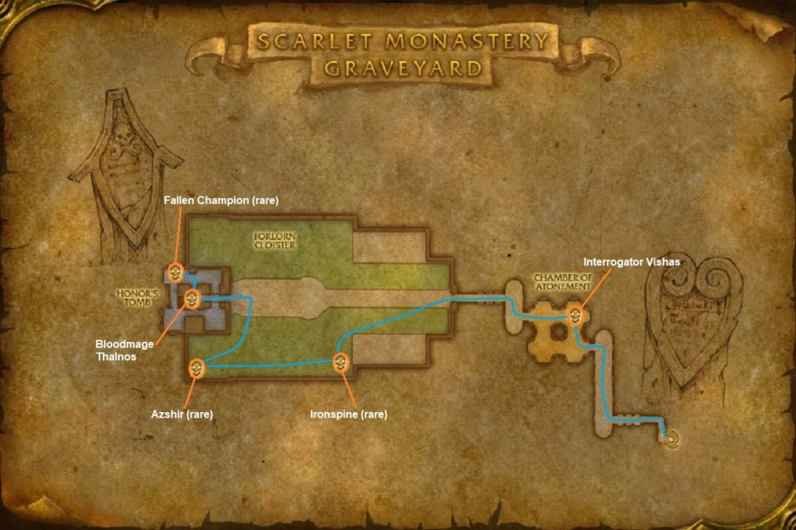

# Scarlet Monastery: Graveyard

[All Forever dungeon guides](README.md)

## Plan your run

**Planning range: 30–38 / Five players / Tirisfal Glades.** Researched 31 October 2026; beta details may change. Playfulls lists dungeon level 30+; that is a data label, not a verified portal-entry requirement. [Current dungeon data](https://playfulls.com/loot-tables/dungeons/scarlet-monastery).

Enter northeastern Tirisfal's monastery and choose the far-left doorway. No Scarlet Key is required.

Clear the torture chamber, cross the graveyard checking rare spawns, then descend the crypt to Thalnos. Clear around rare enemies before pulling. [Entrance and route reference](https://www.icy-veins.com/wow-forever/scarlet-monastery-graveyard-guide).

## Layout maps

Annotated Classic reference layout; Forever details may differ. [Full-size map](https://eintr.net/WoW/images/SM-Graveyard-walkthrough-map-1024x683.jpg) / [Map source](https://eintr.net/WoW/World-of-Warcraft-Classic-Dungeon-Walkthrough.html).

- [Map of Scarlet Monastery, Graveyard](https://playfulls.com/dungeonmaps/scarlet-monastery-1.webp)

Open the [interactive dungeon map](https://playfulls.com/loot-tables/dungeons/scarlet-monastery) for floor controls and available markers. Some boss positions are approximate or absent. [Annotated reference layout](https://foreveroth.com/en/donjons/?donjon=scarlet-monastery-graveyard).

## Bosses and tactics

The following tactics are summarized from the Forever guide.

- **Interrogator Vishas:** Control surrounding enemies; remove Immolate when possible.
- **Azshir the Sleepless (rare):** Clear for fear; interrupt Soul Siphon and remove his curse.
- **Fallen Champion (rare):** Stay behind cleave; prepare for increased low-health damage.
- **Ironspine (rare):** Leave poison clouds and remove Curse of Weakness.
- **Bloodmage Thalnos:** Ranged stay back; move away from fire-area effects.

[Tactics source](https://www.icy-veins.com/wow-forever/scarlet-monastery-graveyard-guide).

## Boss loot and item links

Named equipment, boss-specific recipes, pets, bags and quest starters currently listed by the sources appear below. Drop percentages are omitted: the sites mix expectations, legacy values and beta observations. Boss associations are community reports; client item existence alone does not prove a live drop.

| Boss / encounter | Named drops |
| --- | --- |
| Interrogator Vishas | [Bloody Brass Knuckles](https://playfulls.com/item/7683-bloody-brass-knuckles); [Painwalker Buckler](https://playfulls.com/item/274290-painwalker-buckler); [Torturing Poker](https://playfulls.com/item/7682-torturing-poker) |
| Bloodmage Thalnos | [Bloodmage Mantle](https://playfulls.com/item/7684-bloodmage-mantle); [Orb of the Forgotten Seer](https://playfulls.com/item/7685-orb-of-the-forgotten-seer); [Polished Skullcap](https://playfulls.com/item/274291-polished-skullcap) |
| Azshir the Sleepless | [Blighted Leggings](https://foreverdb.net/item/7709); [Necrotic Wand](https://foreverdb.net/item/7708); [Ghostshard Talisman](https://foreverdb.net/item/7731) |
| Fallen Champion | [Embalmed Shroud](https://foreverdb.net/item/7691); [Ebon Vise](https://foreverdb.net/item/7690); [Morbid Dawn](https://foreverdb.net/item/7689) |
| Ironspine | [Ironspine's Ribcage](https://foreverdb.net/item/7688); [Ironspine's Fist](https://foreverdb.net/item/7687); [Ironspine's Eye](https://foreverdb.net/item/7686) |

[Loot source: Playfulls](https://playfulls.com/loot-tables/dungeons/scarlet-monastery). Supplemental rare, event or missing entries use [Icy Veins](https://www.icy-veins.com/wow-forever/scarlet-monastery-graveyard-guide) and [WoW Source](https://wowsrc.com/loot/scarlet-monastery-graveyard/), with individual ForeverDB item records. Shared recipe pools and generic trash/world drops remain in the [complete source table](https://playfulls.com/loot-tables/dungeons/scarlet-monastery); they are excluded from this boss table. See [Playfulls methodology](https://playfulls.com/methodology) for its client-versus-community distinction.

## Evidence and remaining gaps

Sources disagree on whether Thalnos can be interrupted; movement and healing remain the reliable plan. Scorn appears in additional loot lists, but its spawn/event availability is unverified in Forever; do not plan a guaranteed Scorn farm. [Conflicting Thalnos notes](https://wowfdb.com/zones/scarlet-monastery/bosses/).

**Unverified event encounter: Scorn.** Supplemental tables list [Scorn's Icy Choker](https://foreverdb.net/item/23169), [Scorn's Focal Dagger](https://wowclassicdb.com/item/23168) and [The Frozen Clutch](https://wowclassicdb.com/item/23170). The latter two links are Classic references. [WoW Source](https://wowsrc.com/loot/scarlet-monastery-graveyard/) lists these rewards but does not establish a guaranteed current spawn.

Pattern: Brawler's Leather Legguards (252820) and Pattern: Defender's Leather Kilt (252822) are vendor-sold recipes with sparse community drop reports, so they remain outside the targeted boss table. [Wowhead reports the kilt pattern from Thalnos](https://www.wowhead.com/forever/item=252822/pattern-defenders-leather-kilt) and [the legguards pattern from Gelihast](https://www.wowhead.com/forever/npc=6243/gelihast). These reports do not establish reliable targeted boss loot.
