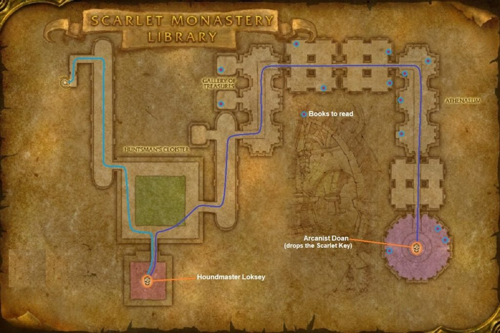

# Scarlet Monastery: Library

[All Forever dungeon guides](README.md)

## Plan your run

**Planning range: 33–41 / Five players / Tirisfal Glades.** Researched 31 October 2026; beta details may change. Playfulls lists dungeon level 30+; that is a data label, not a verified portal-entry requirement. [Current dungeon data](https://playfulls.com/loot-tables/dungeons/scarlet-monastery).

Choose the far-right monastery entrance. The Library itself needs no key.

Clear to Loksey's side room, then follow the library corridors to Doan. Loot the chest behind Doan for the Scarlet Key needed by Armory and Cathedral. [Entrance and route reference](https://www.icy-veins.com/wow-forever/scarlet-monastery-library-guide).

## Layout maps

Annotated Classic reference layout; Forever details may differ. [Full-size map](https://eintr.net/WoW/images/SM-Library-walkthrough-map-1024x683.jpg) / [Map source](https://eintr.net/WoW/World-of-Warcraft-Classic-Dungeon-Walkthrough.html).

- [Map of Scarlet Monastery, Library](https://playfulls.com/dungeonmaps/scarlet-monastery-2.webp)

Open the [interactive dungeon map](https://playfulls.com/loot-tables/dungeons/scarlet-monastery) for floor controls and available markers. Some boss positions are approximate or absent. [Annotated reference layout](https://foreveroth.com/en/donjons/?donjon=scarlet-monastery-library).

## Bosses and tactics

The following tactics are summarized from the Forever guide.

- **Houndmaster Loksey:** Kill or control his three hounds first; dispel Bloodlust when available.
- **Arcanist Doan:** Keep ranged distant. Everyone retreat from Detonation; do not rely on interrupts through his bubble.

[Tactics source](https://www.icy-veins.com/wow-forever/scarlet-monastery-library-guide).

## Boss loot and item links

Named equipment, boss-specific recipes, pets, bags and quest starters currently listed by the sources appear below. Drop percentages are omitted: the sites mix expectations, legacy values and beta observations. Boss associations are community reports; client item existence alone does not prove a live drop.

| Boss / encounter | Named drops |
| --- | --- |
| Houndmaster Loksey | [Dog Training Gloves](https://playfulls.com/item/7756-dog-training-gloves); [Dog Whistle](https://playfulls.com/item/3456-dog-whistle); [Loksey's Training Stick](https://playfulls.com/item/7710-lokseys-training-stick) |
| Arcanist Doan | [Hypnotic Blade](https://playfulls.com/item/7714-hypnotic-blade); [Illusionary Rod](https://playfulls.com/item/7713-illusionary-rod); [Spellsever Crossbow](https://playfulls.com/item/274293-spellsever-crossbow); [Library Walkers](https://playfulls.com/item/274294-library-walkers); [Mantle of Doan](https://playfulls.com/item/7712-mantle-of-doan); [Robe of Doan](https://playfulls.com/item/7711-robe-of-doan) |
| Chest behind Arcanist Doan (not a boss drop) | [The Scarlet Key](https://foreverdb.net/item/7146) |

[Loot source: Playfulls](https://playfulls.com/loot-tables/dungeons/scarlet-monastery). Supplemental rare, event or missing entries use [Icy Veins](https://www.icy-veins.com/wow-forever/scarlet-monastery-library-guide) and [WoW Source](https://wowsrc.com/loot/scarlet-monastery-library/), with individual ForeverDB item records. Shared recipe pools and generic trash/world drops remain in the [complete source table](https://playfulls.com/loot-tables/dungeons/scarlet-monastery); they are excluded from this boss table. See [Playfulls methodology](https://playfulls.com/methodology) for its client-versus-community distinction.

## Evidence and remaining gaps

Library Walkers are listed by Playfulls but omitted by the older Icy Veins table; their boss attribution remains community-reported.
