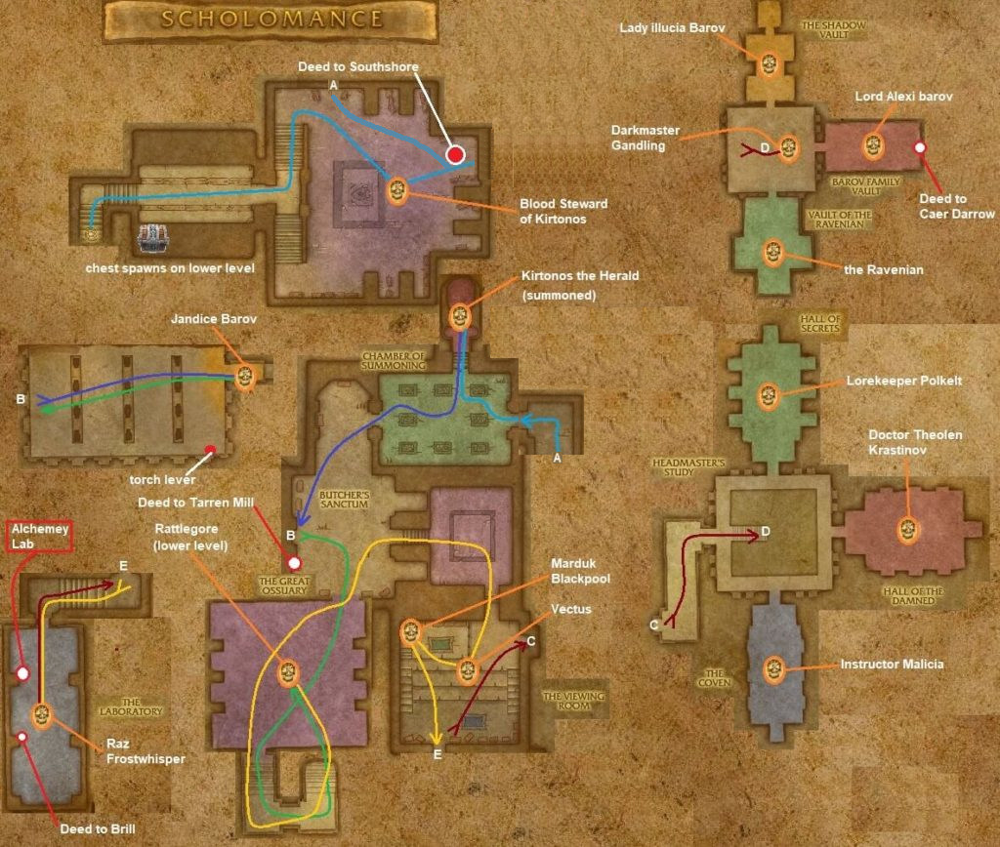

# Scholomance

[All Forever dungeon guides](README.md)

**Research snapshot: 31 October 2026.** Tactics and annotated layouts use Classic references. Forever loot reports and Classic drop tables are listed separately.

**Level:** Client level 57; Classic planning 58–60. **Location:** Caer Darrow, Western Plaguelands. **Group:** 5. Client level is a listing value, not a promise that a group at that level can finish the dungeon. [Forever listing](https://playfulls.com/loot-tables/dungeons/scholomance).

## Before entering

Classic reference: Skeleton Key or suitable lockpicking opens the entrance. Blood of Innocents summons Kirtonos. Dawn's Gambit simplifies the Viewing Room event. Kormok is a dungeon-set quest summon. Leave room for keys and quest items; do not attack neutral students casually. [Classic preparation reference](https://www.wowhead.com/classic/guide/scholomance-dungeon-strategy-wow-classic).

## Layout and route

Annotated Classic reference layout; Forever details may differ. [Full-size map](https://eintr.net/WoW/images/Scholomance-walkthrough-map-v2-1024x868.jpg) / [Map source](https://eintr.net/WoW/World-of-Warcraft-Classic-Dungeon-Walkthrough.html).

Cross the entrance bridge and descend through the summoning rooms. Add Kirtonos and Jandice if needed; kill Rattlegore for the Viewing Room Key. Move through the neutral students carefully, clear Ras, then all six side-room instructors to spawn Gandling. Clear the lower rooms first to avoid an accidental final pull. [Classic route reference](https://www.wowhead.com/classic/guide/scholomance-dungeon-strategy-wow-classic).

- [Annotated Classic layout and route](https://eintr.net/WoW/images/Scholomance-walkthrough-map-v2-1024x868.jpg) — Classic reference; Forever changes unverified. [Map source](https://eintr.net/WoW/World-of-Warcraft-Classic-Dungeon-Walkthrough.html).
- [Scholomance, The Reliquary](https://playfulls.com/dungeonmaps/scholomance-1.webp) — Community-hosted dungeon map; boss pins may be approximate or incomplete. [Map source](https://playfulls.com/loot-tables/dungeons/scholomance).
- [Scholomance, Chamber of Summoning](https://playfulls.com/dungeonmaps/scholomance-2.webp) — Community-hosted dungeon map; boss pins may be approximate or incomplete. [Map source](https://playfulls.com/loot-tables/dungeons/scholomance).
- [Scholomance, The Upper Study](https://playfulls.com/dungeonmaps/scholomance-3.webp) — Community-hosted dungeon map; boss pins may be approximate or incomplete. [Map source](https://playfulls.com/loot-tables/dungeons/scholomance).
- [Scholomance, Headmaster's Study](https://playfulls.com/dungeonmaps/scholomance-4.webp) — Community-hosted dungeon map; boss pins may be approximate or incomplete. [Map source](https://playfulls.com/loot-tables/dungeons/scholomance).

## Bosses and tactics

Use these as Classic-based tactical prompts, not verified Forever combat logs. “Client listed” means the current community client roster names the encounter; additional rares, companions and summons are included for planning. [Current roster](https://playfulls.com/loot-tables/dungeons/scholomance), [tactical reference](https://www.wowhead.com/classic/guide/scholomance-dungeon-strategy-wow-classic).

| Boss / encounter | Status | Action |
| --- | --- | --- |
| Kirtonos the Herald | Client listed; summoned | Summon with Blood; tank away from window. |
| Jandice Barov | Client listed; optional | Retarget real Jandice; avoid wasting damage on illusions. |
| Rattlegore | Client listed; main encounter | Clear patrols; tank with back to wall. |
| Marduk Blackpool | Client listed; optional | Use Dawn's Gambit before engaging students. |
| Vectus | Client listed; optional | Handle student event; avoid fire area. |
| Kormok | Client listed; quest | Quest summon; collect skeleton waves. |
| Ras Frostwhisper | Client listed; main encounter | Spread; interrupt frost casts; clear room. |
| Instructor Malicia | Client listed; main encounter | Interrupt healing; remove magic damage. |
| Doctor Theolen Krastinov | Client listed; main encounter | Prepare for enrage and knockback. |
| Lorekeeper Polkelt | Client listed; main encounter | Spread away from infected players. |
| The Ravenian | Client listed; main encounter | Face cleave away; heal tank burst. |
| Lord Alexei Barov | Client listed; main encounter | Control guards; focus one target. |
| Lady Illucia Barov | Client listed; main encounter | Interrupt casts; control feared paths. |
| Darkmaster Gandling | Client listed; main encounter | Teleported player kills skeletons and returns. |
| Death Knight Darkreaver | Classic reference; quest | Paladin mount quest summon; conditional encounter. |

## Forever loot currently documented

The following is the complete boss-associated list recovered from the linked Playfulls page for this wing, not a complete Forever drop table. These are community loot associations checked against client item data; a client item existing does not by itself prove its drop source. Drop percentages are intentionally omitted because the source marks them unconfirmed in Forever. [Live loot source](https://playfulls.com/loot-tables/dungeons/scholomance).

| Boss | Linked items |
| --- | --- |
| Kirtonos the Herald | [Boots of Valor](https://playfulls.com/item/16734-boots-of-valor) |
| Jandice Barov | [Dreadmist Mantle](https://playfulls.com/item/16701-dreadmist-mantle); [Blood of Innocents](https://playfulls.com/item/13523-blood-of-innocents) (Quest / conditional) |
| Rattlegore | [Shadowcraft Boots](https://playfulls.com/item/16711-shadowcraft-boots); [Top Half of Advanced Armorsmithing: Volume II](https://playfulls.com/item/18782-top-half-of-advanced-armorsmithing-volume-ii); [Viewing Room Key](https://playfulls.com/item/13873-viewing-room-key) (Access) |
| Ras Frostwhisper | [Magister's Mantle](https://playfulls.com/item/16689-magisters-mantle); [Recipe: Flask of Supreme Power](https://playfulls.com/item/13521-recipe-flask-of-supreme-power) (Recipe) |
| Instructor Malicia | [Shadowcraft Bracers](https://playfulls.com/item/16710-shadowcraft-bracers) |
| Doctor Theolen Krastinov | [Magister's Gloves](https://playfulls.com/item/16684-magisters-gloves); [Sawbones Shirt](https://playfulls.com/item/14617-sawbones-shirt) |
| Lorekeeper Polkelt | [Dreadmist Wraps](https://playfulls.com/item/16705-dreadmist-wraps) |
| The Ravenian | [Wildheart Belt](https://playfulls.com/item/16716-wildheart-belt) |
| Lord Alexei Barov | [Lightforge Bracers](https://playfulls.com/item/16722-lightforge-bracers) |
| Darkmaster Gandling | [Beaststalker's Cap](https://playfulls.com/item/16677-beaststalkers-cap); [Coif of Elements](https://playfulls.com/item/16667-coif-of-elements); [Devout Crown](https://playfulls.com/item/16693-devout-crown); [Dreadmist Mask](https://playfulls.com/item/16698-dreadmist-mask); [Helm of Valor](https://playfulls.com/item/16731-helm-of-valor); [Lightforge Helm](https://playfulls.com/item/16727-lightforge-helm); [Magister's Crown](https://playfulls.com/item/16686-magisters-crown); [Shadowcraft Cap](https://playfulls.com/item/16707-shadowcraft-cap); [Wildheart Cowl](https://playfulls.com/item/16720-wildheart-cowl); [Pattern: Robe of the Void](https://playfulls.com/item/14514-pattern-robe-of-the-void) (Recipe); [Ace of Portals](https://playfulls.com/item/19276-ace-of-portals) (Card); [Recipe: Major Mana Potion](https://playfulls.com/item/13501-recipe-major-mana-potion) (Recipe) |

Bosses absent from this section have no recovered Forever loot association in this source. The table below supplies a separately labeled Classic reference. Dungeon-wide random drops, quest turn-in rewards and event chests are not silently counted as boss loot.

## Classic loot reference

**These drops are not confirmed for Forever.**

Direct links open Classic item records. Each boss name links to the database or guide supporting its Classic drop association. Named equipment and recipes are listed; ordinary grey/white items and broad random world-drop pools are omitted. A missing entry means the retrieved sources did not supply a dedicated table. Rare spawns and quest summons may require different access or may change in Forever.

| Boss / encounter | Linked items |
| --- | --- |
| [Kirtonos the Herald](https://classicdb.ch/?npc=10506) | [Stoneform Shoulders](https://classicdb.ch/?item=13955); [Clutch of Andros](https://classicdb.ch/?item=13956); [Gargoyle Slashers](https://classicdb.ch/?item=13957); [Heart of the Fiend](https://classicdb.ch/?item=13960); [Windreaver Greaves](https://classicdb.ch/?item=13967); [Loomguard Armbraces](https://classicdb.ch/?item=13969); [Gravestone War Axe](https://classicdb.ch/?item=13983); [Frightalon](https://classicdb.ch/?item=14024); [Boots of Valor](https://classicdb.ch/?item=16734) |
| [Jandice Barov](https://www.wowhead.com/classic/guide/scholomance-dungeon-strategy-wow-classic) | [Barovian Family Sword](https://classicdb.ch/?item=14541); [Darkshade Gloves](https://classicdb.ch/?item=14543); [Ghostloom Leggings](https://classicdb.ch/?item=14545); [Royal Cap Spaulders](https://classicdb.ch/?item=14548); [Dreadmist Mantle](https://classicdb.ch/?item=16701); [Phantasmal Cloak](https://classicdb.ch/?item=18689); [Wraithplate Leggings](https://classicdb.ch/?item=18690); [Staff of Metanoia](https://classicdb.ch/?item=22394) **Quest / access / other:** [Blood of Innocents](https://classicdb.ch/?item=13523) |
| [Rattlegore](https://www.wowhead.com/classic/guide/scholomance-dungeon-strategy-wow-classic) | [Rattlecage Buckler](https://classicdb.ch/?item=14528); [Frightskull Shaft](https://classicdb.ch/?item=14531); [Corpselight Greaves](https://classicdb.ch/?item=14537); [Deadwalker Mantle](https://classicdb.ch/?item=14538); [Bone Ring Helm](https://classicdb.ch/?item=14539); [Shadowcraft Boots](https://classicdb.ch/?item=16711); [Bone Golem Shoulders](https://classicdb.ch/?item=18686) **Quest / access / other:** [Viewing Room Key](https://classicdb.ch/?item=13873); [Top Half of Advanced Armorsmithing: Volume II](https://classicdb.ch/?item=18782) |
| [Marduk Blackpool](https://www.wowhead.com/classic/guide/scholomance-dungeon-strategy-wow-classic) | [Ebon Hilt of Marduk](https://classicdb.ch/?item=14576); [Death Knight Sabatons](https://classicdb.ch/?item=18692) |
| [Vectus](https://www.wowhead.com/classic/guide/scholomance-dungeon-strategy-wow-classic) | [Skullsmoke Pants](https://classicdb.ch/?item=14577); [Dark Advisor's Pendant](https://classicdb.ch/?item=18691) |
| [Kormok](https://classicdb.ch/?npc=16118) | [Ironweave Pants](https://classicdb.ch/?item=22303); [Amalgam's Band](https://classicdb.ch/?item=22326); [Band of the Steadfast Hero](https://classicdb.ch/?item=22331); [Blade of Necromancy](https://classicdb.ch/?item=22332); [Hammer of Divine Might](https://classicdb.ch/?item=22333) **Quest / access / other:** [Left Piece of Lord Valthalak's Amulet](https://classicdb.ch/?item=21984); [Right Piece of Lord Valthalak's Amulet](https://classicdb.ch/?item=22046) |
| [Ras Frostwhisper](https://www.wowhead.com/classic/guide/scholomance-dungeon-strategy-wow-classic) | [Alanna's Embrace](https://classicdb.ch/?item=13314); [Recipe: Flask of Supreme Power](https://classicdb.ch/?item=13521); [Iceblade Hacker](https://classicdb.ch/?item=13952); [Freezing Lich Robes](https://classicdb.ch/?item=14340); [Bonechill Hammer](https://classicdb.ch/?item=14487); [Frostbite Girdle](https://classicdb.ch/?item=14502); [Death's Clutch](https://classicdb.ch/?item=14503); [Maelstrom Leggings](https://classicdb.ch/?item=14522); [Boneclenched Gauntlets](https://classicdb.ch/?item=14525); [Magister's Mantle](https://classicdb.ch/?item=16689); [Shivery Handwraps](https://classicdb.ch/?item=18693); [Shadowy Mail Greaves](https://classicdb.ch/?item=18694); [Spellbound Tome](https://classicdb.ch/?item=18695); [Intricately Runed Shield](https://classicdb.ch/?item=18696) |
| [Instructor Malicia](https://www.wowhead.com/classic/guide/scholomance-dungeon-strategy-wow-classic) | [Shadowcraft Bracers](https://classicdb.ch/?item=16710); [Ancient Bone Bow](https://classicdb.ch/?item=18680); [Burial Shawl](https://classicdb.ch/?item=18681); [Ghoul Skin Leggings](https://classicdb.ch/?item=18682); [Hammer of the Vesper](https://classicdb.ch/?item=18683); [Dimly Opalescent Ring](https://classicdb.ch/?item=18684); [Totem of Sustaining](https://classicdb.ch/?item=23200); [Libram of Divinity](https://classicdb.ch/?item=23201) |
| [Doctor Theolen Krastinov](https://www.wowhead.com/classic/guide/scholomance-dungeon-strategy-wow-classic) | [Sawbones Shirt](https://classicdb.ch/?item=14617); [Magister's Gloves](https://classicdb.ch/?item=16684); [Ancient Bone Bow](https://classicdb.ch/?item=18680); [Burial Shawl](https://classicdb.ch/?item=18681); [Ghoul Skin Leggings](https://classicdb.ch/?item=18682); [Hammer of the Vesper](https://classicdb.ch/?item=18683); [Dimly Opalescent Ring](https://classicdb.ch/?item=18684); [Totem of Sustaining](https://classicdb.ch/?item=23200); [Libram of Divinity](https://classicdb.ch/?item=23201) **Quest / access / other:** [Blood of Innocents](https://classicdb.ch/?item=13523) |
| [Lorekeeper Polkelt](https://www.wowhead.com/classic/guide/scholomance-dungeon-strategy-wow-classic) | [Dreadmist Wraps](https://classicdb.ch/?item=16705); [Ancient Bone Bow](https://classicdb.ch/?item=18680); [Burial Shawl](https://classicdb.ch/?item=18681); [Ghoul Skin Leggings](https://classicdb.ch/?item=18682); [Hammer of the Vesper](https://classicdb.ch/?item=18683); [Dimly Opalescent Ring](https://classicdb.ch/?item=18684); [Totem of Sustaining](https://classicdb.ch/?item=23200); [Libram of Divinity](https://classicdb.ch/?item=23201) |
| [The Ravenian](https://www.wowhead.com/classic/guide/scholomance-dungeon-strategy-wow-classic) | [Wildheart Belt](https://classicdb.ch/?item=16716); [Ancient Bone Bow](https://classicdb.ch/?item=18680); [Burial Shawl](https://classicdb.ch/?item=18681); [Ghoul Skin Leggings](https://classicdb.ch/?item=18682); [Hammer of the Vesper](https://classicdb.ch/?item=18683); [Dimly Opalescent Ring](https://classicdb.ch/?item=18684); [Totem of Sustaining](https://classicdb.ch/?item=23200); [Libram of Divinity](https://classicdb.ch/?item=23201) |
| [Lord Alexei Barov](https://www.wowhead.com/classic/guide/scholomance-dungeon-strategy-wow-classic) | [Lightforge Bracers](https://classicdb.ch/?item=16722); [Ancient Bone Bow](https://classicdb.ch/?item=18680); [Burial Shawl](https://classicdb.ch/?item=18681); [Ghoul Skin Leggings](https://classicdb.ch/?item=18682); [Hammer of the Vesper](https://classicdb.ch/?item=18683); [Dimly Opalescent Ring](https://classicdb.ch/?item=18684); [Totem of Sustaining](https://classicdb.ch/?item=23200); [Libram of Divinity](https://classicdb.ch/?item=23201) |
| [Lady Illucia Barov](https://www.wowhead.com/classic/guide/scholomance-dungeon-strategy-wow-classic) | [Ancient Bone Bow](https://classicdb.ch/?item=18680); [Burial Shawl](https://classicdb.ch/?item=18681); [Ghoul Skin Leggings](https://classicdb.ch/?item=18682); [Hammer of the Vesper](https://classicdb.ch/?item=18683); [Dimly Opalescent Ring](https://classicdb.ch/?item=18684); [Totem of Sustaining](https://classicdb.ch/?item=23200); [Libram of Divinity](https://classicdb.ch/?item=23201) |
| [Darkmaster Gandling](https://classicdb.ch/?npc=1853) | [Boots of the Shrieker](https://classicdb.ch/?item=13398); [Recipe: Major Mana Potion](https://classicdb.ch/?item=13501); [Headmaster's Charge](https://classicdb.ch/?item=13937); [Bonecreeper Stylus](https://classicdb.ch/?item=13938); [Tombstone Breastplate](https://classicdb.ch/?item=13944); [Vigorsteel Vambraces](https://classicdb.ch/?item=13951); [Silent Fang](https://classicdb.ch/?item=13953); [Witchblade](https://classicdb.ch/?item=13964); [Pattern: Robe of the Void](https://classicdb.ch/?item=14514); [Coif of Elements](https://classicdb.ch/?item=16667); [Beaststalker's Cap](https://classicdb.ch/?item=16677); [Magister's Crown](https://classicdb.ch/?item=16686); [Devout Crown](https://classicdb.ch/?item=16693); [Dreadmist Mask](https://classicdb.ch/?item=16698); [Shadowcraft Cap](https://classicdb.ch/?item=16707); [Wildheart Cowl](https://classicdb.ch/?item=16720); [Lightforge Helm](https://classicdb.ch/?item=16727); [Helm of Valor](https://classicdb.ch/?item=16731); [Don Mauricio's Band of Domination](https://classicdb.ch/?item=22433) **Quest / access / other:** [Ace of Portals](https://classicdb.ch/?item=19276) |
| [Death Knight Darkreaver](https://classicdb.ch/?npc=14516) | [Specter's Blade](https://classicdb.ch/?item=18758); [Malicious Axe](https://classicdb.ch/?item=18759); [Necromantic Band](https://classicdb.ch/?item=18760); [Oblivion's Touch](https://classicdb.ch/?item=18761) **Quest / access / other:** [Charger's Lost Soul](https://classicdb.ch/?item=18749); [Darkreaver's Head](https://classicdb.ch/?item=18880) |
