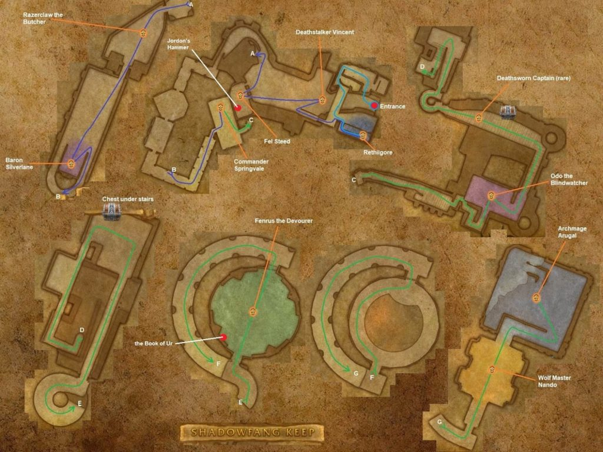

# Shadowfang Keep

[All Forever dungeon guides](README.md)

## Plan your run

**Planning range: 20–30 / Five players / Silverpine Forest.** Researched 31 October 2026; beta details may change. Playfulls lists dungeon level 18+; that is a data label, not a verified portal-entry requirement. [Current dungeon data](https://playfulls.com/loot-tables/dungeons/shadowfang-keep).

Take the road uphill to the keep in southern Silverpine. Prepare interrupts, curse removal and control for tightly packed rooms.

Work from the prison through the courtyard, dining rooms and upper towers. Clear patrols before bosses; check the corridor after Odo for Deathsworn Captain. [Entrance and route reference](https://www.icy-veins.com/wow-forever/shadowfang-keep-guide).

## Layout maps

Annotated Classic reference layout; Forever details may differ. [Full-size map](https://eintr.net/WoW/images/Shadowfang-Keep-walkthrough-map-1024x768.jpg) / [Map source](https://eintr.net/WoW/World-of-Warcraft-Classic-Dungeon-Walkthrough.html).

- [Map of Shadowfang Keep, Ground floor](https://playfulls.com/dungeonmaps/shadowfang-keep-1.webp)
- [Map of Shadowfang Keep, Upper floors](https://playfulls.com/dungeonmaps/shadowfang-keep-2.webp)
- [Map of Shadowfang Keep, Towers](https://playfulls.com/dungeonmaps/shadowfang-keep-3.webp)
- [Map of Shadowfang Keep, Top](https://playfulls.com/dungeonmaps/shadowfang-keep-4.webp)

Open the [interactive dungeon map](https://playfulls.com/loot-tables/dungeons/shadowfang-keep) for floor controls and available markers. Some boss positions are approximate or absent. [Annotated reference layout](https://foreveroth.com/en/donjons/?donjon=shadowfang-keep).

## Bosses and tactics

The following tactics are summarized from the Forever guide.

- **Rethilgore:** Interrupt Soul Drain; clear enemies on nearby elevations.
- **Fel Steed / Shadow Charger (optional):** Attacking one pulls the stable group; control spare horses.
- **Razorclaw the Butcher:** Isolate patrols and heal the tank through Butcher Drain.
- **Baron Silverlaine:** Remove Veil of Shadow promptly; it suppresses healing.
- **Commander Springvale:** Kill the silencing Guardsman first; interrupt Holy Light.
- **Odo the Blindwatcher:** Control bats and face their cleave away.
- **Deathsworn Captain (rare):** Secure his companions and kill adds first.
- **Fenrus the Devourer:** Prepare to collect Voidwalkers; they persist beyond the wolf.
- **Wolf Master Nandos:** Clear room worgs beforehand; kill summoned worgs.
- **Archmage Arugal:** Use corners against Void Bolt; manage threat after teleports.

[Tactics source](https://www.icy-veins.com/wow-forever/shadowfang-keep-guide).

## Boss loot and item links

Named equipment, boss-specific recipes, pets, bags and quest starters currently listed by the sources appear below. Drop percentages are omitted: the sites mix expectations, legacy values and beta observations. Boss associations are community reports; client item existence alone does not prove a live drop.

| Boss / encounter | Named drops |
| --- | --- |
| Rethilgore | [Cell Keeper's Claws](https://playfulls.com/item/273456-cell-keepers-claws); [Rugged Spaulders](https://playfulls.com/item/5254-rugged-spaulders); [Sorcerer Collar](https://playfulls.com/item/273457-sorcerer-collar) |
| Razorclaw the Butcher | [Bloody Apron](https://playfulls.com/item/6226-bloody-apron); [Butcher's Cleaver](https://playfulls.com/item/1292-butchers-cleaver); [Butcher's Slicer](https://playfulls.com/item/6633-butchers-slicer); [Blueprint: Tanning Rack](https://foreverdb.net/item/273096) |
| Baron Silverlaine | [Baron's Scepter](https://playfulls.com/item/6323-barons-scepter); [Blade of Silverlaine](https://playfulls.com/item/273637-blade-of-silverlaine); [Coldflame Saber](https://playfulls.com/item/276631-coldflame-saber); [Silverlaine's Family Seal](https://playfulls.com/item/6321-silverlaines-family-seal); [Scroll of the Saber](https://playfulls.com/item/277490-scroll-of-the-saber) |
| Commander Springvale | [Arced War Axe](https://playfulls.com/item/3191-arced-war-axe); [Commander's Crest](https://playfulls.com/item/6320-commanders-crest); [Eerie Stable Lantern](https://playfulls.com/item/6341-eerie-stable-lantern); [Worgenbane Talisman](https://playfulls.com/item/273643-worgenbane-talisman); [Blueprint: Toxin Study](https://playfulls.com/item/273105-blueprint-toxin-study) |
| Odo the Blindwatcher | [Blindwatcher's Sight](https://playfulls.com/item/273645-blindwatchers-sight); [Girdle of the Blindwatcher](https://playfulls.com/item/6319-girdle-of-the-blindwatcher); [Odo's Ley Staff](https://playfulls.com/item/6318-odos-ley-staff) |
| Fenrus the Devourer | [Black Wolf Bracers](https://playfulls.com/item/3230-black-wolf-bracers); [Fenrus' Hide](https://playfulls.com/item/6340-fenrus-hide); [Half-Eaten Boots](https://playfulls.com/item/273646-half-eaten-boots); [Plans: Veteran's Silvered Chain Helm](https://playfulls.com/item/251380-plans-veterans-silvered-chain-helm) |
| Wolf Master Nandos | [Feline Mantle](https://playfulls.com/item/3748-feline-mantle); [Wolfmaster Cape](https://playfulls.com/item/6314-wolfmaster-cape); [Worgpelt Leggings](https://playfulls.com/item/273647-worgpelt-leggings) |
| Archmage Arugal | [Belt of Arugal](https://playfulls.com/item/6392-belt-of-arugal); [Meteor Shard](https://playfulls.com/item/6220-meteor-shard); [Robes of Arugal](https://playfulls.com/item/6324-robes-of-arugal) |
| Deathsworn Captain | [Haunting Blade](https://foreverdb.net/item/6641); [Phantom Armor](https://foreverdb.net/item/6642) |
| Fel Steed / Shadow Charger | [Eerie Stable Lantern](https://foreverdb.net/item/6341); [Fel Steed Saddlebags](https://foreverdb.net/item/932) |
| Arugal's Voidwalkers | [Rift Bracers](https://foreverdb.net/item/5943) |

[Loot source: Playfulls](https://playfulls.com/loot-tables/dungeons/shadowfang-keep). Supplemental rare, event or missing entries use [Icy Veins](https://www.icy-veins.com/wow-forever/shadowfang-keep-guide) and [WoW Source](https://wowsrc.com/loot/shadowfang-keep/), with individual ForeverDB item records. Shared recipe pools and generic trash/world drops remain in the [complete source table](https://playfulls.com/loot-tables/dungeons/shadowfang-keep); they are excluded from this boss table. See [Playfulls methodology](https://playfulls.com/methodology) for its client-versus-community distinction.

## Evidence and remaining gaps

Eerie Stable Lantern has conflicting attribution: Playfulls places it under Springvale; Icy Veins lists the stable horses. Rift Bracers are associated with Arugal's Voidwalkers, not a guaranteed Fenrus drop. Sever is also listed by WoW Source, but its event availability in Forever is unverified. [Compare the Forever guide](https://www.icy-veins.com/wow-forever/shadowfang-keep-guide) with [the community loot list](https://playfulls.com/loot-tables/dungeons/shadowfang-keep).

**Unverified event encounter: Sever.** Historical rewards are [The Axe of Severing](https://wowclassicdatabase.com/item/the-axe-of-severing) and [Abomination Skin Leggings](https://wowclassicdb.com/item/23173), both Classic references. [GearInsight](https://gearinsight.app/wow/en/forever/dungeons/shadowfang-keep) flags the axe as absent from the beta and the leggings as Classic values. Do not treat either as a confirmed Forever farm.
