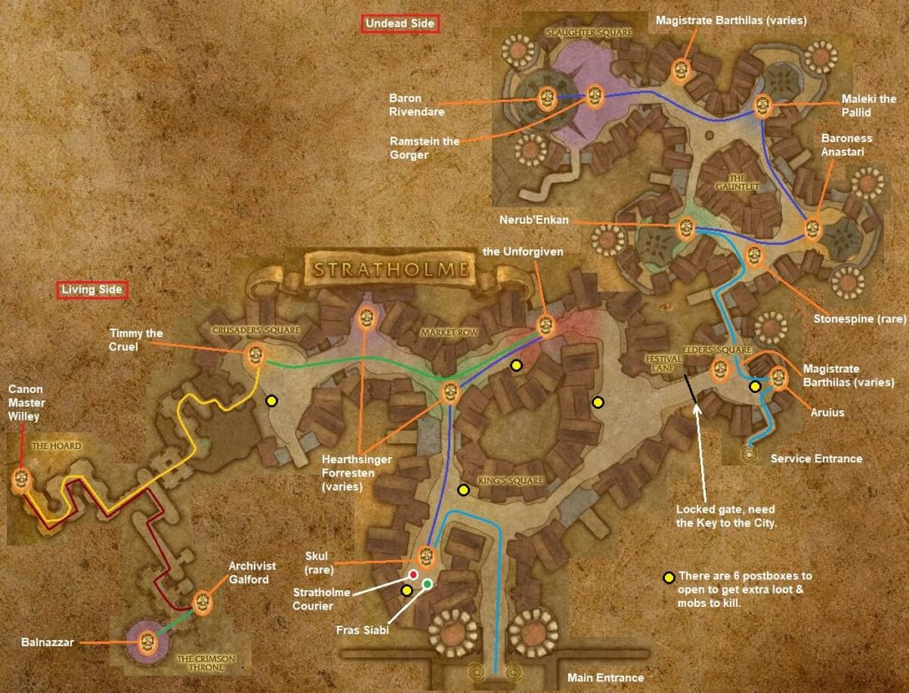

# Stratholme Main Gate

[All Forever dungeon guides](README.md)

**Research snapshot: 31 October 2026.** Tactics and annotated layouts use Classic references. Forever loot reports and Classic drop tables are listed separately.

**Level:** Client level 55; Classic planning 58–60. **Location:** Eastern Plaguelands. **Group:** 5. Client level is a listing value, not a promise that a group at that level can finish the dungeon. [Forever listing](https://playfulls.com/loot-tables/dungeons/stratholme).

## Before entering

Classic reference: bring Scarlet Key from Scarlet Monastery Library for the Bastion. Pick up Argent Dawn and archive quests beforehand. Opening three mailboxes summons Postmaster Malown; do this only with the party ready. The Medallion helps Aurius join the Undead-side final encounter. [Classic preparation reference](https://www.wowhead.com/classic/guide/stratholme-live-dungeon-strategy-wow-classic).

## Layout and route

Annotated Classic reference layout; Forever details may differ. [Full-size map](https://eintr.net/WoW/images/Stratholme-walkthrough-map-1024x781.jpg) / [Map source](https://eintr.net/WoW/World-of-Warcraft-Classic-Dungeon-Walkthrough.html).

Enter the main northern gate and follow the streets toward the Scarlet Bastion. Kill Timmy at the courtyard, pass the locked Scarlet entrance, then clear Willey, Galford and Balnazzar. Check the optional Malor side room for the Medallion of Faith; street rares and mailboxes are separate detours. [Classic route reference](https://www.wowhead.com/classic/guide/stratholme-live-dungeon-strategy-wow-classic).

- [Annotated Classic layout and route](https://eintr.net/WoW/images/Stratholme-walkthrough-map-1024x781.jpg) — Classic reference; Forever changes unverified. [Map source](https://eintr.net/WoW/World-of-Warcraft-Classic-Dungeon-Walkthrough.html).
- [Stratholme](https://playfulls.com/dungeonmaps/stratholme-1.webp) — Community-hosted dungeon map; boss pins may be approximate or incomplete. [Map source](https://playfulls.com/loot-tables/dungeons/stratholme).

## Bosses and tactics

Use these as Classic-based tactical prompts, not verified Forever combat logs. “Client listed” means the current community client roster names the encounter; additional rares, companions and summons are included for planning. [Current roster](https://playfulls.com/loot-tables/dungeons/stratholme), [tactical reference](https://www.wowhead.com/classic/guide/stratholme-live-dungeon-strategy-wow-classic).

| Boss / encounter | Status | Action |
| --- | --- | --- |
| Hearthsinger Forresten | Client listed; rare | Interrupt lullaby; spread against Multi-Shot. |
| The Unforgiven | Client listed; optional | Clear alley; collect ghost adds. |
| Skul | Client listed; rare | Optional street rare; interrupt casts. |
| Timmy the Cruel | Client listed; main encounter | Save mitigation and damage for enrage. |
| Malor the Zealous | Client listed; optional | Interrupt healing; burst through low health. |
| Cannon Master Willey | Client listed; main encounter | Assign cannons to riflemen; save ammunition. |
| Archivist Galford | Client listed; main encounter | Heal Burning Winds victim; ranged stay back. |
| Balnazzar | Client listed; main encounter | Dispel control; handle fear without extra pulls. |
| Crimson Hammersmith | Client listed; summoned | Summoned by blacksmithing-plan interaction. |
| Postmaster Malown | Client listed; summoned | Third mailbox event; prepare for teleport/control. |
| Ezra Grimm | Client listed; quest | Classic counterpart Fras Siabi; avoid fire cone. |
| Sothos | Classic reference; quest | Dungeon-set summon with Jarien; conditional. |
| Jarien | Classic reference; quest | Dungeon-set summon with Sothos; conditional. |

## Forever loot currently documented

The following is the complete boss-associated list recovered from the linked Playfulls page for this wing, not a complete Forever drop table. These are community loot associations checked against client item data; a client item existing does not by itself prove its drop source. Drop percentages are intentionally omitted because the source marks them unconfirmed in Forever. [Live loot source](https://playfulls.com/loot-tables/dungeons/stratholme).

| Boss | Linked items |
| --- | --- |
| Hearthsinger Forresten | [Magister's Boots](https://playfulls.com/item/16682-magisters-boots) |
| Timmy the Cruel | [Lightforge Gauntlets](https://playfulls.com/item/16724-lightforge-gauntlets) |
| Malor the Zealous |  |
| Cannon Master Willey | [Shadowcraft Spaulders](https://playfulls.com/item/16708-shadowcraft-spaulders); [Plans: Heartseeker](https://playfulls.com/item/12839-plans-heartseeker) (Recipe) |
| Archivist Galford | [Devout Gloves](https://playfulls.com/item/16692-devout-gloves); [Tome of Conjure Food VII](https://playfulls.com/item/22897-tome-of-conjure-food-vii) (Spell-learning item); [Righteous Orb](https://playfulls.com/item/12811-righteous-orb) |
| Balnazzar | [Lightforge Boots](https://playfulls.com/item/16725-lightforge-boots); [Pattern: Truefaith Vestments](https://playfulls.com/item/14512-pattern-truefaith-vestments) (Recipe); [Recipe: Flask of Distilled Wisdom](https://playfulls.com/item/13520-recipe-flask-of-distilled-wisdom) (Recipe); [Head of Balnazzar](https://playfulls.com/item/13250-head-of-balnazzar) (Quest / conditional) |
| The Unforgiven | [Wildheart Gloves](https://playfulls.com/item/16717-wildheart-gloves) |
| Crimson Hammersmith | [Bottom Half of Advanced Armorsmithing: Volume II](https://playfulls.com/item/18781-bottom-half-of-advanced-armorsmithing-volume-ii) |

Bosses absent from this section have no recovered Forever loot association in this source. The table below supplies a separately labeled Classic reference. Dungeon-wide random drops, quest turn-in rewards and event chests are not silently counted as boss loot.

## Classic loot reference

**These drops are not confirmed for Forever.**

Direct links open Classic item records. Each boss name links to the database or guide supporting its Classic drop association. Named equipment and recipes are listed; ordinary grey/white items and broad random world-drop pools are omitted. A missing entry means the retrieved sources did not supply a dedicated table. Rare spawns and quest summons may require different access or may change in Forever.

| Boss / encounter | Linked items |
| --- | --- |
| [Hearthsinger Forresten](https://www.wowhead.com/classic/guide/stratholme-live-dungeon-strategy-wow-classic) | [Songbird Blouse](https://classicdb.ch/?item=13378); [Piccolo of the Flaming Fire](https://classicdb.ch/?item=13379); [Woollies of the Prancing Minstrel](https://classicdb.ch/?item=13383); [Rainbow Girdle](https://classicdb.ch/?item=13384); [Magister's Boots](https://classicdb.ch/?item=16682) |
| [The Unforgiven](https://classicdb.ch/?npc=10516) | [Mask of the Unforgiven](https://classicdb.ch/?item=13404); [Wailing Nightbane Pauldrons](https://classicdb.ch/?item=13405); [Soul Breaker](https://classicdb.ch/?item=13408); [Tearfall Bracers](https://classicdb.ch/?item=13409); [Wildheart Gloves](https://classicdb.ch/?item=16717) **Quest / access / other:** [Plagued Flesh Sample](https://classicdb.ch/?item=13174) |
| [Skul](https://classicdb.ch/?npc=10393) | [Skul's Cold Embrace](https://classicdb.ch/?item=13394); [Skul's Fingerbone Claws](https://classicdb.ch/?item=13395); [Skul's Ghastly Touch](https://classicdb.ch/?item=13396) |
| [Timmy the Cruel](https://classicdb.ch/?npc=10808) | [Vambraces of the Sadist](https://classicdb.ch/?item=13400); [The Cruel Hand of Timmy](https://classicdb.ch/?item=13401); [Timmy's Galoshes](https://classicdb.ch/?item=13402); [Grimgore Noose](https://classicdb.ch/?item=13403); [Lightforge Gauntlets](https://classicdb.ch/?item=16724) **Quest / access / other:** [Plagued Flesh Sample](https://classicdb.ch/?item=13174) |
| [Malor the Zealous](https://classicdb.ch/?npc=11032) | No dedicated equipment verified in retrieved table. |
| [Cannon Master Willey](https://classicdb.ch/?npc=10997) | [Plans: Heartseeker](https://classicdb.ch/?item=12839); [Willey's Portable Howitzer](https://classicdb.ch/?item=13380); [Master Cannoneer Boots](https://classicdb.ch/?item=13381); [Cannonball Runner](https://classicdb.ch/?item=13382); [Shadowcraft Spaulders](https://classicdb.ch/?item=16708); [Barrage Girdle](https://classicdb.ch/?item=18721); [Diana's Pearl Necklace](https://classicdb.ch/?item=22403); [Willey's Back Scratcher](https://classicdb.ch/?item=22404); [Mantle of the Scarlet Crusade](https://classicdb.ch/?item=22405); [Redemption](https://classicdb.ch/?item=22406); [Helm of the New Moon](https://classicdb.ch/?item=22407) **Quest / access / other:** [Miniature Cannon Balls](https://classicdb.ch/?item=13377) |
| [Archivist Galford](https://classicdb.ch/?npc=10811) | [Tome of Knowledge](https://classicdb.ch/?item=13385); [Archivist Cape](https://classicdb.ch/?item=13386); [Foresight Girdle](https://classicdb.ch/?item=13387); [Devout Gloves](https://classicdb.ch/?item=16692); [Ash Covered Boots](https://classicdb.ch/?item=18716); [Tome of Conjure Food VII](https://classicdb.ch/?item=22897) **Quest / access / other:** [Righteous Orb](https://classicdb.ch/?item=12811) |
| [Balnazzar](https://www.wowhead.com/classic/guide/stratholme-live-dungeon-strategy-wow-classic) | [Star of Mystaria](https://classicdb.ch/?item=12103); [Demonshear](https://classicdb.ch/?item=13348); [Book of the Dead](https://classicdb.ch/?item=13353); [Wyrmtongue Shoulders](https://classicdb.ch/?item=13358); [Crown of Tyranny](https://classicdb.ch/?item=13359); [Gift of the Elven Magi](https://classicdb.ch/?item=13360); [Fire Striders](https://classicdb.ch/?item=13369); [Recipe: Flask of Distilled Wisdom](https://classicdb.ch/?item=13520); [Pattern: Truefaith Vestments](https://classicdb.ch/?item=14512); [Lightforge Boots](https://classicdb.ch/?item=16725); [Hammer of the Grand Crusader](https://classicdb.ch/?item=18717); [Grand Crusader's Helm](https://classicdb.ch/?item=18718); [Shroud of the Nathrezim](https://classicdb.ch/?item=18720); [Band of Mending](https://classicdb.ch/?item=22334) |
| [Crimson Hammersmith](https://classicdb.ch/?npc=11120) | No dedicated equipment verified in retrieved table. **Quest / access / other:** [Crimson Hammersmith's Apron](https://classicdb.ch/?item=13351); [Bottom Half of Advanced Armorsmithing: Volume II](https://classicdb.ch/?item=18781) |
| [Postmaster Malown](https://classicdb.ch/?npc=11143) | [The Postmaster's Tunic](https://classicdb.ch/?item=13388); [The Postmaster's Trousers](https://classicdb.ch/?item=13389); [The Postmaster's Band](https://classicdb.ch/?item=13390); [The Postmaster's Treads](https://classicdb.ch/?item=13391); [The Postmaster's Seal](https://classicdb.ch/?item=13392); [Malown's Slam](https://classicdb.ch/?item=13393) **Quest / access / other:** [Plagued Flesh Sample](https://classicdb.ch/?item=13174) |
| [Ezra Grimm](https://classicdb.ch/?npc=11058) | No dedicated equipment verified in retrieved table. **Quest / access / other:** [Siabi's Premium Tobacco](https://classicdb.ch/?item=13172) |
| [Sothos](https://classicdb.ch/?npc=16102) | No dedicated equipment verified in retrieved table. **Quest / access / other:** [Left Piece of Lord Valthalak's Amulet](https://classicdb.ch/?item=21984); [Right Piece of Lord Valthalak's Amulet](https://classicdb.ch/?item=22046) |
| [Jarien](https://classicdb.ch/?npc=16101) | No dedicated equipment verified in retrieved table. **Quest / access / other:** [Left Piece of Lord Valthalak's Amulet](https://classicdb.ch/?item=21984); [Right Piece of Lord Valthalak's Amulet](https://classicdb.ch/?item=22046) |

**Name mismatch:** the current community roster calls the tobacco-crate encounter Ezra Grimm; the Classic database for the same NPC ID calls it Fras Siabi. The fallback loot link preserves the Classic source name. Jarien/Sothos also reward their event chest; their personal drops are not the complete event rewards.

**Sothos and Jarien's Heirlooms (Classic event chest):** [Ironweave Robe](https://classicdb.ch/?item=22301); [Amulet of the Redeemed](https://classicdb.ch/?item=22327); [Legplates of Vigilance](https://classicdb.ch/?item=22328); [Scepter of Interminable Focus](https://classicdb.ch/?item=22329); [Band of Mending](https://classicdb.ch/?item=22334). [Chest source](https://classicdb.ch/?object=181083). The Medallion of Faith is in Malor's Strongbox, not his personal loot. [Medallion source](https://warcraft.wiki.gg/wiki/Medallion_of_Faith).
