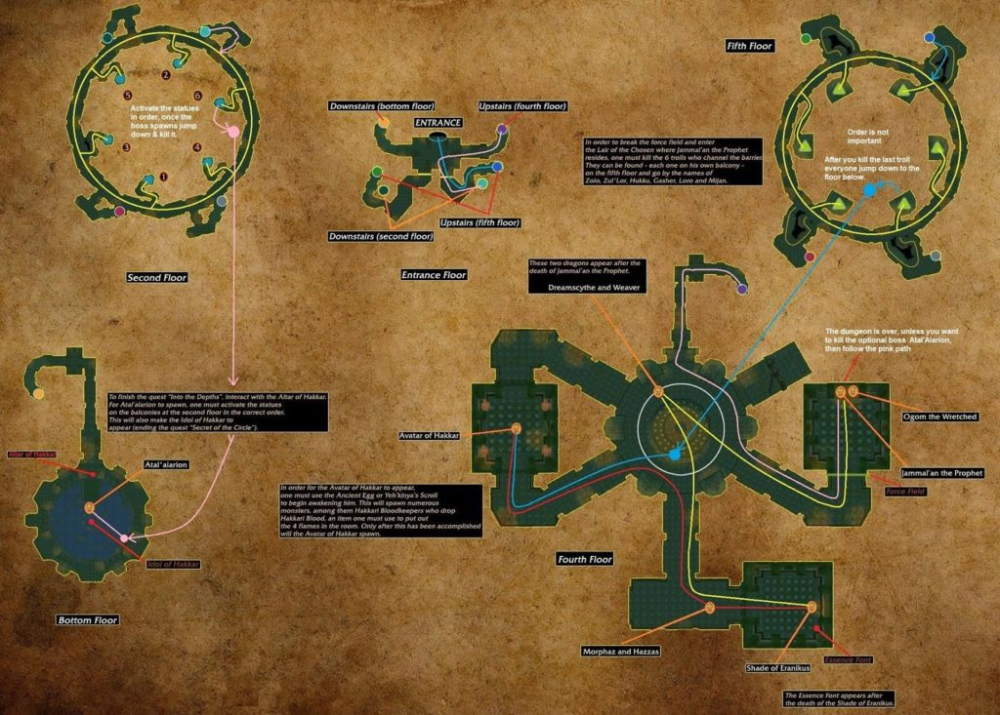

# Sunken Temple

[All Forever dungeon guides](README.md)

**Research snapshot: 31 October 2026.** Tactics and annotated layouts use Classic references. Forever loot reports and Classic drop tables are listed separately.

**Level:** Client/reported entry minimum level 45; Classic full-clear planning 50–55. **Location:** Swamp of Sorrows. **Group:** 5. Client level is a listing value, not a promise that a group at that level can finish the dungeon. [Forever listing](https://playfulls.com/loot-tables/dungeons/sunken-temple).
[Entry-level source](https://wowfdb.com/zones/sunken-temple/).

## Before entering

Classic reference: Atal'alarion's statues activate south, north, southwest, southeast, northwest, northeast. The Avatar event needs the Egg of Hakkar quest chain and collected Hakkari Blood to extinguish braziers. Bring an off-tank or reliable backup for Eranikus's sleep; prepare class quests beforehand. [Classic preparation reference](https://www.wowhead.com/classic/guide/temple-of-atalhakkar-sunken-temple-dungeon-strategy-wow-classic).

## Layout and route

Annotated Classic reference layout; Forever details may differ. [Full-size map](https://eintr.net/WoW/images/Sunken-Temple-walkthrough-map-1024x733.jpg) / [Map source](https://eintr.net/WoW/World-of-Warcraft-Classic-Dungeon-Walkthrough.html).

Swim into the temple in the Pool of Tears. Plan separate lower-statue and upper-platform loops so the group does not repeatedly change floors. Kill all six Atal'ai defenders to remove Jammal'an's barrier. Clear the dragon rooms, defeat Jammal'an/Ogom, then finish Eranikus. Add Atal'alarion and Hakkar only when their prerequisites are ready. [Classic route reference](https://www.wowhead.com/classic/guide/temple-of-atalhakkar-sunken-temple-dungeon-strategy-wow-classic).

- [Annotated Classic layout and route](https://eintr.net/WoW/images/Sunken-Temple-walkthrough-map-1024x733.jpg) — Classic reference; Forever changes unverified. [Map source](https://eintr.net/WoW/World-of-Warcraft-Classic-Dungeon-Walkthrough.html).
- [Sunken Temple](https://playfulls.com/dungeonmaps/sunken-temple-1.webp) — Community-hosted dungeon map; boss pins may be approximate or incomplete. [Map source](https://playfulls.com/loot-tables/dungeons/sunken-temple).

## Bosses and tactics

Use these as Classic-based tactical prompts, not verified Forever combat logs. “Client listed” means the current community client roster names the encounter; additional rares, companions and summons are included for planning. [Current roster](https://playfulls.com/loot-tables/dungeons/sunken-temple), [tactical reference](https://www.wowhead.com/classic/guide/temple-of-atalhakkar-sunken-temple-dungeon-strategy-wow-classic).

| Boss / encounter | Status | Action |
| --- | --- | --- |
| Gasher | Classic reference; defender | Clear platform carefully before moving on. |
| Hukku | Classic reference; defender | Control summoned demons; kill caster first. |
| Loro | Classic reference; defender | Interrupt casts; clear platform. |
| Mijan | Classic reference; defender | Interrupt healing. |
| Zolo | Classic reference; defender | Spread against chain damage. |
| Zul'Lor | Classic reference; defender | Keep debuff on tank; control nearby adds. |
| Atal'alarion | Client listed; summoned | Back against stairs; avoid knockback. |
| Jammal'an the Prophet | Client listed; main encounter | Kill Ogom; control the hexed player. |
| Ogom the Wretched | Classic reference; companion | Interrupt Shadow Bolt; remove curses. |
| Dreamscythe | Client listed; main encounter | Pull patrol separately; face breath away. |
| Weaver | Client listed; main encounter | Keep breath away from the party. |
| Morphaz | Client listed; main encounter | Spread; do not stand in front. |
| Hazzas | Client listed; main encounter | Keep tank in range through knockbacks. |
| Avatar of Hakkar | Client listed; summoned | Handle waves; interrupt suppressors; extinguish braziers. |
| Shade of Eranikus | Client listed; main encounter | Backup tank catches threat during Deep Slumber. |

## Forever loot currently documented

The following is the complete boss-associated list recovered from the linked Playfulls page for this wing, not a complete Forever drop table. These are community loot associations checked against client item data; a client item existing does not by itself prove its drop source. Drop percentages are intentionally omitted because the source marks them unconfirmed in Forever. [Live loot source](https://playfulls.com/loot-tables/dungeons/sunken-temple).

No boss equipment drops are documented in the retrieved Forever table. This is an evidence gap, not a claim that bosses drop nothing.

The current table has only dungeon-wide recipes: [Pattern: Green Dragonscale Leggings](https://playfulls.com/item/15733-pattern-green-dragonscale-leggings); [Formula: Enchant Cloak - Greater Resistance](https://playfulls.com/item/16216-formula-enchant-cloak-greater-resistance). These are trash drops, not boss rewards.

Bosses absent from this section have no recovered Forever loot association in this source. The table below supplies a separately labeled Classic reference. Dungeon-wide random drops, quest turn-in rewards and event chests are not silently counted as boss loot.

## Classic loot reference

**These drops are not confirmed for Forever.**

Direct links open Classic item records. Each boss name links to the database or guide supporting its Classic drop association. Named equipment and recipes are listed; ordinary grey/white items and broad random world-drop pools are omitted. A missing entry means the retrieved sources did not supply a dedicated table. Rare spawns and quest summons may require different access or may change in Forever.

| Boss / encounter | Linked items |
| --- | --- |
| [Gasher](https://classicdb.ch/?npc=5713) | [Atal'ai Spaulders](https://classicdb.ch/?item=10783); [Atal'ai Breastplate](https://classicdb.ch/?item=10784); [Atal'ai Leggings](https://classicdb.ch/?item=10785); [Atal'ai Boots](https://classicdb.ch/?item=10786); [Atal'ai Gloves](https://classicdb.ch/?item=10787); [Atal'ai Girdle](https://classicdb.ch/?item=10788) **Quest / access / other:** [Fetish of Hakkar](https://classicdb.ch/?item=6181) |
| [Hukku](https://classicdb.ch/?npc=5715) | [Atal'ai Spaulders](https://classicdb.ch/?item=10783); [Atal'ai Breastplate](https://classicdb.ch/?item=10784); [Atal'ai Leggings](https://classicdb.ch/?item=10785); [Atal'ai Boots](https://classicdb.ch/?item=10786); [Atal'ai Gloves](https://classicdb.ch/?item=10787); [Atal'ai Girdle](https://classicdb.ch/?item=10788) **Quest / access / other:** [Fetish of Hakkar](https://classicdb.ch/?item=6181) |
| [Loro](https://classicdb.ch/?npc=5714) | [Atal'ai Spaulders](https://classicdb.ch/?item=10783); [Atal'ai Breastplate](https://classicdb.ch/?item=10784); [Atal'ai Leggings](https://classicdb.ch/?item=10785); [Atal'ai Boots](https://classicdb.ch/?item=10786); [Atal'ai Gloves](https://classicdb.ch/?item=10787); [Atal'ai Girdle](https://classicdb.ch/?item=10788) **Quest / access / other:** [Fetish of Hakkar](https://classicdb.ch/?item=6181) |
| [Mijan](https://classicdb.ch/?npc=5717) | [Atal'ai Spaulders](https://classicdb.ch/?item=10783); [Atal'ai Breastplate](https://classicdb.ch/?item=10784); [Atal'ai Leggings](https://classicdb.ch/?item=10785); [Atal'ai Boots](https://classicdb.ch/?item=10786); [Atal'ai Gloves](https://classicdb.ch/?item=10787); [Atal'ai Girdle](https://classicdb.ch/?item=10788) **Quest / access / other:** [Fetish of Hakkar](https://classicdb.ch/?item=6181) |
| [Zolo](https://classicdb.ch/?npc=5712) | [Atal'ai Spaulders](https://classicdb.ch/?item=10783); [Atal'ai Breastplate](https://classicdb.ch/?item=10784); [Atal'ai Leggings](https://classicdb.ch/?item=10785); [Atal'ai Boots](https://classicdb.ch/?item=10786); [Atal'ai Gloves](https://classicdb.ch/?item=10787); [Atal'ai Girdle](https://classicdb.ch/?item=10788) **Quest / access / other:** [Fetish of Hakkar](https://classicdb.ch/?item=6181) |
| [Zul'Lor](https://classicdb.ch/?npc=5716) | [Atal'ai Spaulders](https://classicdb.ch/?item=10783); [Atal'ai Breastplate](https://classicdb.ch/?item=10784); [Atal'ai Leggings](https://classicdb.ch/?item=10785); [Atal'ai Boots](https://classicdb.ch/?item=10786); [Atal'ai Gloves](https://classicdb.ch/?item=10787); [Atal'ai Girdle](https://classicdb.ch/?item=10788) **Quest / access / other:** [Fetish of Hakkar](https://classicdb.ch/?item=6181) |
| [Atal'alarion](https://classicdb.ch/?npc=8580) | [Atal'alarion's Tusk Ring](https://classicdb.ch/?item=10798); [Headspike](https://classicdb.ch/?item=10799); [Darkwater Bracers](https://classicdb.ch/?item=10800) **Quest / access / other:** [Fetish of Hakkar](https://classicdb.ch/?item=6181) |
| [Jammal'an the Prophet](https://classicdb.ch/?npc=5710) | [Vestments of the Atal'ai Prophet](https://classicdb.ch/?item=10806); [Kilt of the Atal'ai Prophet](https://classicdb.ch/?item=10807); [Gloves of the Atal'ai Prophet](https://classicdb.ch/?item=10808) **Quest / access / other:** [Fetish of Hakkar](https://classicdb.ch/?item=6181); [Head of Jammal'an](https://classicdb.ch/?item=6212) |
| [Ogom the Wretched](https://classicdb.ch/?npc=5711) | [Blade of the Wretched](https://classicdb.ch/?item=10803); [Fist of the Damned](https://classicdb.ch/?item=10804); [Eater of the Dead](https://classicdb.ch/?item=10805) **Quest / access / other:** [Fetish of Hakkar](https://classicdb.ch/?item=6181) |
| [Dreamscythe](https://classicdb.ch/?npc=5721) | [Drakeclaw Band](https://classicdb.ch/?item=10795); [Drakestone](https://classicdb.ch/?item=10796); [Firebreather](https://classicdb.ch/?item=10797); [Smoldering Claw](https://classicdb.ch/?item=12243); [Drakefang Butcher](https://classicdb.ch/?item=12463); [Bloodfire Talons](https://classicdb.ch/?item=12464); [Nightfall Drape](https://classicdb.ch/?item=12465); [Dawnspire Cord](https://classicdb.ch/?item=12466) |
| [Weaver](https://classicdb.ch/?npc=5720) | [Drakeclaw Band](https://classicdb.ch/?item=10795); [Drakestone](https://classicdb.ch/?item=10796); [Firebreather](https://classicdb.ch/?item=10797); [Smoldering Claw](https://classicdb.ch/?item=12243); [Drakefang Butcher](https://classicdb.ch/?item=12463); [Bloodfire Talons](https://classicdb.ch/?item=12464); [Nightfall Drape](https://classicdb.ch/?item=12465); [Dawnspire Cord](https://classicdb.ch/?item=12466) |
| [Morphaz](https://classicdb.ch/?npc=5719) | [Drakeclaw Band](https://classicdb.ch/?item=10795); [Drakestone](https://classicdb.ch/?item=10796); [Firebreather](https://classicdb.ch/?item=10797); [Smoldering Claw](https://classicdb.ch/?item=12243); [Drakefang Butcher](https://classicdb.ch/?item=12463); [Bloodfire Talons](https://classicdb.ch/?item=12464); [Nightfall Drape](https://classicdb.ch/?item=12465); [Dawnspire Cord](https://classicdb.ch/?item=12466) **Quest / access / other:** [Blood of Morphaz](https://classicdb.ch/?item=20025) |
| [Hazzas](https://classicdb.ch/?npc=5722) | [Drakeclaw Band](https://classicdb.ch/?item=10795); [Drakestone](https://classicdb.ch/?item=10796); [Firebreather](https://classicdb.ch/?item=10797); [Smoldering Claw](https://classicdb.ch/?item=12243); [Drakefang Butcher](https://classicdb.ch/?item=12463); [Bloodfire Talons](https://classicdb.ch/?item=12464); [Nightfall Drape](https://classicdb.ch/?item=12465); [Dawnspire Cord](https://classicdb.ch/?item=12466) |
| [Avatar of Hakkar](https://classicdb.ch/?npc=8443) | [Might of Hakkar](https://classicdb.ch/?item=10838); [Windscale Sarong](https://classicdb.ch/?item=10842); [Featherskin Cape](https://classicdb.ch/?item=10843); [Spire of Hakkar](https://classicdb.ch/?item=10844); [Warrior's Embrace](https://classicdb.ch/?item=10845); [Bloodshot Greaves](https://classicdb.ch/?item=10846); [Embrace of the Wind Serpent](https://classicdb.ch/?item=12462) |
| [Shade of Eranikus](https://classicdb.ch/?npc=5709) | [Dire Nail](https://classicdb.ch/?item=10828); [Dragon's Eye](https://classicdb.ch/?item=10829); [Horns of Eranikus](https://classicdb.ch/?item=10833); [Crest of Supremacy](https://classicdb.ch/?item=10835); [Rod of Corrosion](https://classicdb.ch/?item=10836); [Tooth of Eranikus](https://classicdb.ch/?item=10837); [Dragon's Call](https://classicdb.ch/?item=10847) **Quest / access / other:** [Essence of Eranikus](https://classicdb.ch/?item=10454) |
