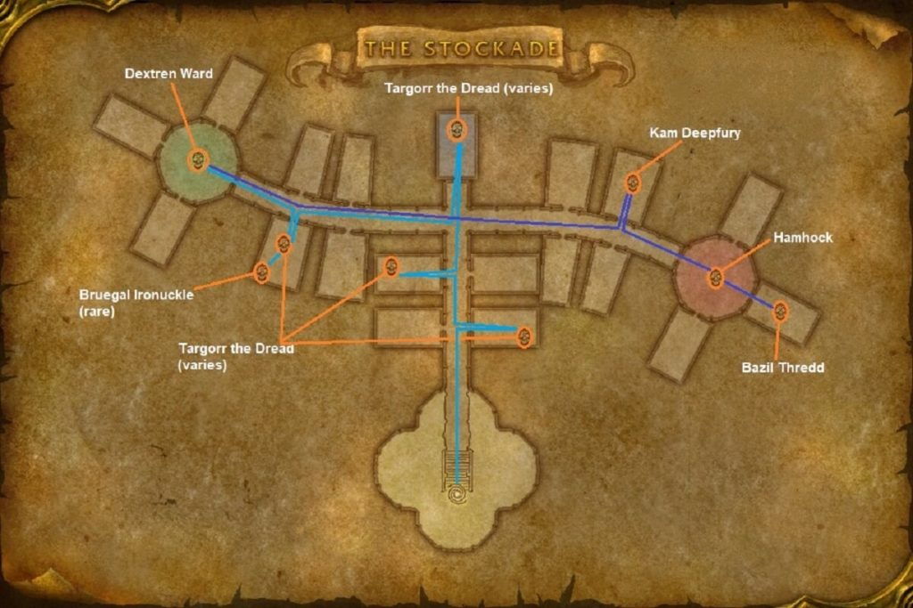

# The Stockade

[All Forever dungeon guides](README.md)

## Plan your run

**Planning range: 24–32 / Five players / Stormwind City.** Researched 31 October 2026; beta details may change. Playfulls lists dungeon level 23+; that is a data label, not a verified portal-entry requirement. [Current dungeon data](https://playfulls.com/loot-tables/dungeons/stormwind-stockade).

Enter the prison building north of the Mage Quarter. This is practically an Alliance dungeon because of its capital-city location.

Sweep both wings and side cells. Clear every nearby room before Dextren Ward; fear can pull uncleared prisoners. Control extra enemies before each boss. [Entrance and route reference](https://www.icy-veins.com/wow-forever/the-stockade-guide).

## Layout maps

Annotated Classic reference layout; Forever details may differ. [Full-size map](https://eintr.net/WoW/images/The-Stockades-walkthrough-map-1024x683.jpg) / [Map source](https://eintr.net/WoW/World-of-Warcraft-Classic-Dungeon-Walkthrough.html).

- [Map of Stormwind Stockade](https://playfulls.com/dungeonmaps/stormwind-stockade-1.webp)

Open the [interactive dungeon map](https://playfulls.com/loot-tables/dungeons/stormwind-stockade) for floor controls and available markers. Some boss positions are approximate or absent. [Annotated reference layout](https://foreveroth.com/en/donjons/?donjon=the-stockade).

## Bosses and tactics

The following tactics are summarized from the Forever guide.

- **Targorr the Dread:** Kill companions first; prepare healing for his low-health enrage.
- **Kam Deepfury:** Kill or control escorts; watch the tank during Shield Slam stuns.
- **Hamhock:** Kill escorts; spread to limit Chain Lightning.
- **Dextren Ward:** Clear adjacent cells before his fear.
- **Bazil Thredd:** Keep tank health high before Smoke Bomb's group stun.
- **Bruegal Ironknuckle (rare):** Check side cells; pull into cleared space and focus him.

[Tactics source](https://www.icy-veins.com/wow-forever/the-stockade-guide).

## Boss loot and item links

Named equipment, boss-specific recipes, pets, bags and quest starters currently listed by the sources appear below. Drop percentages are omitted: the sites mix expectations, legacy values and beta observations. Boss associations are community reports; client item existence alone does not prove a live drop.

| Boss / encounter | Named drops |
| --- | --- |
| Targorr the Dread | [Blackrock Harness](https://playfulls.com/item/273805-blackrock-harness); [Dark Horde Band](https://playfulls.com/item/273806-dark-horde-band); [Executioner Mantle](https://playfulls.com/item/273804-executioner-mantle); [Pattern: Filigreed Flame Leggings](https://playfulls.com/item/253942-pattern-filigreed-flame-leggings); [Plans: Veteran's Silvered Chain Helm](https://playfulls.com/item/251380-plans-veterans-silvered-chain-helm) |
| Kam Deepfury | [Bridgebreaker Bindings](https://playfulls.com/item/273808-bridgebreaker-bindings); [Demolition Girdle](https://playfulls.com/item/273807-demolition-girdle); [Kam's Walking Stick](https://playfulls.com/item/2280-kams-walking-stick); [Plans: Crusader's Silvered Chain Leggings](https://playfulls.com/item/251379-plans-crusaders-silvered-chain-leggings) |
| Hamhock | [Hamhock's Cleaver](https://playfulls.com/item/273809-hamhocks-cleaver); [Ogre Grips](https://playfulls.com/item/273810-ogre-grips); [Repurposed Rack](https://playfulls.com/item/273811-repurposed-rack) |
| Dextren Ward | [Boneslicer](https://playfulls.com/item/273819-boneslicer); [Graverobber's Shovel](https://playfulls.com/item/273817-graverobbers-shovel); [Nightskulker Ring](https://playfulls.com/item/273820-nightskulker-ring); [Plans: Guard's Silvered Chain Leggings](https://playfulls.com/item/251376-plans-guards-silvered-chain-leggings) |
| Bazil Thredd | [Concealed Hand Crossbow](https://playfulls.com/item/273829-concealed-hand-crossbow); [Debt Collector](https://playfulls.com/item/273827-debt-collector); [Defias Jailbreakers](https://playfulls.com/item/273824-defias-jailbreakers); [Red Wool Cloak](https://playfulls.com/item/273825-red-wool-cloak); [Pattern: Filigreed Pristine Circlet](https://playfulls.com/item/253976-pattern-filigreed-pristine-circlet); [Pattern: Filigreed Shining Circlet](https://playfulls.com/item/253986-pattern-filigreed-shining-circlet); [Pattern: Stormrider's Leather Kilt](https://playfulls.com/item/252824-pattern-stormriders-leather-kilt) |
| Bruegal Ironknuckle | [Jimmied Handcuffs](https://foreverdb.net/item/3228); [Prison Shank](https://foreverdb.net/item/2941); [Iron Knuckles](https://foreverdb.net/item/2942) |

[Loot source: Playfulls](https://playfulls.com/loot-tables/dungeons/stormwind-stockade). Supplemental rare, event or missing entries use [Icy Veins](https://www.icy-veins.com/wow-forever/the-stockade-guide) and [WoW Source](https://wowsrc.com/loot/the-stockade/), with individual ForeverDB item records. Shared recipe pools and generic trash/world drops remain in the [complete source table](https://playfulls.com/loot-tables/dungeons/stormwind-stockade); they are excluded from this boss table. See [Playfulls methodology](https://playfulls.com/methodology) for its client-versus-community distinction.

## Evidence and remaining gaps

Pattern: Brawler's Leather Legguards (252820) and Pattern: Defender's Leather Kilt (252822) are vendor-sold recipes with sparse community drop reports, so they remain outside the targeted boss table. [Wowhead reports the kilt pattern from Thalnos](https://www.wowhead.com/forever/item=252822/pattern-defenders-leather-kilt) and [the legguards pattern from Gelihast](https://www.wowhead.com/forever/npc=6243/gelihast). These reports do not establish reliable targeted boss loot.
