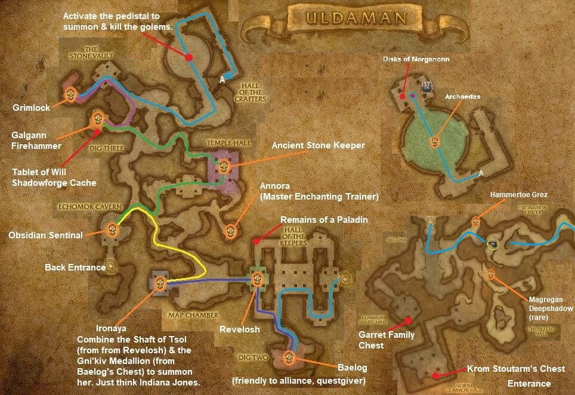

# Uldaman

[All Forever dungeon guides](README.md)

**Research snapshot: 31 October 2026.** Tactics and annotated layouts use Classic references. Forever loot reports and Classic drop tables are listed separately.

**Level:** Client level 35; reported entry minimum 30; Classic full-clear planning 42–46. **Location:** Badlands. **Group:** 5. Client level is a listing value, not a promise that a group at that level can finish the dungeon. [Forever listing](https://playfulls.com/loot-tables/dungeons/uldaman).
[Entry-level source](https://wowfdb.com/zones/uldaman/).

## Before entering

Classic access reference: combine Revelosh's Shaft of Tsol with the Gni'kiv Medallion from the dwarves' chest for Ironaya. Collect necklace and excavation quests beforehand. The Lost Dwarves are hostile to Horde; Alliance interaction differs. [Classic preparation reference](https://www.wowhead.com/classic/guide/uldaman-dungeon-strategy-wow-classic).

## Layout and route

Annotated Classic reference layout; Forever details may differ. [Full-size map](https://eintr.net/WoW/images/Uldaman-walkthrough-map.jpg) / [Map source](https://eintr.net/WoW/World-of-Warcraft-Classic-Dungeon-Walkthrough.html).

Enter the northern Badlands dig and follow the excavation tunnels to the portal. Clear the early dwarf and trogg branches, obtain the Staff of Prehistoria components, open Ironaya's chamber, then continue through the stone halls to Galgann, Grimlok and Archaedas. Activate the altars only when everyone is ready. [Classic route reference](https://www.wowhead.com/classic/guide/uldaman-dungeon-strategy-wow-classic).

- [Annotated Classic layout and route](https://eintr.net/WoW/images/Uldaman-walkthrough-map.jpg) — Classic reference; Forever changes unverified. [Map source](https://eintr.net/WoW/World-of-Warcraft-Classic-Dungeon-Walkthrough.html).
- [Uldaman](https://playfulls.com/dungeonmaps/uldaman-1.webp) — Community-hosted dungeon map; boss pins may be approximate or incomplete. [Map source](https://playfulls.com/loot-tables/dungeons/uldaman).

## Bosses and tactics

Use these as Classic-based tactical prompts, not verified Forever combat logs. “Client listed” means the current community client roster names the encounter; additional rares, companions and summons are included for planning. [Current roster](https://playfulls.com/loot-tables/dungeons/uldaman), [tactical reference](https://www.wowhead.com/classic/guide/uldaman-dungeon-strategy-wow-classic).

| Boss / encounter | Status | Action |
| --- | --- | --- |
| Revelosh | Client listed; main encounter | Interrupt Chain Lightning; clear accompanying troggs. |
| The Lost Dwarves | Client listed; faction | Control one dwarf; focus one target. |
| Ironaya | Client listed; optional | Keep non-tanks behind her; allow knockback space. |
| Obsidian Sentinel | Client listed; optional | Collect shards before they overwhelm the healer. |
| Ancient Stone Keeper | Client listed; main encounter | Move away from sand storms. |
| Galgann Firehammer | Client listed; main encounter | Control helpers; remove Amplify Flames. |
| Grimlok | Client listed; main encounter | Control the adds; interrupt his spells. |
| Archaedas | Client listed; main encounter | Assign add control; prioritize awakened guardians. |
| Digmaster Shovelphlange | Classic reference; outdoor rare | Rare in the outer dig; outside the instance. |

## Forever loot currently documented

The following is the complete boss-associated list recovered from the linked Playfulls page for this wing, not a complete Forever drop table. These are community loot associations checked against client item data; a client item existing does not by itself prove its drop source. Drop percentages are intentionally omitted because the source marks them unconfirmed in Forever. [Live loot source](https://playfulls.com/loot-tables/dungeons/uldaman).

| Boss | Linked items |
| --- | --- |
| Revelosh | [Revelosh's Armguards](https://playfulls.com/item/9388-reveloshs-armguards); [Revelosh's Boots](https://playfulls.com/item/9387-reveloshs-boots); [Revelosh's Gloves](https://playfulls.com/item/9390-reveloshs-gloves); [Revelosh's Spaulders](https://playfulls.com/item/9389-reveloshs-spaulders); [The Shaft of Tsol](https://playfulls.com/item/7741-the-shaft-of-tsol) (Quest / conditional) |
| Ironaya | [Ironaya's Bracers](https://playfulls.com/item/9409-ironayas-bracers); [Ironshod Bludgeon](https://playfulls.com/item/9408-ironshod-bludgeon); [Stoneweaver Leggings](https://playfulls.com/item/9407-stoneweaver-leggings) |
| Obsidian Sentinel | [Obsidian Power Source](https://playfulls.com/item/8053-obsidian-power-source) (Quest / conditional) |
| Ancient Stone Keeper | [Cragfists](https://playfulls.com/item/9410-cragfists); [Rockshard Pauldrons](https://playfulls.com/item/9411-rockshard-pauldrons) |
| Galgann Firehammer | [Emberscale Cape](https://playfulls.com/item/11311-emberscale-cape); [Flameseer Mantle](https://playfulls.com/item/11310-flameseer-mantle); [Galgann's Fireblaster](https://playfulls.com/item/9412-galganns-fireblaster); [Galgann's Firehammer](https://playfulls.com/item/9419-galganns-firehammer) |
| Grimlok | [Grimlok's Charge](https://playfulls.com/item/9416-grimloks-charge); [Grimlok's Tribal Vestments](https://playfulls.com/item/9415-grimloks-tribal-vestments); [Oilskin Leggings](https://playfulls.com/item/9414-oilskin-leggings); [Shattered Necklace Sapphire](https://playfulls.com/item/7670-shattered-necklace-sapphire) (Quest / conditional) |
| Archaedas | [Archaedic Stone](https://playfulls.com/item/11118-archaedic-stone) |

Bosses absent from this section have no recovered Forever loot association in this source. The table below supplies a separately labeled Classic reference. Dungeon-wide random drops, quest turn-in rewards and event chests are not silently counted as boss loot.

## Classic loot reference

**These drops are not confirmed for Forever.**

Direct links open Classic item records. Each boss name links to the database or guide supporting its Classic drop association. Named equipment and recipes are listed; ordinary grey/white items and broad random world-drop pools are omitted. A missing entry means the retrieved sources did not supply a dedicated table. Rare spawns and quest summons may require different access or may change in Forever.

| Boss / encounter | Linked items |
| --- | --- |
| [Revelosh](https://classicdb.ch/?npc=6910) | [Revelosh's Boots](https://classicdb.ch/?item=9387); [Revelosh's Armguards](https://classicdb.ch/?item=9388); [Revelosh's Spaulders](https://classicdb.ch/?item=9389); [Revelosh's Gloves](https://classicdb.ch/?item=9390) **Quest / access / other:** [The Shaft of Tsol](https://classicdb.ch/?item=7741) |
| [The Lost Dwarves](https://www.wowhead.com/classic/guide/uldaman-dungeon-strategy-wow-classic) | [Horned Viking Helmet](https://classicdb.ch/?item=9394); [Worn Running Boots](https://classicdb.ch/?item=9398); [Nordic Longshank](https://classicdb.ch/?item=9401); [Olaf's All Purpose Shield](https://classicdb.ch/?item=9404) **Quest / access / other:** [Precision Arrow](https://classicdb.ch/?item=9399) |
| [Ironaya](https://classicdb.ch/?npc=7228) | [Stoneweaver Leggings](https://classicdb.ch/?item=9407); [Ironshod Bludgeon](https://classicdb.ch/?item=9408); [Ironaya's Bracers](https://classicdb.ch/?item=9409) |
| [Obsidian Sentinel](https://www.wowhead.com/classic/guide/uldaman-dungeon-strategy-wow-classic) | No dedicated equipment verified in retrieved table. **Quest / access / other:** [Obsidian Power Source](https://classicdb.ch/?item=8053) |
| [Ancient Stone Keeper](https://classicdb.ch/?npc=7206) | [Cragfists](https://classicdb.ch/?item=9410); [Rockshard Pauldrons](https://classicdb.ch/?item=9411) |
| [Galgann Firehammer](https://classicdb.ch/?npc=7291) | [Galgann's Fireblaster](https://classicdb.ch/?item=9412); [Galgann's Firehammer](https://classicdb.ch/?item=9419); [Flameseer Mantle](https://classicdb.ch/?item=11310); [Emberscale Cape](https://classicdb.ch/?item=11311) |
| [Grimlok](https://classicdb.ch/?npc=4854) | [Oilskin Leggings](https://classicdb.ch/?item=9414); [Grimlok's Tribal Vestments](https://classicdb.ch/?item=9415); [Grimlok's Charge](https://classicdb.ch/?item=9416) **Quest / access / other:** [Shattered Necklace Sapphire](https://classicdb.ch/?item=7670) |
| [Archaedas](https://classicdb.ch/?npc=2748) | [The Rockpounder](https://classicdb.ch/?item=9413); [Stoneslayer](https://classicdb.ch/?item=9418); [Archaedic Stone](https://classicdb.ch/?item=11118) **Quest / access / other:** [Shattered Necklace Power Source](https://classicdb.ch/?item=7672) |
| [Digmaster Shovelphlange](https://www.wowhead.com/classic/guide/uldaman-dungeon-strategy-wow-classic) | [Expert Goldminer's Helmet](https://classicdb.ch/?item=9375); [Shovelphlange's Mining Axe](https://classicdb.ch/?item=9378) |
