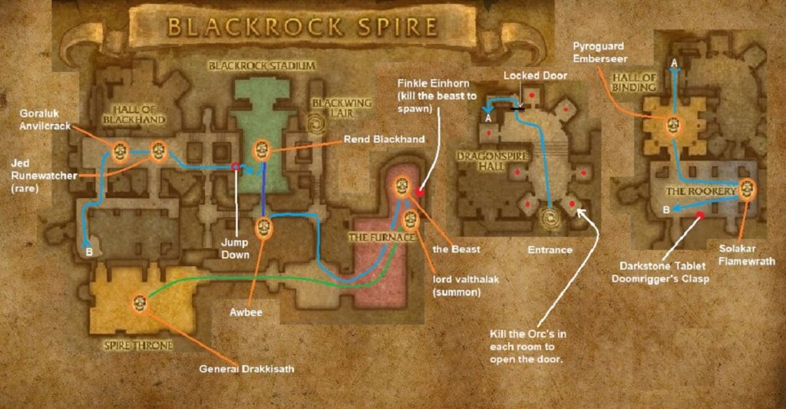

# Upper Blackrock Spire

[All Forever dungeon guides](README.md)

**Research snapshot: 31 October 2026.** Tactics and annotated layouts use Classic references. Forever loot reports and Classic drop tables are listed separately.

**Level:** Client Spire level 53; Classic planning level 60. **Location:** Blackrock Mountain / Burning Steppes. **Group:** 10 in Classic and current community reference. Client level is a listing value, not a promise that a group at that level can finish the dungeon. [Forever listing](https://playfulls.com/loot-tables/dungeons/blackrock-spire).

## Before entering

Classic reference: one player needs Seal of Ascension to open Upper. Assign two tanks or a practiced kite for Drakkisath and his guards. Jed is a rare, Solakar an optional rookery event, and Valthalak a dungeon-set quest summon. Confirm these special encounters in Forever before arranging a farm. [Classic preparation reference](https://www.wowhead.com/classic/guide/upper-blackrock-spire-ubrs-dungeon-strategy-wow-classic).

## Layout and route

Annotated Classic reference layout; Forever details may differ. [Full-size map](https://eintr.net/WoW/images/Blackrock-Spire-Upper-walkthrough-map-1-1024x533.jpg) / [Map source](https://eintr.net/WoW/World-of-Warcraft-Classic-Dungeon-Walkthrough.html).

Open Upper's sealed door, clear the rune rooms, free and defeat Emberseer, then cross the rookery carefully. Continue through optional side rooms into Rend's arena waves, then The Beast and Drakkisath. Keep the raid together in the arena and avoid touching rookery eggs unnecessarily. [Classic route reference](https://www.wowhead.com/classic/guide/upper-blackrock-spire-ubrs-dungeon-strategy-wow-classic).

- [Annotated Classic layout and route](https://eintr.net/WoW/images/Blackrock-Spire-Upper-walkthrough-map-1-1024x533.jpg) — Classic reference; Forever changes unverified. [Map source](https://eintr.net/WoW/World-of-Warcraft-Classic-Dungeon-Walkthrough.html).
- [Blackrock Spire](https://playfulls.com/dungeonmaps/blackrock-spire-1.webp) — Community-hosted dungeon map; boss pins may be approximate or incomplete. [Map source](https://playfulls.com/loot-tables/dungeons/blackrock-spire).

## Bosses and tactics

Use these as Classic-based tactical prompts, not verified Forever combat logs. “Client listed” means the current community client roster names the encounter; additional rares, companions and summons are included for planning. [Current roster](https://playfulls.com/loot-tables/dungeons/blackrock-spire), [tactical reference](https://www.wowhead.com/classic/guide/upper-blackrock-spire-ubrs-dungeon-strategy-wow-classic).

| Boss / encounter | Status | Action |
| --- | --- | --- |
| Pyroguard Emberseer | Client listed; main encounter | Clear jailers; spread; heal fire damage. |
| Solakar Flamewreath | Classic reference; optional | Control successive rookery waves and whelps. |
| Jed Runewatcher | Classic reference; rare | Optional rare; interrupt casts. |
| Goraluk Anvilcrack | Classic reference; optional | Optional smith; face melee attacks away. |
| Gyth | Classic reference; arena | Face breath away; prepare Rend's dismount. |
| Warchief Rend Blackhand | Client listed; main encounter | Handle arena waves; focus the active boss. |
| The Beast | Client listed; main encounter | Tank against wall; manage fear and knockback. |
| General Drakkisath | Client listed; main encounter | Separate guards; interrupt heals; backup tank ready. |
| Lord Valthalak | Client listed; quest | Kill summoned spirits; interrupt life-drain mechanics. |

## Forever loot currently documented

The following is the complete boss-associated list recovered from the linked Playfulls page for this wing, not a complete Forever drop table. These are community loot associations checked against client item data; a client item existing does not by itself prove its drop source. Drop percentages are intentionally omitted because the source marks them unconfirmed in Forever. [Live loot source](https://playfulls.com/loot-tables/dungeons/blackrock-spire).

| Boss | Linked items |
| --- | --- |
| Pyroguard Emberseer | [Gauntlets of Elements](https://playfulls.com/item/16672-gauntlets-of-elements); [Tablet of Flame Shock VI](https://playfulls.com/item/23320-tablet-of-flame-shock-vi) (Spell-learning item) |
| Warchief Rend Blackhand | [Spaulders of Valor](https://playfulls.com/item/16733-spaulders-of-valor) |
| The Beast | [Lightforge Spaulders](https://playfulls.com/item/16729-lightforge-spaulders); [Ace of Beasts](https://playfulls.com/item/19227-ace-of-beasts) (Card); [Book of Ferocious Bite V](https://playfulls.com/item/24101-book-of-ferocious-bite-v) (Spell-learning item) |
| General Drakkisath | [Beaststalker's Tunic](https://playfulls.com/item/16674-beaststalkers-tunic); [Breastplate of Valor](https://playfulls.com/item/16730-breastplate-of-valor); [Devout Robe](https://playfulls.com/item/16690-devout-robe); [Dreadmist Robe](https://playfulls.com/item/16700-dreadmist-robe); [Lightforge Breastplate](https://playfulls.com/item/16726-lightforge-breastplate); [Magister's Robes](https://playfulls.com/item/16688-magisters-robes); [Shadowcraft Tunic](https://playfulls.com/item/16721-shadowcraft-tunic); [Vest of Elements](https://playfulls.com/item/16666-vest-of-elements); [Wildheart Vest](https://playfulls.com/item/16706-wildheart-vest); [Pattern: Red Dragonscale Breastplate](https://playfulls.com/item/15730-pattern-red-dragonscale-breastplate) (Recipe); [Recipe: Flask of the Titans](https://playfulls.com/item/13519-recipe-flask-of-the-titans) (Recipe) |

Bosses absent from this section have no recovered Forever loot association in this source. The table below supplies a separately labeled Classic reference. Dungeon-wide random drops, quest turn-in rewards and event chests are not silently counted as boss loot.

## Classic loot reference

**These drops are not confirmed for Forever.**

Direct links open Classic item records. Each boss name links to the database or guide supporting its Classic drop association. Named equipment and recipes are listed; ordinary grey/white items and broad random world-drop pools are omitted. A missing entry means the retrieved sources did not supply a dedicated table. Rare spawns and quest summons may require different access or may change in Forever.

| Boss / encounter | Linked items |
| --- | --- |
| [Pyroguard Emberseer](https://www.wowhead.com/classic/guide/upper-blackrock-spire-ubrs-dungeon-strategy-wow-classic) | [Wildfire Cape](https://classicdb.ch/?item=12905); [Flaming Band](https://classicdb.ch/?item=12926); [Truestrike Shoulders](https://classicdb.ch/?item=12927); [Emberfury Talisman](https://classicdb.ch/?item=12929); [Gauntlets of Elements](https://classicdb.ch/?item=16672) |
| [Solakar Flamewreath](https://classicdb.ch/?npc=10264) | [Dustfeather Sash](https://classicdb.ch/?item=12589); [Nightbrace Tunic](https://classicdb.ch/?item=12603); [Crystallized Girdle](https://classicdb.ch/?item=12606); [Polychromatic Visionwrap](https://classicdb.ch/?item=12609); [Devout Mantle](https://classicdb.ch/?item=16695); [Schematic: Hyper-Radiant Flame Reflector](https://classicdb.ch/?item=18657) **Quest / access / other:** [Black Dragonspawn Eye](https://classicdb.ch/?item=16786) |
| [Jed Runewatcher](https://classicdb.ch/?npc=10509) | [Starfire Tiara](https://classicdb.ch/?item=12604); [Serpentine Skuller](https://classicdb.ch/?item=12605); [Briarwood Reed](https://classicdb.ch/?item=12930) **Quest / access / other:** [Blackrock Bracer](https://classicdb.ch/?item=22138) |
| [Goraluk Anvilcrack](https://classicdb.ch/?npc=10899) | [Plans: Invulnerable Mail](https://classicdb.ch/?item=12728); [Plans: Arcanite Champion](https://classicdb.ch/?item=12834); [Plans: Masterwork Stormhammer](https://classicdb.ch/?item=12837); [Handcrafted Mastersmith Leggings](https://classicdb.ch/?item=13498); [Handcrafted Mastersmith Girdle](https://classicdb.ch/?item=13502); [Flame Walkers](https://classicdb.ch/?item=18047); [Mastersmith's Hammer](https://classicdb.ch/?item=18048) **Quest / access / other:** [Bottom Half of Advanced Armorsmithing: Volume I](https://classicdb.ch/?item=18779); [Blackrock Bracer](https://classicdb.ch/?item=22138) |
| [Gyth](https://classicdb.ch/?npc=10339) | [Gyth's Skull](https://classicdb.ch/?item=12952); [Dragoneye Coif](https://classicdb.ch/?item=12953); [Tribal War Feathers](https://classicdb.ch/?item=12960); [Recipe: Flask of Chromatic Resistance](https://classicdb.ch/?item=13522); [Pauldrons of Elements](https://classicdb.ch/?item=16669); [Dragonskin Cowl](https://classicdb.ch/?item=22225) **Quest / access / other:** [Chromatic Carapace](https://classicdb.ch/?item=12871) |
| [Warchief Rend Blackhand](https://www.wowhead.com/classic/guide/upper-blackrock-spire-ubrs-dungeon-strategy-wow-classic) | [Blackhand Doomsaw](https://classicdb.ch/?item=12583); [Eye of Rend](https://classicdb.ch/?item=12587); [Felstriker](https://classicdb.ch/?item=12590); [Warmaster Legguards](https://classicdb.ch/?item=12935); [Battleborn Armbraces](https://classicdb.ch/?item=12936); [Dal'Rend's Tribal Guardian](https://classicdb.ch/?item=12939); [Dal'Rend's Sacred Charge](https://classicdb.ch/?item=12940); [Spaulders of Valor](https://classicdb.ch/?item=16733); [Dragonrider Boots](https://classicdb.ch/?item=18102); [Band of Rumination](https://classicdb.ch/?item=18103); [Feralsurge Girdle](https://classicdb.ch/?item=18104); [Faith Healer's Boots](https://classicdb.ch/?item=22247) |
| [The Beast](https://classicdb.ch/?npc=10430) | [Finkle's Skinner](https://classicdb.ch/?item=12709); [Blademaster Leggings](https://classicdb.ch/?item=12963); [Tristam Legguards](https://classicdb.ch/?item=12964); [Spiritshroud Leggings](https://classicdb.ch/?item=12965); [Blackmist Armguards](https://classicdb.ch/?item=12966); [Bloodmoon Cloak](https://classicdb.ch/?item=12967); [Frostweaver Cape](https://classicdb.ch/?item=12968); [Seeping Willow](https://classicdb.ch/?item=12969); [Lightforge Spaulders](https://classicdb.ch/?item=16729); [Ironweave Boots](https://classicdb.ch/?item=22311); [Book of Ferocious Bite V](https://classicdb.ch/?item=24101) **Quest / access / other:** [Ace of Beasts](https://classicdb.ch/?item=19227) |
| [General Drakkisath](https://classicdb.ch/?npc=10363) | [Blackblade of Shahram](https://classicdb.ch/?item=12592); [Draconian Deflector](https://classicdb.ch/?item=12602); [Painweaver Band](https://classicdb.ch/?item=13098); [Tooth of Gnarr](https://classicdb.ch/?item=13141); [Brigam Girdle](https://classicdb.ch/?item=13142); [Recipe: Flask of the Titans](https://classicdb.ch/?item=13519); [Pattern: Red Dragonscale Breastplate](https://classicdb.ch/?item=15730); [Vest of Elements](https://classicdb.ch/?item=16666); [Beaststalker's Tunic](https://classicdb.ch/?item=16674); [Magister's Robes](https://classicdb.ch/?item=16688); [Devout Robe](https://classicdb.ch/?item=16690); [Dreadmist Robe](https://classicdb.ch/?item=16700); [Wildheart Vest](https://classicdb.ch/?item=16706); [Shadowcraft Tunic](https://classicdb.ch/?item=16721); [Lightforge Breastplate](https://classicdb.ch/?item=16726); [Breastplate of Valor](https://classicdb.ch/?item=16730); [Tome of the Lost](https://classicdb.ch/?item=22253); [Spellweaver's Turban](https://classicdb.ch/?item=22267); [Draconic Infused Emblem](https://classicdb.ch/?item=22268); [Shadow Prowler's Cloak](https://classicdb.ch/?item=22269) **Quest / access / other:** [Blood of the Black Dragon Champion](https://classicdb.ch/?item=16663) |
| [Lord Valthalak](https://www.wowhead.com/classic/npc=16042/lord-valthalak) | [Ironweave Cowl](https://classicdb.ch/?item=22302); [Lord Valthalak's Staff of Command](https://classicdb.ch/?item=22335); [Draconian Aegis of the Legion](https://classicdb.ch/?item=22336); [Shroud of Domination](https://classicdb.ch/?item=22337); [Rune Band of Wizardry](https://classicdb.ch/?item=22339); [Pendant of Celerity](https://classicdb.ch/?item=22340); [Leggings of Torment](https://classicdb.ch/?item=22342); [Handguards of Savagery](https://classicdb.ch/?item=22343) |
