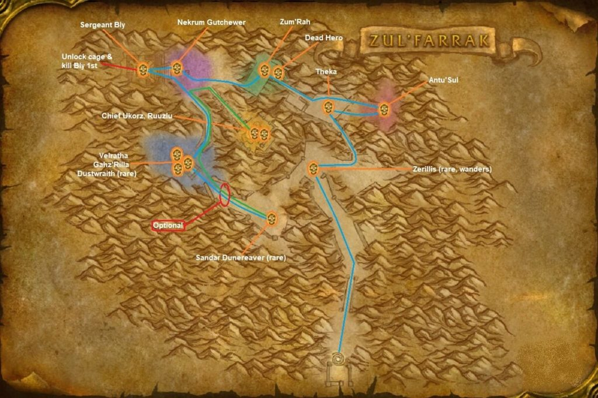

# Zul'Farrak

[All Forever dungeon guides](README.md)

**Research snapshot: 31 October 2026.** Tactics and annotated layouts use Classic references. Forever loot reports and Classic drop tables are listed separately.

**Level:** Client level 42; Classic full-clear planning 44–49. **Location:** Tanaris. **Group:** 5. Client level is a listing value, not a promise that a group at that level can finish the dungeon. [Forever listing](https://playfulls.com/loot-tables/dungeons/zulfarrak).

## Before entering

Classic reference: one player needs the Mallet of Zul'Farrak to ring Gahz'rilla's gong. Prepare it at Jintha'Alor using Qiaga's Sacred Mallet. Pick up the two Mosh'aru-tablet, Tiara, pyramid and Gahz'rilla quests. Do not provoke Sergeant Bly before Weegli opens the gate. [Classic preparation reference](https://www.wowhead.com/classic/guide/zulfarrak-dungeon-strategy-wow-classic).

## Layout and route

Annotated Classic reference layout; Forever details may differ. [Full-size map](https://eintr.net/WoW/images/ZulFarrak-walkthrough-map-1024x683.jpg) / [Map source](https://eintr.net/WoW/World-of-Warcraft-Classic-Dungeon-Walkthrough.html).

Travel northwest from Gadgetzan. Clear the entrance, take the Antu'sul branch if wanted, then work around the central circuit through Theka and Zum'rah. Complete the pyramid rescue before asking Weegli to open the final gate. Finish Ukorz and Ruuzlu; visit the pool for Velratha and optional Gahz'rilla. [Classic route reference](https://www.wowhead.com/classic/guide/zulfarrak-dungeon-strategy-wow-classic).

- [Annotated Classic layout and route](https://eintr.net/WoW/images/ZulFarrak-walkthrough-map-1024x683.jpg) — Classic reference; Forever changes unverified. [Map source](https://eintr.net/WoW/World-of-Warcraft-Classic-Dungeon-Walkthrough.html).
- [Zul'Farrak](https://playfulls.com/dungeonmaps/zulfarrak-1.webp) — Community-hosted dungeon map; boss pins may be approximate or incomplete. [Map source](https://playfulls.com/loot-tables/dungeons/zulfarrak).

## Bosses and tactics

Use these as Classic-based tactical prompts, not verified Forever combat logs. “Client listed” means the current community client roster names the encounter; additional rares, companions and summons are included for planning. [Current roster](https://playfulls.com/loot-tables/dungeons/zulfarrak), [tactical reference](https://www.wowhead.com/classic/guide/zulfarrak-dungeon-strategy-wow-classic).

| Boss / encounter | Status | Action |
| --- | --- | --- |
| Antu'sul | Client listed; main encounter | Destroy totems and adds; interrupt healing. |
| Theka the Martyr | Client listed; main encounter | Avoid extra scarabs; use magic during immunity. |
| Witch Doctor Zum'rah | Client listed; main encounter | Interrupt heals and volleys; kill zombies. |
| Nekrum Gutchewer | Client listed; main encounter | Control pyramid waves; kill him before Sezz'ziz. |
| Shadowpriest Sezz'ziz | Client listed; main encounter | Interrupt heals; spread for fear. |
| Hydromancer Velratha | Client listed; main encounter | Isolate her patrol; interrupt casts. |
| Chief Ukorz Sandscalp | Client listed; main encounter | Kill Ruuzlu first; face cleaves away. |
| Ruuzlu | Classic reference; companion | Tank alongside Ukorz; kill first. |
| Gahz'rilla | Client listed; summoned | Clear pool; tank with back against terrain. |
| Zerillis | Classic reference; rare | Break line of sight to bring him close. |
| Sandarr Dunereaver | Classic reference; rare | Isolate his patrol and interrupt casts. |
| Sergeant Bly | Classic reference; quest | Optional quest fight after opening final gate. |

## Forever loot currently documented

The following is the complete boss-associated list recovered from the linked Playfulls page for this wing, not a complete Forever drop table. These are community loot associations checked against client item data; a client item existing does not by itself prove its drop source. Drop percentages are intentionally omitted because the source marks them unconfirmed in Forever. [Live loot source](https://playfulls.com/loot-tables/dungeons/zulfarrak).

| Boss | Linked items |
| --- | --- |
| Hydromancer Velratha | [Second Mosh'aru Tablet](https://playfulls.com/item/10661-second-mosharu-tablet) (Quest / conditional); [Tiara of the Deep](https://playfulls.com/item/9234-tiara-of-the-deep) |
| Theka the Martyr | [First Mosh'aru Tablet](https://playfulls.com/item/10660-first-mosharu-tablet) (Quest / conditional) |
| Nekrum Gutchewer | [Nekrum's Medallion](https://playfulls.com/item/9471-nekrums-medallion) (Quest / conditional) |

Bosses absent from this section have no recovered Forever loot association in this source. The table below supplies a separately labeled Classic reference. Dungeon-wide random drops, quest turn-in rewards and event chests are not silently counted as boss loot.

## Classic loot reference

**These drops are not confirmed for Forever.**

Direct links open Classic item records. Each boss name links to the database or guide supporting its Classic drop association. Named equipment and recipes are listed; ordinary grey/white items and broad random world-drop pools are omitted. A missing entry means the retrieved sources did not supply a dedicated table. Rare spawns and quest summons may require different access or may change in Forever.

| Boss / encounter | Linked items |
| --- | --- |
| [Antu'sul](https://classicdb.ch/?npc=8127) | [Shriveled Heart](https://classicdb.ch/?item=9243); [Sang'thraze the Deflector](https://classicdb.ch/?item=9379); [The Hand of Antu'sul](https://classicdb.ch/?item=9639); [Vice Grips](https://classicdb.ch/?item=9640); [Lifeblood Amulet](https://classicdb.ch/?item=9641) **Quest / access / other:** [Troll Temper](https://classicdb.ch/?item=9523) |
| [Theka the Martyr](https://www.wowhead.com/classic/guide/zulfarrak-dungeon-strategy-wow-classic) | No dedicated equipment verified in retrieved table. |
| [Witch Doctor Zum'rah](https://classicdb.ch/?npc=7271) | [Shriveled Heart](https://classicdb.ch/?item=9243); [Zum'rah's Vexing Cane](https://classicdb.ch/?item=18082); [Jumanza Grips](https://classicdb.ch/?item=18083) |
| [Nekrum Gutchewer](https://classicdb.ch/?npc=7796) | No dedicated equipment verified in retrieved table. **Quest / access / other:** [OOX-17/TN Distress Beacon](https://classicdb.ch/?item=8623); [Nekrum's Medallion](https://classicdb.ch/?item=9471); [Troll Temper](https://classicdb.ch/?item=9523) |
| [Shadowpriest Sezz'ziz](https://classicdb.ch/?npc=7275) | [Shriveled Heart](https://classicdb.ch/?item=9243); [Bad Mojo Mask](https://classicdb.ch/?item=9470); [Jinxed Hoodoo Skin](https://classicdb.ch/?item=9473); [Jinxed Hoodoo Kilt](https://classicdb.ch/?item=9474); [Diabolic Skiver](https://classicdb.ch/?item=9475) |
| [Hydromancer Velratha](https://www.wowhead.com/classic/guide/zulfarrak-dungeon-strategy-wow-classic) | No dedicated equipment verified in retrieved table. |
| [Chief Ukorz Sandscalp](https://classicdb.ch/?npc=7267) | [Shriveled Heart](https://classicdb.ch/?item=9243); [Big Bad Pauldrons](https://classicdb.ch/?item=9476); [The Chief's Enforcer](https://classicdb.ch/?item=9477); [Ripsaw](https://classicdb.ch/?item=9478); [Embrace of the Lycan](https://classicdb.ch/?item=9479); [Jang'thraze the Protector](https://classicdb.ch/?item=11086) **Quest / access / other:** [Troll Temper](https://classicdb.ch/?item=9523) |
| [Ruuzlu](https://classicdb.ch/?npc=7797) | No dedicated equipment verified in retrieved table. **Quest / access / other:** [OOX-17/TN Distress Beacon](https://classicdb.ch/?item=8623); [Troll Temper](https://classicdb.ch/?item=9523) |
| [Gahz'rilla](https://classicdb.ch/?npc=7273) | [Gahz'rilla Fang](https://classicdb.ch/?item=9467); [Gahz'rilla Scale Armor](https://classicdb.ch/?item=9469) **Quest / access / other:** [Gahz'rilla's Electrified Scale](https://classicdb.ch/?item=8707) |
| [Zerillis](https://www.wowhead.com/classic/guide/zulfarrak-dungeon-strategy-wow-classic) | [Sandstalker Ankleguards](https://classicdb.ch/?item=12470) |
| [Sandarr Dunereaver](https://classicdb.ch/?npc=10080) | No dedicated equipment verified in retrieved table. **Quest / access / other:** [OOX-17/TN Distress Beacon](https://classicdb.ch/?item=8623); [Troll Temper](https://classicdb.ch/?item=9523) |
| [Sergeant Bly](https://www.wowhead.com/classic/guide/zulfarrak-dungeon-strategy-wow-classic) | No dedicated equipment verified in retrieved table. |
